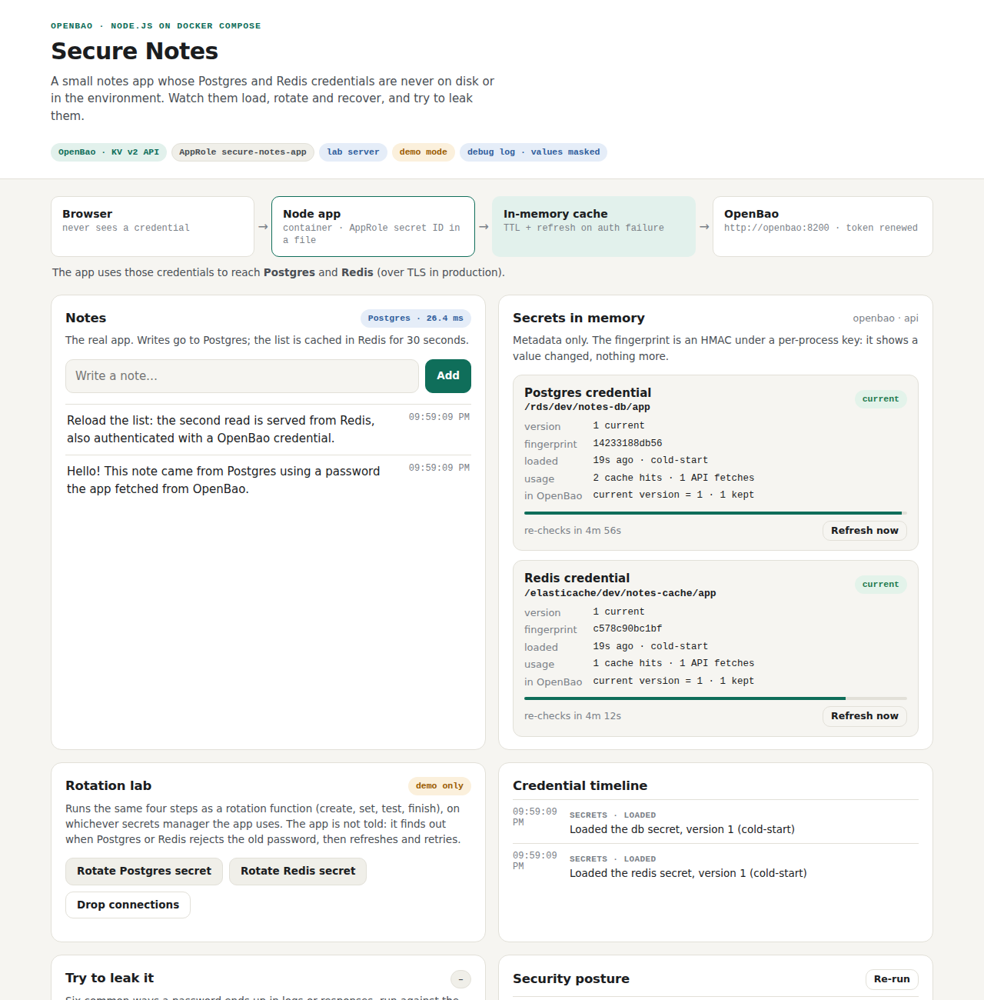
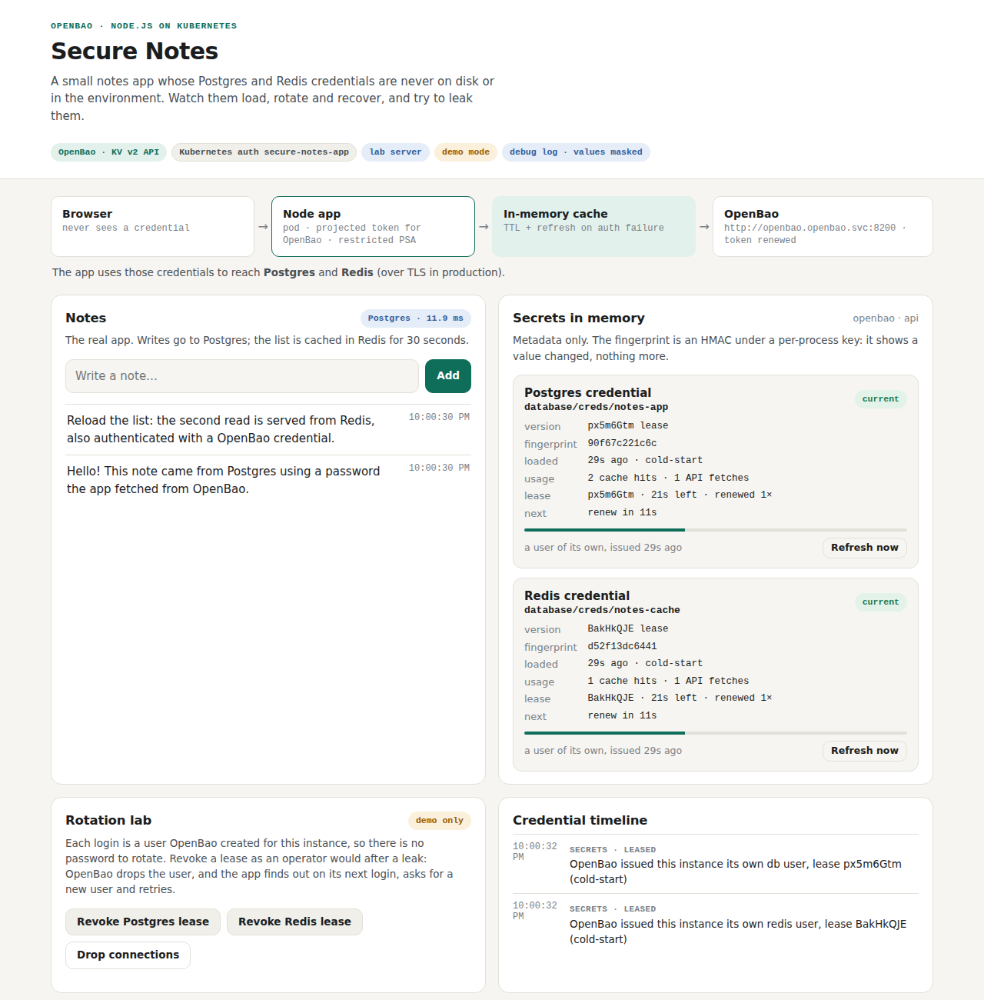
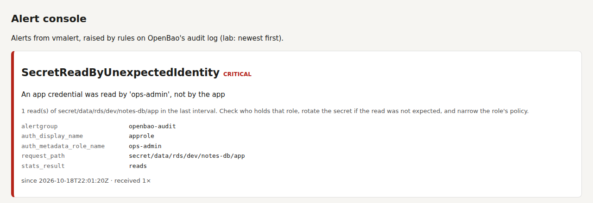

# Demo — one test case at a time

Each file below is one thing this project claims about credentials, shown the
way you would demo it: **what it proves, the steps (click or command), what you
should see, the screenshot and the real output from a CI run.** The pictures and
outputs come from the CI captures on the
[`ci-captures`](https://github.com/ephico2real2/openbao-node-poc/tree/ci-captures)
branch, so they show the app as it actually ran.

Do them **in order**: test case 6 searches for the passwords that test cases 2–4
created and leaked into the logs, and test cases 9 and 10 change which stack is
running. Test case 18 is the "before" picture and runs on its own (13 to 17, the alert
demos for AWS, stay in the sibling repo, whose alerting this repo doesn't copy).
Test cases 19–24 move the same app onto OpenBao and Vault, one step folder each.

**Where the evidence comes from.** Every page links the CI run its screenshots and
output come from: [CI run 39169755271](https://github.com/ephico2real2/openbao-node-poc/actions/runs/39169755271),
which ran every leg (AWS, OpenBao, dynamic users, kind with Kubernetes auth and with
External Secrets, Vault and detection) on the commit that closed epic B7. Counts such as
versions, file numbers and fingerprints will differ on your machine; the shape of the
output is what matters.

**You need:** Docker with Compose v2, `jq`, and for the check scripts Node.js 22
and `curl` on your machine. Test case 10 also needs [kind](https://kind.sigs.k8s.io)
and `kubectl`; test case 11 `cosign` (and Linux on x86-64 for the scan script);
test case 12 `skopeo` (or `oc`) and a registry you can push to.

| # | Test case | What you'll see | Catalogue IDs |
| --- | --- | --- | --- |
| 1 | [Start the app and load the secrets](test-case-01-start-and-load-secrets.md) | Both credentials in memory: name, version, fingerprint — never the value | S1–S8 |
| 2 | [Rotate the Postgres password from the dashboard](test-case-02-rotate-postgres.md) | Click **Rotate Postgres secret**, then **Drop connections**: `auth-failed → new-version → recovered` | R1, R2 |
| 3 | [Rotate the Redis password from the dashboard](test-case-03-rotate-redis.md) | Click **Rotate Redis secret**: both passwords valid for a moment, then the old one is revoked | R1, R2 |
| 4 | [Try to leak a password](test-case-04-leak-test.md) | Click **Run leak attempts**: `0 of 6 leaked` | L1–L7 |
| 5 | [Read the debug log, values masked](test-case-05-debug-log.md) | Tick **Credential lines only**: which secret, which keys, `password=******** (32 chars, fp=…)` | D1–D7 |
| 6 | [No credential in any container or pod](test-case-06-credential-scan.md) | The real passwords searched for everywhere: every place `clean` | C1–C16 |
| 7 | [Reveal the real values in a lab](test-case-07-reveal-flag.md) | `LOG_REVEAL_SECRETS=true`: red banner, posture fails, the scan finds the values in the app log only | C11, F1–F6 |
| 8 | [Production refuses the reveal flag](test-case-08-reveal-refused-in-production.md) | The app will not start: exit code 78 | F4 |
| 9 | [Agent mode](test-case-09-agent-mode.md) | `mode: agent`; the agent rejects a request without its token (403) | A1–A4 |
| 10 | [The same on Kubernetes (kind)](test-case-10-kubernetes.md) | Pod specs, ConfigMaps, decoded Secrets, events, pod files and logs: all `clean` | C2–C5, C12–C15, P1, P2 |
| 11 | [Scanned, listed and signed images](test-case-11-supply-chain.md) | 0 fixable critical vulnerabilities; an SBOM per image; signatures verified without logging in | K1–K3, K5 |
| 12 | [Mirror the images to your own registry](test-case-12-image-mirror.md) | All four images copied; the overlay pulls only from your registry; layers identical | K4 |
| 18 | [Before: the original `.env` app leaks everywhere](test-case-18-v0-before.md) | `versions/v0-env-file/leak.sh`: the passwords in 8 of 9 places | N14 |
| 19 | [The same lab on OpenBao](test-case-19-openbao-kv.md) | Step v1: KV v2 and AppRole, the secret ID in a mode-0400 file; rotation and the scan as on AWS | O1–O14 |
| 20 | [Database users that expire](test-case-20-dynamic-users.md) | Step v2: a Postgres and a Valkey user per instance, with leases; **Revoke Postgres lease**, then recovery | Y1–Y9 |
| 21 | [OpenBao on Kubernetes, Kubernetes auth](test-case-21-kubernetes-auth.md) | Step v3: OpenBao from Helm, unsealed by itself; the pod logs in with a projected token, no secret zero | K8B1–K8B4 |
| 22 | [File mode with External Secrets Operator](test-case-22-external-secrets.md) | Step v3: a mounted Secret, no OpenBao identity in the app; a rotation arrives as a file in 56 s | K8B5–K8B10 |
| 23 | [The same app on HashiCorp Vault](test-case-23-vault.md) | Step v4: same image, `SECRETS_PROVIDER=vault`; the lab script unseals Vault and revokes its root token | V1–V6 |
| 24 | [An alert when someone else reads the secret](test-case-24-detection.md) | Step v5: audit log → VictoriaLogs → vmalert; `ops-admin` reads the app's secret, an alert names it | T1–T5 |

## The story, in screenshots

The same Secure Notes image runs through every step; only where the credentials come
from changes. Each picture is a CI capture from the run above.

| Step | What changed | The app shows |
| --- | --- | --- |
| v0, [test case 18](test-case-18-v0-before.md) | Passwords in a `.env` file | They leak into 8 of 9 places |
| AWS baseline, test cases [1–12](test-case-01-start-and-load-secrets.md) | AWS Secrets Manager, fetched at runtime |  |
| v1, [test case 19](test-case-19-openbao-kv.md) | OpenBao KV v2; AppRole with the secret ID in a file |  |
| v2, [test case 20](test-case-20-dynamic-users.md) | No stored database password: leased users |  |
| v3, [test case 21](test-case-21-kubernetes-auth.md) | On Kubernetes: the pod's own token is the identity |  |
| v3 file mode, [test case 22](test-case-22-external-secrets.md) | External Secrets Operator; the app has no identity at all |  |
| v4, [test case 23](test-case-23-vault.md) | The same app on HashiCorp Vault |  |
| v5, [test case 24](test-case-24-detection.md) | Someone else reads the secret, and an alert says who |  |

Each step answers the question the step before it leaves open. A secrets manager removes
the `.env` file, but the app still needs a first credential (secret zero): AppRole puts it
in a file, and Kubernetes auth removes it. A stored password can still leak and stay
valid: leased users expire on their own. And a leak that never shows up in any log can
still be a read by the wrong identity: the audit log catches that.

The catalogue IDs refer to [`docs/TEST-CASES.md`](../docs/TEST-CASES.md), which lists
every automated test. For the same features as one continuous walk-through, see
[`docs/TUTORIAL.md`](../docs/TUTORIAL.md).

## Before you start

```bash
git clone https://github.com/ephico2real2/openbao-node-poc.git
cd openbao-node-poc
docker compose up --build -d     # then open http://localhost:3000
docker compose logs -f app       # optional: follow the log in a second terminal
```

When you're done: `docker compose down -v`.
