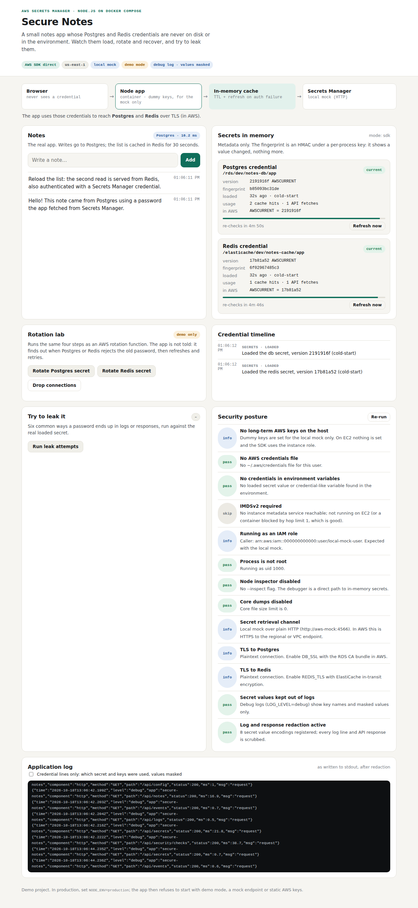
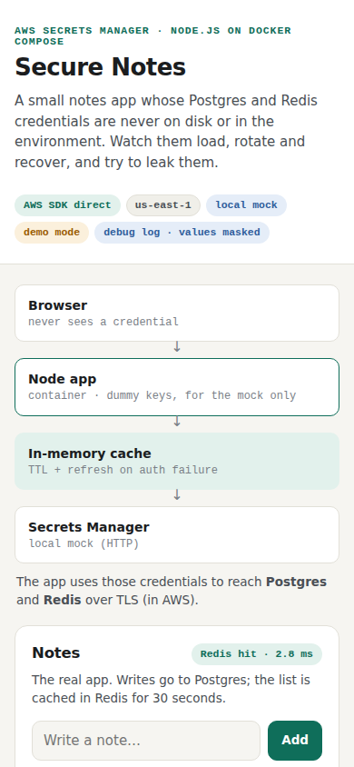

# Test case 1 — Start the app and load the secrets

[← all test cases](README.md)

**What it proves:** the app gets both credentials from Secrets Manager at startup and keeps them only in memory; the dashboard shows which secret and version it holds, never the value.

**Catalogue IDs:** S1–S8 ([TEST-CASES.md](../docs/TEST-CASES.md)) · **Proven in CI by:** `compose (sdk)`, `compose (agent)`, `kind` · **Evidence from:** [CI run 39093063634](https://github.com/ephico2real2/aws-secrets-manager-node-poc/actions/runs/39093063634), published on [`ci-captures`](https://github.com/ephico2real2/aws-secrets-manager-node-poc/tree/ci-captures)

## Steps

1. `docker compose up --build -d`, then wait until `docker compose logs app` shows `secure-notes listening`.
2. Open <http://localhost:3000>.

## What you should see

- **Secrets in memory**: a *Postgres credential* and a *Redis credential* card, each with the secret name, version, a fingerprint and `current`.
- **Credential timeline**: `loaded` for both.
- **Security posture**: no `fail`.
- The badges: `AWS SDK direct`, `local mock`, `demo mode`, `debug log · values masked`.



The fingerprint is an HMAC under a key that exists only in this process: it changes when the value changes, and reveals nothing about it.

## Evidence from the run

The browser walk checks the page shows what it must:

```
01-dashboard: found "Secure Notes", "Secrets in memory", "Postgres credential", "Redis credential", "dummy keys, for the mock only" — expectations met
```

The end-to-end smoke test, run against the same stack. It runs through test cases 1–4
automatically (including rotations and the leak test), which is why it shows new
versions; run it yourself at the end with `scripts/compose-check.sh`:

```
Smoke test against http://localhost:3000
  mode: sdk (local mock)
  ok    health: postgres and redis reachable
  ok    notes: write to postgres, read through redis  (postgres -> redis)
  ok    rotate db secret (createSecret -> setSecret -> testSecret -> finishSecret)  (new version 2ca1634d)
  ok    rotate redis secret (createSecret -> setSecret -> testSecret -> finishSecret)  (new version 38bf9dd6)
  ok    drop connections, then app recovers with the rotated credentials  (recovered: db, redis)
  ok    secrets dashboard shows the new versions in cache
  ok    leak test: no attempt exposes the password  (6 attempts, 0 leaks)
  ok    security posture: no check fails  (13 checks, none failing)

All checks passed
```

The same page on a phone:


