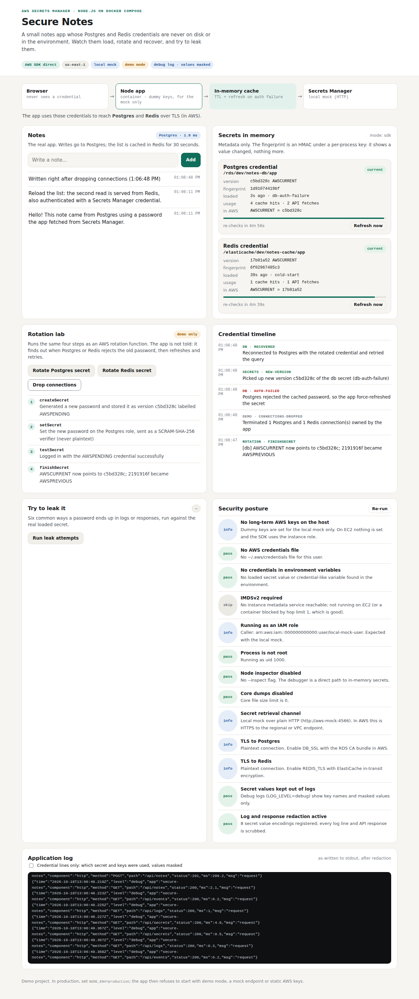

# Test case 2 — Rotate the Postgres password from the dashboard

[← all test cases](README.md)

**What it proves:** the database password can be rotated while the app runs; when Postgres rejects the old password, the app re-reads the secret and recovers with no restart and no error for the user.

**Catalogue IDs:** R1, R2 ([TEST-CASES.md](../docs/TEST-CASES.md)) · **Proven in CI by:** `compose (sdk)`, `compose (agent)`, `kind` · **Evidence from:** [CI run 39093063634](https://github.com/ephico2real2/aws-secrets-manager-node-poc/actions/runs/39093063634), published on [`ci-captures`](https://github.com/ephico2real2/aws-secrets-manager-node-poc/tree/ci-captures)

## Steps

1. In **Rotation lab**, click **Rotate Postgres secret**. The four steps of an AWS rotation function run: `createSecret` (new password, stage `AWSPENDING`), `setSecret` (applied to Postgres as a SCRAM verifier), `testSecret`, `finishSecret` (`AWSCURRENT` moves).
2. The Postgres card turns amber, **cache behind**: Secrets Manager has a new version, the app still holds the old one.
3. Click **Drop connections**. The app's next login uses the old password.
   (Don't use **Refresh now** here: it re-reads the secret before anything fails,
   so you'd see `new-version` but not the rejection and recovery.)

## What you should see

In **Credential timeline**, within the same second: `auth-failed` (Postgres rejected the cached password) → `new-version` (the app re-read the secret) → `recovered` (reconnected and retried the query). The Postgres card is green again with the new version.



## Evidence from the run

```
02-rotation-and-recovery: found "createSecret", "setSecret", "testSecret", "finishSecret", "Reconnected to Postgres with the rotated credential" — expectations met
```

In the app's debug log, the `secret consumed` line written when the app re-read the
secret shows the fingerprint change as `old -> new`, and the next `postgres connecting with`
line carries the new one (see [test case 5](test-case-05-debug-log.md)).
