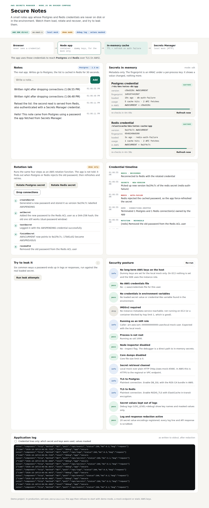

# Test case 3 — Rotate the Redis password from the dashboard

[← all test cases](README.md)

**What it proves:** the cache password rotates the same way; Redis users accept two passwords, so the old one keeps working until the new one is in place, then it is revoked.

**Catalogue IDs:** R1, R2 ([TEST-CASES.md](../docs/TEST-CASES.md)) · **Proven in CI by:** `compose (sdk)`, `compose (agent)`, `kind` · **Evidence from:** [CI run 39093063634](https://github.com/ephico2real2/aws-secrets-manager-node-poc/actions/runs/39093063634), published on [`ci-captures`](https://github.com/ephico2real2/aws-secrets-manager-node-poc/tree/ci-captures)

## Steps

1. Click **Rotate Redis secret**. The steps are the same as Postgres, plus `revokeOld`: for a moment both passwords are valid, then the old one is removed.
2. Click **Drop connections**.

## What you should see

`Reconnected to Redis with the rotated credential` in the timeline, and the Redis card back to green with a new version.



## Evidence from the run

```
03-redis-rotation: found "revokeOld", "Reconnected to Redis with the rotated credential" — expectations met
```

On AWS the same thing is done by the stack's rotation function every 30 days; its four tests are `R3` in the catalogue, and the manual AWS workflow triggers one for real.
