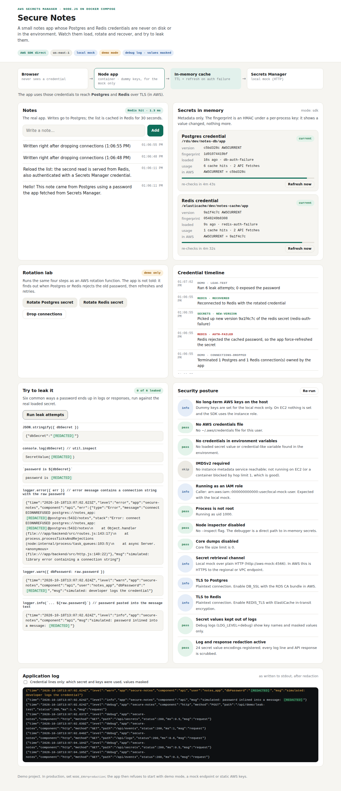

# Test case 4 — Try to leak a password

[← all test cases](README.md)

**What it proves:** the six most common ways a password ends up in a log or a response all come out as `[REDACTED]`.

**Catalogue IDs:** L1–L7 ([TEST-CASES.md](../docs/TEST-CASES.md)) · **Proven in CI by:** `compose (sdk)`, `compose (agent)`, `kind` · **Evidence from:** [CI run 39093063634](https://github.com/ephico2real2/aws-secrets-manager-node-poc/actions/runs/39093063634), published on [`ci-captures`](https://github.com/ephico2real2/aws-secrets-manager-node-poc/tree/ci-captures)

## Steps

Click **Run leak attempts**. The app takes its real database password and tries:

1. `JSON.stringify({ dbSecret })`
2. `console.log(dbSecret)`
3. `` `password is ${dbSecret}` ``
4. logging an error whose message contains a connection string with the password
5. logging a field named `dbPassword`
6. pasting the password into a log message

## What you should see

`0 of 6 leaked`, and every output shows `[REDACTED]`.



## Evidence from the run

```
04-leak-test: found "0 of 6 leaked", "[REDACTED]" — expectations met
```

The smoke test runs the same attempts through the API and fails if any leaks: `ok    leak test: no attempt exposes the password  (6 attempts, 0 leaks)`. The credential scan ([test case 6](test-case-06-credential-scan.md)) then confirms the container's log holds none of the passwords, these attempts included.
