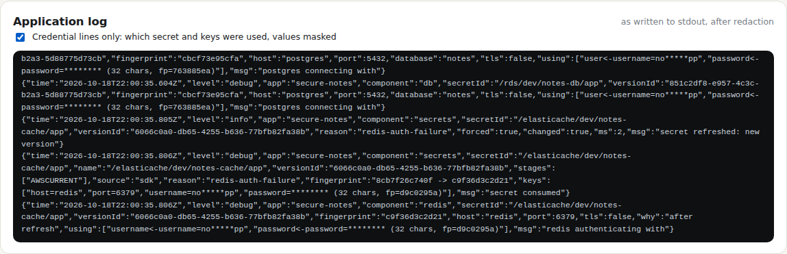

# Test case 5 — Read the debug log, values masked

[← all test cases](README.md)

**What it proves:** with `LOG_LEVEL=debug`, the log says exactly which secret, which version and which keys each part of the app used, and never shows a password.

**Catalogue IDs:** D1–D7 ([TEST-CASES.md](../docs/TEST-CASES.md)) · **Proven in CI by:** unit tests, `compose (sdk)`, `compose (agent)`, `kind (aws)` · **Evidence from:** [CI run 39169755271](https://github.com/ephico2real2/openbao-node-poc/actions/runs/39169755271): [app log](https://github.com/ephico2real2/openbao-node-poc/blob/ci-captures/2026-10-18T2201Z_ci_run39169755271-1_compose-sdk-logs/compose.log), [captures](https://github.com/ephico2real2/openbao-node-poc/tree/ci-captures/2026-10-18T2159Z_ci_run39169755271-1_compose-compose-sdk), [kind app log](https://github.com/ephico2real2/openbao-node-poc/blob/ci-captures/2026-10-18T2201Z_ci_run39169755271-1_kind-aws-logs/secure-notes.log)

## Steps

1. Scroll to **Application log** at the bottom of the dashboard.
2. Tick **Credential lines only**.

Or from a terminal:

```bash
docker compose logs app | grep '"secret consumed"' | tail -1 | sed 's/^[^{]*//' | jq '{secretId, versionId, source, fingerprint, keys}'
docker compose logs app | grep -E 'connecting with|authenticating with' | tail -2 | sed 's/^[^{]*//' | jq '{msg, secretId, fingerprint, host, port, using}'
```

## What you should see


| Key | Shown as | Why |
| --- | --- | --- |
| `password`, `token`, `secret`… | `******** (32 chars, fp=1a2b3c4d)` | nothing of the value; the fingerprint shows when it changes |
| `username`, `dbname` | `no*****pp`, `n****` | partly masked |
| `host`, `port`, `engine` | in full | not secret; what you need to debug a connection |

## Evidence from the run (excerpts of the app's real log)

Fields trimmed to the interesting ones. These come from the app's last restart in
CI (after test case 7 turned the reveal flag off again), so they show a cold start.

A secret loaded at startup:

```json
{
  "msg": "secret consumed",
  "component": "secrets",
  "secretId": "/elasticache/dev/notes-cache/app",
  "versionId": "b9d2cd05-a80c-4566-90cc-b58bfc815a39",
  "stages": [
    "AWSCURRENT"
  ],
  "source": "sdk",
  "reason": "cold-start",
  "fingerprint": "e84bbf9a7fe1",
  "keys": [
    "host=redis",
    "port=6379",
    "username=no*****pp",
    "password=******** (32 chars, fp=13599bd0)"
  ]
}
```

Postgres and Redis logins, showing which secret key feeds which setting:

```json
{
  "msg": "postgres connecting with",
  "component": "db",
  "secretId": "/rds/dev/notes-db/app",
  "fingerprint": "aa30d6635bf4",
  "host": "postgres",
  "port": 5432,
  "database": "notes",
  "using": [
    "user<-username=no*****pp",
    "password<-password=******** (32 chars, fp=3fdd52f4)"
  ]
}
```

```json
{
  "msg": "redis authenticating with",
  "component": "redis",
  "secretId": "/elasticache/dev/notes-cache/app",
  "fingerprint": "e84bbf9a7fe1",
  "host": "redis",
  "port": 6379,
  "why": "first connection",
  "using": [
    "username<-username=no*****pp",
    "password<-password=******** (32 chars, fp=13599bd0)"
  ]
}
```

The same on Kubernetes (kind):



Unit tests D1–D5 check each masking rule and that no line ever contains the password; the walk checks the panel shows `secret consumed`, `password=******** (` and `connecting with`.
