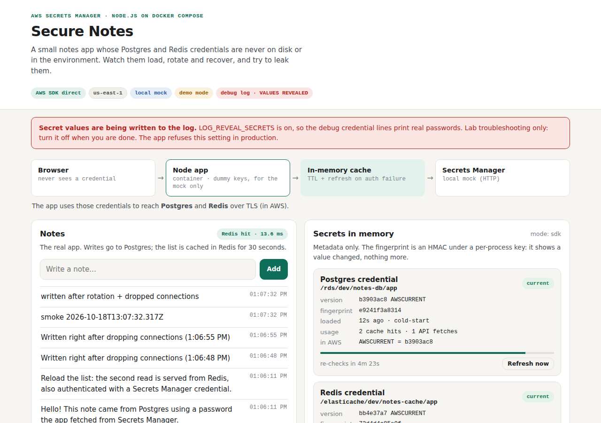
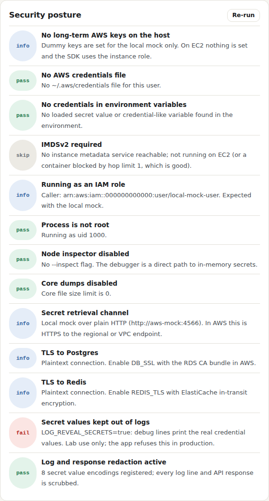
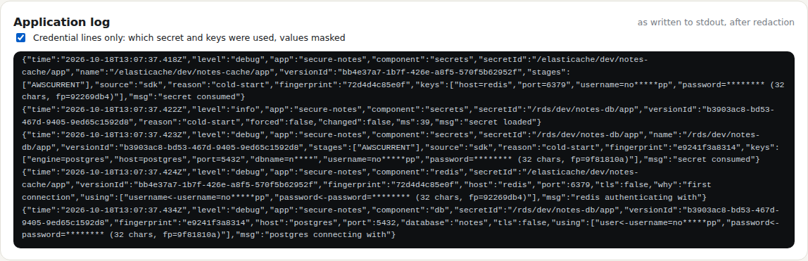

# Test case 7 — Reveal the real values in a lab

[← all test cases](README.md)

**What it proves:** for troubleshooting a wrong password, `LOG_REVEAL_SECRETS=true` makes the debug credential lines print the real values; it is impossible to miss while on, never reaches the dashboard, and it proves the scan catches a real leak.

**Catalogue IDs:** C11, F1–F6 ([TEST-CASES.md](../docs/TEST-CASES.md)) · **Proven in CI by:** unit tests, `compose (sdk)` · **Evidence from:** [CI run 39093063634](https://github.com/ephico2real2/aws-secrets-manager-node-poc/actions/runs/39093063634), published on [`ci-captures`](https://github.com/ephico2real2/aws-secrets-manager-node-poc/tree/ci-captures)

## Steps

With the normal stack from test case 1 running (`docker compose up -d`):

```bash
LOG_REVEAL_SECRETS=true docker compose up -d --no-deps app
docker compose logs app | grep 'values revealed' | tail -1 | sed 's/^[^{]*//' | jq '{msg, keys, warning}'
EXPECT_REVEALED=1 scripts/credential-scan.sh compose
docker compose up -d --no-deps app        # turn it off again
```

If you are following `docker compose logs -f app` in another terminal, the real
passwords will scroll past there too: that is the point of the flag, and why it is
for a lab only.

## What you should see

A red banner and a `debug log · VALUES REVEALED` badge:



The posture check **Secret values kept out of logs** fails:



The dashboard's own log panel still shows only masked values: revealed lines go to the container's log only, never to `/api/logs`.



## Evidence from the run

With the flag on, the scan finds the passwords in the app's log, and **still nowhere else**:

```
== credential scan (compose): searching for 6 secret values from Secrets Manager (every version); the values are never printed
-- containers
  ok    app: container config (env, command, labels: docker inspect)   clean
  ok    aws-mock: container config (env, command, labels: docker inspect) clean
  ok    postgres: container config (env, command, labels: docker inspect) clean
  ok    redis: container config (env, command, labels: docker inspect) clean
  ok    seed: container config (env, command, labels: docker inspect)  clean
  ok    app: process environment values (/proc/1/environ)              clean
  ok    app: every readable file (5828 files)                          clean
  ok    postgres: data directory and config (plaintext passwords?)     clean
  ok    redis: data and ACL files (plaintext passwords?)               clean
-- logs
  ok    app: log                                                       FOUND 4 (expected: LOG_REVEAL_SECRETS=true)
  ok    aws-mock: log                                                  clean
  ok    postgres: log                                                  clean
  ok    redis: log                                                     clean
  ok    seed: log                                                      clean
-- debug logging (LOG_LEVEL=debug)
  ok    app log names the secrets and keys it consumed                 2 line(s)
  ok    every password is shown as ******** (length, fingerprint)      yes
credential-scan: no credential value found anywhere it must not be
```

What a revealed line looks like (the value replaced here, of course):

```json
{
  "level": "debug",
  "component": "secrets",
  "secretId": "/rds/dev/notes-db/app",
  "msg": "secret consumed (values revealed)",
  "keys": [
    "username=no*****pp value=notes_app",
    "password=******** (32 chars, fp=e5fc7aa0) value=<the real password>",
    "host=postgres value=postgres"
  ],
  "revealed": true,
  "warning": "secret values in this line are NOT masked (LOG_REVEAL_SECRETS=true)"
}
```
