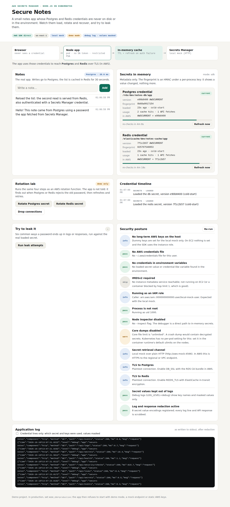

# Test case 10 — The same on Kubernetes (kind)

[← all test cases](README.md)

**What it proves:** on Kubernetes the app's credentials never become a Kubernetes object: no Secret, ConfigMap, pod spec, event, file or log holds one, pods run as non-root under Pod Security `restricted`, and Postgres only ever received password hashes.

**Catalogue IDs:** C2–C5, C12–C15, P1, P2 ([TEST-CASES.md](../docs/TEST-CASES.md)) · **Proven in CI by:** `kind` · **Evidence from:** [CI run 39093063634](https://github.com/ephico2real2/aws-secrets-manager-node-poc/actions/runs/39093063634), published on [`ci-captures`](https://github.com/ephico2real2/aws-secrets-manager-node-poc/tree/ci-captures)

## Steps

```bash
docker compose down -v            # free ports 3000 and 4575 from the earlier test cases
scripts/kind-up.sh && scripts/images-build.sh
scripts/k8s-deploy.sh deploy/k8s/overlays/kind
scripts/k8s-check.sh              # kind maps the app to localhost:3000; no port-forward
```

## What you should see



## Evidence from the run

```
== who each container runs as (OpenShift-style arbitrary UIDs show up here)
  secure-notes  uid=1000(node) gid=1000(node) groups=1000(node)
  aws-mock      uid=1000(node) gid=1000(node) groups=1000(node)
  postgres      uid=999(postgres) gid=999(postgres) groups=999(postgres),101(ssl-cert)
  redis         uid=999(redis) gid=1000(redis) groups=1000(redis)
  ok    no pod asks for UID 0
== the app never restarted (startup and rotation recover in-process)
  ok    restartCount 0
== Pod Security admission on the namespace
  ok    enforce=restricted: the API server rejects non-compliant pods
== Kubernetes Secrets in the namespace (Opaque ones; names and keys only)
  local-bootstrap-f9hmh2c6g8: pg-password redis-password 
  ok    the only Secret is the one-time bootstrap; the app's credentials are not stored in Kubernetes
== the bootstrap passwords were burned by the seed job
  ok    Redis rejects the bootstrap password
  ok    Postgres rejects the bootstrap password
== the app's environment holds IDs and hostnames, no credentials
  AWS_ACCESS_KEY_ID AWS_MOCK_ENDPOINT AWS_REGION AWS_SECRET_ACCESS_KEY DB_SECRET_RESOURCE DEMO_MODE HOME HOST HO
  STNAME KUBERNETES_PORT KUBERNETES_PORT_443_TCP KUBERNETES_PORT_443_TCP_ADDR KUBERNETES_PORT_443_TCP_PORT KUBER
  NETES_PORT_443_TCP_PROTO KUBERNETES_SERVICE_HOST KUBERNETES_SERVICE_PORT KUBERNETES_SERVICE_PORT_HTTPS LOG_LEV
  EL NODE_ENV NODE_VERSION PATH PORT PWD REDIS_SECRET_RESOURCE SECRETS_ENV SECRETS_MODE SHLVL STATIC_DIR YARN_VE
  RSION 
  ok    no credential-named variables
== Postgres statement log: new passwords arrived as SCRAM verifiers
  ALTER ROLE notes_app WITH LOGIN PASSWORD 'SCRAM-SHA-256$4096:V5EeS
  ALTER ROLE "postgres" WITH PASSWORD 'SCRAM-SHA-256$4096:MiZaU
  ALTER ROLE "notes_app" WITH PASSWORD 'SCRAM-SHA-256$4096:VCEjy
  ok    every ALTER ROLE in the log carries a SCRAM verifier
```

`AWS_ACCESS_KEY_ID` and `AWS_SECRET_ACCESS_KEY` in that list are the dummy `local-mock`
values the stand-in needs (the SDK signs requests even though the stand-in ignores the
signature); on EKS/ROSA the `aws` overlay uses an IAM role instead and sets neither.

Then the credential scan across the cluster:

```
== credential scan (k8s): searching for 6 secret values from Secrets Manager (every version); the values are never printed
-- Kubernetes objects
  ok    pod specs, Deployments, Jobs (env, args, annotations)          clean
  ok    ConfigMaps                                                     clean
  ok    Secrets (decoded)                                              clean
  ok    events                                                         clean
-- inside the app pod
  ok    app: process environment values (/proc/1/environ)              clean
  ok    app: every readable file (5829 files)                          clean
  ok    postgres pod: data directory (plaintext passwords?)            clean
  ok    redis pod: data and ACL files (plaintext passwords?)           clean
-- logs (every container, current and previous)
  ok    aws-mock-7dc6d4744f-8snlw: logs                                clean
  ok    postgres-7f4f4f4bcc-qzvh5: logs                                clean
  ok    redis-7cf5965cd7-k952r: logs                                   clean
  ok    secure-notes-6648cc8b67-mvp4s: logs                            clean
  ok    seed-nt9z4: logs                                               clean
-- debug logging (LOG_LEVEL=debug)
  ok    app log names the secrets and keys it consumed                 6 line(s)
  ok    every password is shown as ******** (length, fingerprint)      yes
        e.g. {"secretId":"/elasticache/dev/notes-cache/app","versionId":"77830568-80be-41f2-b8d1-17e03bf1ce9d","source":"sdk","keys":["host=redis","port=6379","username=no*****pp","password=******** (32 chars, fp=1a926a75)"]}
credential-scan: no credential value found anywhere it must not be
```
