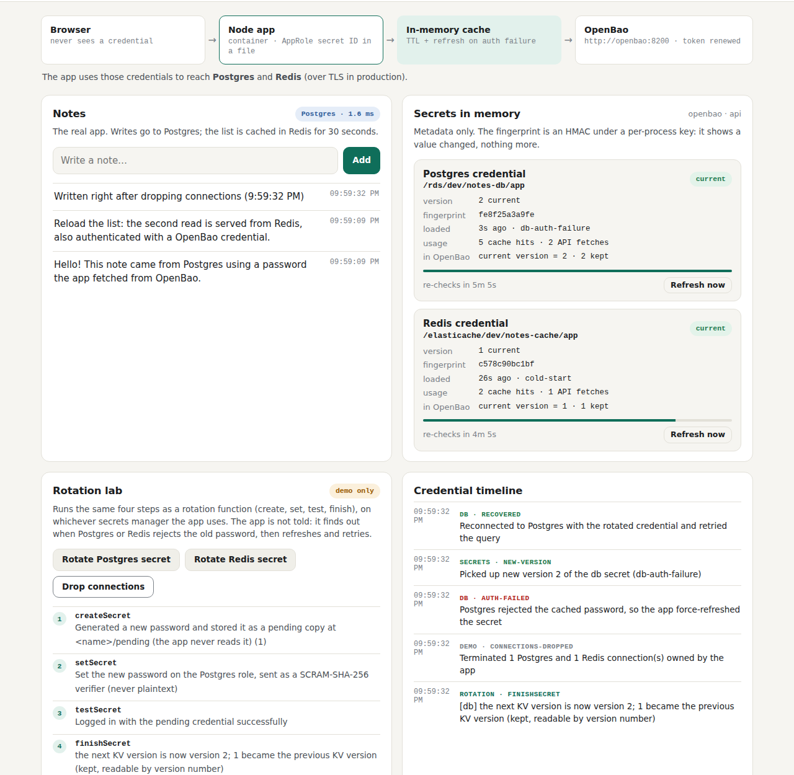

# Test case 19 — The same lab on OpenBao (step v1)

[← all test cases](README.md) · [Step v1](../steps/v1-openbao-kv/README.md) · [Chapter 7](../docs/learn/07-secret-zero-and-approle.md)

**What it proves:** the same app image, with `SECRETS_PROVIDER=openbao`, reads its
credentials from OpenBao's KV v2. It logs in with AppRole, and its secret ID is in a
mode-0400 file, never in env. Rotation, recovery, masking and the credential scan work
as they do on the AWS path (test cases 1–6).

**Catalogue IDs:** O1–O14 ([TEST-CASES.md](../docs/TEST-CASES.md)) · **Proven in CI by:** `compose (openbao)` · **Evidence from:** [CI run 39169755271](https://github.com/ephico2real2/openbao-node-poc/actions/runs/39169755271): [captures](https://github.com/ephico2real2/openbao-node-poc/tree/ci-captures/2026-10-18T2159Z_ci_run39169755271-1_compose-compose-openbao), [check output](https://github.com/ephico2real2/openbao-node-poc/blob/ci-captures/2026-10-18T2202Z_ci_run39169755271-1_compose-openbao-logs/compose-check.txt)

## Steps

```bash
export COMPOSE_FILE=docker-compose.yml:steps/v1-openbao-kv/compose.yaml
docker compose down -v && docker compose up --build -d
scripts/compose-check.sh
```

Then open <http://localhost:3000>, click **Rotate Postgres secret**, then **Drop connections**.

## What you should see

The header says **OpenBao · KV v2 API** and the AppRole login. The flow says the app runs
in a container with an **AppRole secret ID in a file**:


The rotation runs the same four steps as on AWS. The pending copy is kept at
`<name>/pending`, and finishing writes the next KV version with check-and-set. The app
recovers the same way:



## Evidence from the run

```
== secrets provider: openbao, mode: api
  ok    the app is logged in to OpenBao as role 'secure-notes-app' (policies: default,secure-notes-app)
  ok    /api/config shows the login state, never the token
  ok    the app's secret ID file is mode 0400, owned by the app user
  ok    no token or secret ID in the app's environment
  ok    the seed's bootstrap secret ID is spent (single use)
  ok    the app's policy refuses a path outside its own (403)
  ok    the audit log recorded 44 KV request/response entries
…
  ok    rotate db secret (createSecret -> setSecret -> testSecret -> finishSecret)  (new version 3)
  ok    drop connections, then app recovers with the rotated credentials  (recovered: db, redis)
…
  ok    openbao: audit log (values must be HMAC'd)                     clean
  ok    openbao: raft storage, seal/unseal key, config, /tmp (plaintext?) clean
-- the AppRole secret IDs (3: the app's, the seed's spent bootstrap one, and the lab's ops-admin one if present)
  ok    every container's config (env, command, labels)                clean
  ok    every container's log (the app log too, even when revealing)   clean
credential-scan: no credential value found anywhere it must not be
```

The scan reads every KV version as the app's own identity. On OpenBao it also searches
the audit log and the raft storage, and it searches for the AppRole secret IDs as well
as the passwords.
