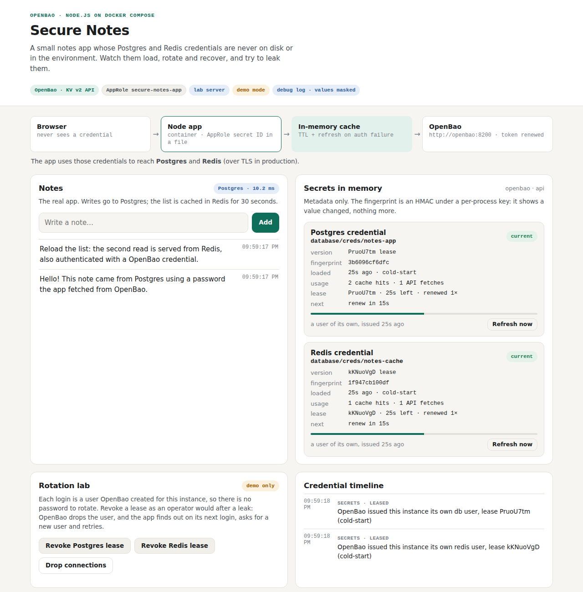
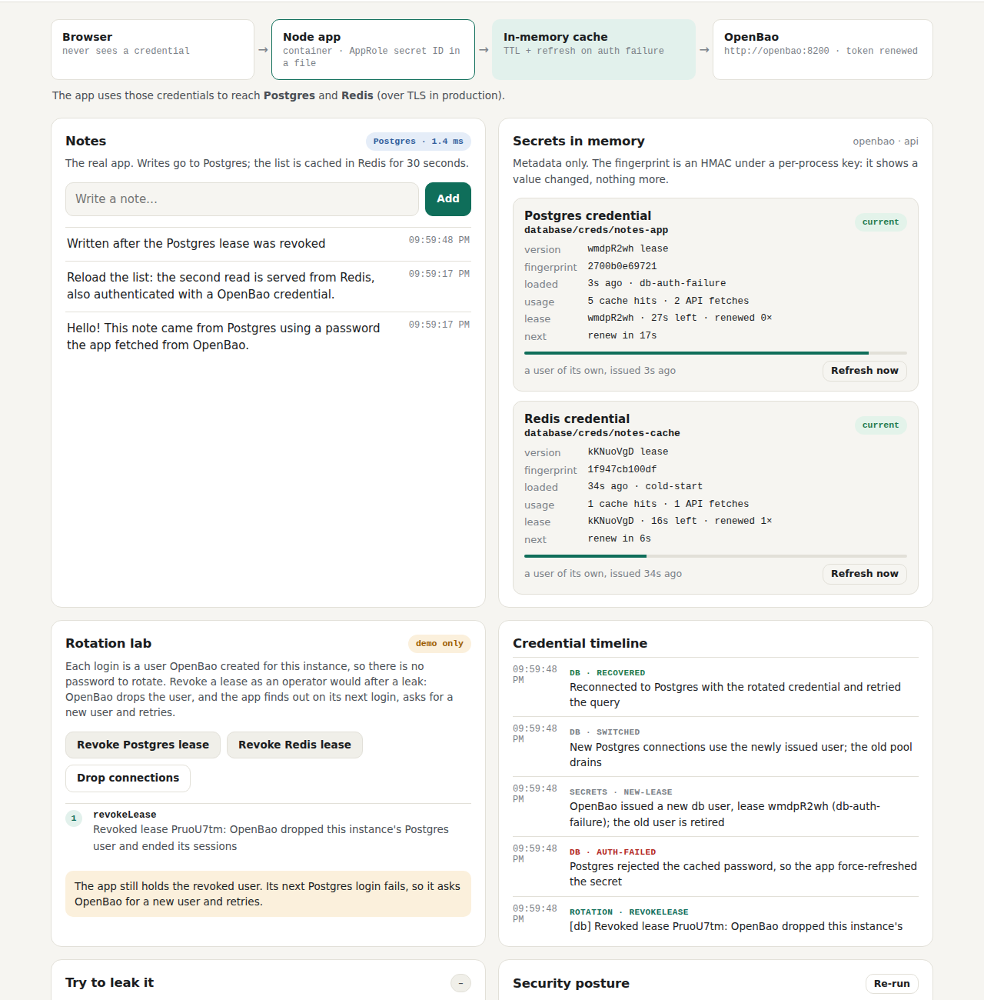
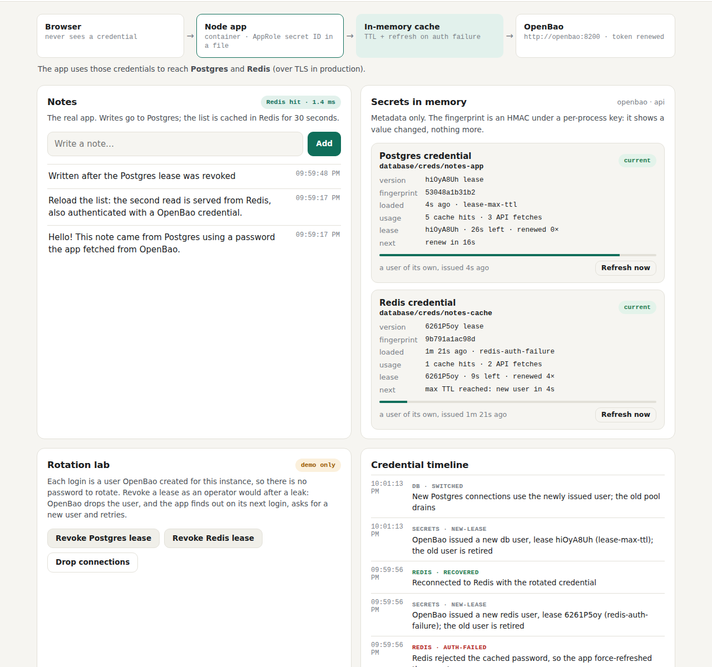

# Test case 20 — Database users that expire (step v2)

[← all test cases](README.md) · [Step v2](../steps/v2-openbao-dynamic/README.md) · [Chapter 8](../docs/learn/08-leases-and-dynamic-credentials.md)

**What it proves:** no database password is stored anywhere. OpenBao creates a Postgres
user and a Valkey user for this app instance, each with a lease. The app renews the
leases, and takes a new user before the role's max TTL. When a lease is revoked, OpenBao
drops the user, and the app recovers on its next query.

**Catalogue IDs:** Y1–Y9 ([TEST-CASES.md](../docs/TEST-CASES.md)) · **Proven in CI by:** `compose (openbao-dynamic)` · **Evidence from:** [CI run 39169755271](https://github.com/ephico2real2/openbao-node-poc/actions/runs/39169755271): [captures](https://github.com/ephico2real2/openbao-node-poc/tree/ci-captures/2026-10-18T2201Z_ci_run39169755271-1_compose-compose-openbao-dynamic), [check output](https://github.com/ephico2real2/openbao-node-poc/blob/ci-captures/2026-10-18T2203Z_ci_run39169755271-1_compose-openbao-dynamic-logs/compose-check.txt)

## Steps

```bash
export COMPOSE_FILE=docker-compose.yml:steps/v1-openbao-kv/compose.yaml:steps/v2-openbao-dynamic/compose.yaml
docker compose down -v && docker compose up --build -d
scripts/compose-check.sh
```

1. Look at **Secrets in memory**: each credential has a lease, the time left and the renewals.
2. Click **Revoke Postgres lease**, then add a note.
3. Leave the page open for two minutes.

## What you should see

Each credential is a lease, and the posture card passes **Database logins are short-lived**:



After the revoke, read the timeline from the bottom up: the lease is revoked, Postgres
rejects the dropped user, OpenBao issues a new one, the pool switches, and the query is
retried. The note is saved:



At the role's max TTL (90 s in the lab), the app takes a new user (`lease-max-ttl`)
before the old one ends. New queries move to it while the old pool drains:



## Evidence from the run

```
== step v2: dynamic database users with leases
  ok    the app's Postgres sessions use a user OpenBao created for it (v-approle-notes-ap-v…), not a stored one
  ok    the app renewed both leases (sys/leases/renew)
…
  ok    revoke the db lease (OpenBao drops the user)  (revoked lease hiOyA8Uh)
  ok    revoke the redis lease (OpenBao drops the user)  (revoked lease YmHRrM3Q)
  ok    drop connections, then app recovers with the rotated credentials  (recovered: db, redis)
…
== step v2: revoked and replaced users are gone
  ok    Postgres has 1 leased user(s) left: the app's current one (and at most one draining)
  info  the app switched to a newly issued user 6 time(s) so far (revocations, and leases at their max TTL)
== the actual credential values, searched for in every container, file and log
== credential scan (compose): searching for 4 secret values from OpenBao, read as the app's own identity (every version); the values are never printed
  info  dynamic users: their passwords are only in the app's memory; the LOG_REVEAL_SECRETS run searches for them
```

The scan searches for 4 values here, not 8: the database users' passwords are not stored
in OpenBao, so only the admin secrets are. The reveal run of the same leg prints the
leased passwords into the app log on purpose, and the scan finds them there and nowhere
else.
