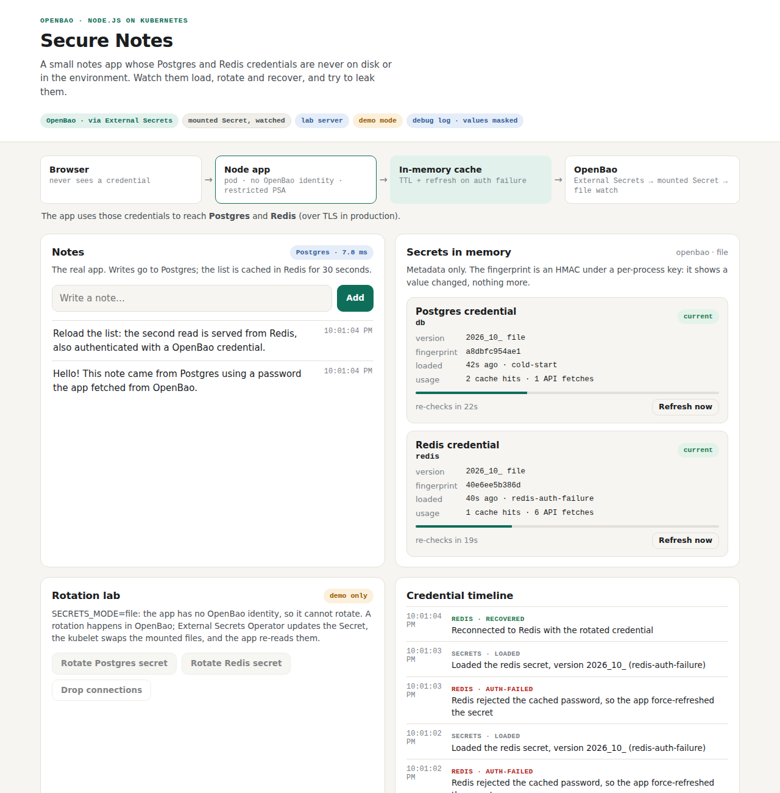
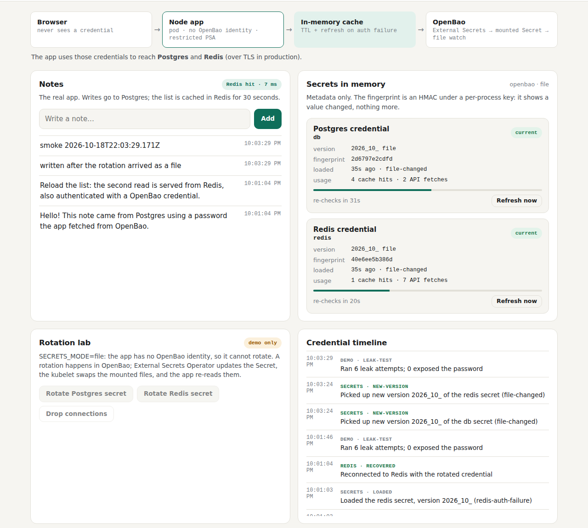

# Test case 22 — File mode with External Secrets Operator (step v3)

[← all test cases](README.md) · [Step v3](../steps/v3-k8s/README.md) · [Chapter 9](../docs/learn/09-kubernetes-auth-and-external-secrets.md)

**What it proves:** External Secrets Operator reads OpenBao and keeps a Kubernetes Secret
in sync. The app mounts that Secret as a volume (not env, not subPath) and has **no
OpenBao identity** at all. A rotation done in OpenBao, from outside the app, reaches it as
a changed file, with no restart.

**Catalogue IDs:** K8B5–K8B10 ([TEST-CASES.md](../docs/TEST-CASES.md)) · **Proven in CI by:** `kind (openbao-eso)` · **Evidence from:** [CI run 39169755271](https://github.com/ephico2real2/openbao-node-poc/actions/runs/39169755271): [captures](https://github.com/ephico2real2/openbao-node-poc/tree/ci-captures/2026-10-18T2201Z_ci_run39169755271-1_kind-kind-openbao-eso), [after the rotation](https://github.com/ephico2real2/openbao-node-poc/tree/ci-captures/2026-10-18T2203Z_ci_run39169755271-1_kind-kind-openbao-eso-rotated), [check output](https://github.com/ephico2real2/openbao-node-poc/blob/ci-captures/2026-10-18T2204Z_ci_run39169755271-1_kind-openbao-eso-logs/k8s-check.txt)

## Steps

```bash
scripts/kind-up.sh && KIND_OPENBAO=1 scripts/images-build.sh
scripts/openbao-k8s-up.sh && scripts/eso-k8s-up.sh
scripts/k8s-deploy.sh deploy/k8s/overlays/kind-openbao-eso
scripts/k8s-check.sh        # runs the rotation Job, then waits for the new file
```

## What you should see

Before the rotation, the header says the secrets come **via External Secrets** from a
mounted, watched Secret. The posture card passes the check that the app has no OpenBao
identity, and the rotation buttons are off, because the app can't rotate what it can't
write:



After `k8s-check` rotates the Postgres password in OpenBao, the timeline shows the app
loading the new version because the **file changed**. The note was written with the new
password:



## Evidence from the run

```
== Kubernetes Secrets in the namespace (Opaque ones; names and keys only)
  local-bootstrap-f9hmh2c6g8: pg-password redis-password
  secure-notes-credentials: db redis
  info  file mode: secure-notes-credentials holds the app's credentials BY DESIGN (owner ExternalSecret/secure-notes-credentials): RBAC on Secrets and etcd encryption now matter
…
== step v3, file mode: External Secrets Operator, a mounted Secret, a watched directory
  ok    ExternalSecret secure-notes-credentials is Ready (SecretSynced)
  ok    its Secret has the keys db and redis (names only shown)
  ok    the Secret is mounted as a volume: no env, no envFrom, no subPath (a subPath file never updates)
  ok    the app pod has no OpenBao token: it has no identity in OpenBao at all
  info  the app holds db version 2026_10_18_22_01_01.2832409426 (the kubelet's directory name)
== rotate in OpenBao from OUTSIDE the app (a Job as the seed job's service account)
  [rotate] postgres: new password set on role notes_app (SCRAM verifier)
  [rotate] OpenBao: /rds/dev/notes-db/app version 1 -> 2 (check-and-set). External Secrets Operator copies it on its next refresh.
  ok    the new version reached the app in 56 s without a restart: 2026_10_18_22_01_01.2832409426 -> 2026_10_18_22_03_24.405889224 (file-changed)
  ok    the app writes to Postgres after the rotation
```

This run printed the version as the kubelet's whole directory name. The app now shows the
time in it (`22:03:24.405889`). The kubelet swaps the whole volume, so the app keeps the
old version for a file whose content didn't change: only the Postgres secret shows a new one.

The trade-off is stated, not hidden: in this mode the credentials **are** a Kubernetes
Secret. That is why the check names it, and why RBAC on Secrets and etcd encryption now
matter. Between the password change and the kubelet's file swap (56 s here), new
connections with the old password fail; [chapter 9](../docs/learn/09-kubernetes-auth-and-external-secrets.md)
covers the ways round that.
