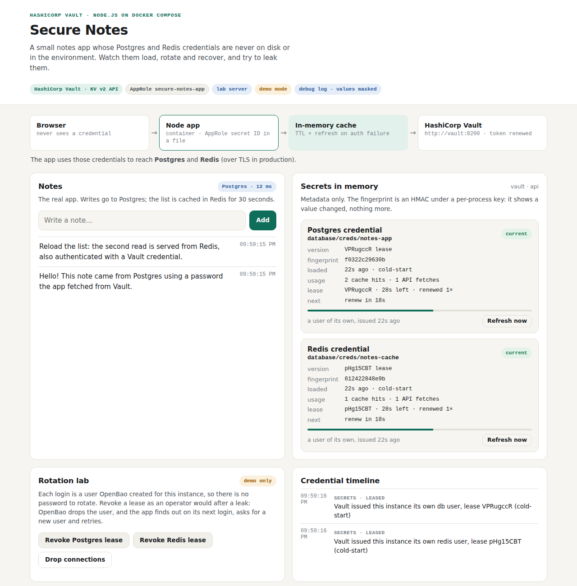
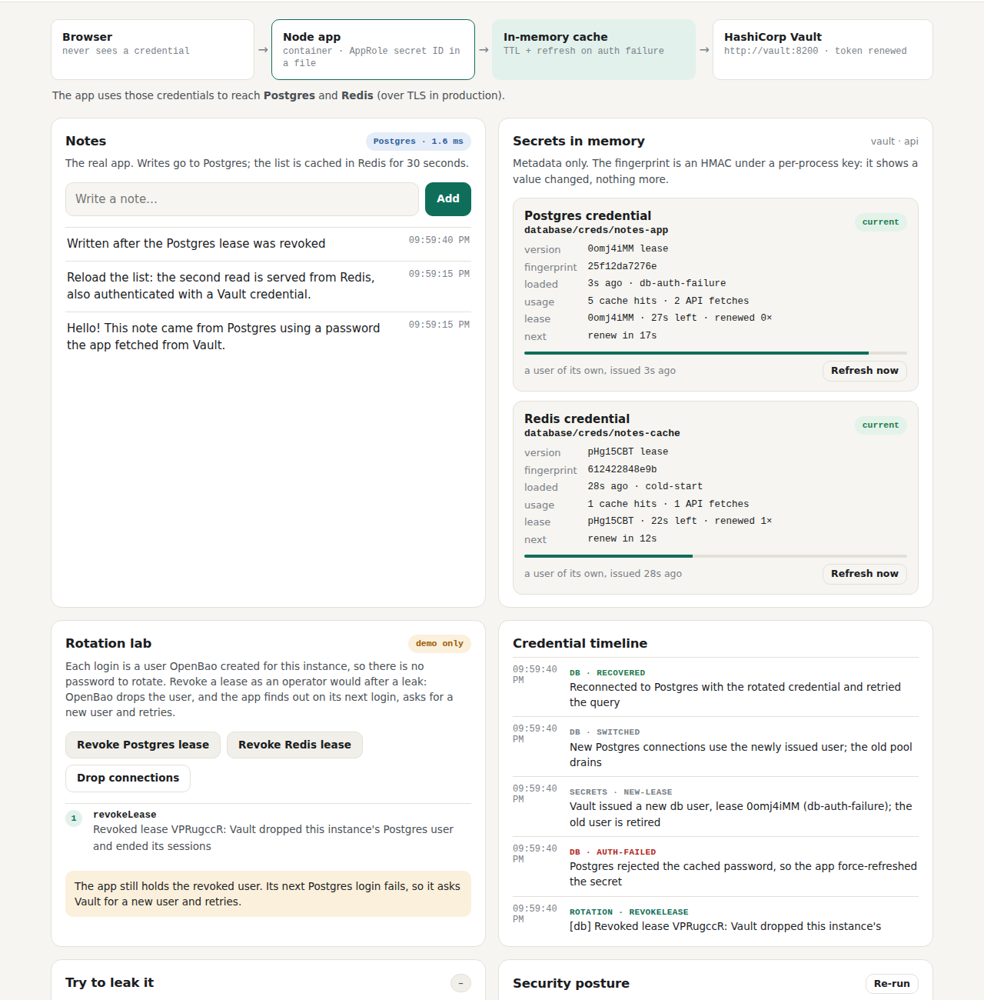

# Test case 23 — The same app on HashiCorp Vault (step v4)

[← all test cases](README.md) · [Step v4](../steps/v4-vault/README.md) · [Chapter 10](../docs/learn/10-openbao-and-vault.md)

**What it proves:** the same image, with `SECRETS_PROVIDER=vault`, runs against HashiCorp
Vault 2.2.0 with the same client: AppRole, KV v2, and database users with leases (Vault's
Redis plugin for the cache). Only the server setup differs. Vault has no self-init, so a
lab script initialises, unseals and configures it, then revokes the root token.

**Catalogue IDs:** V1–V6 ([TEST-CASES.md](../docs/TEST-CASES.md)) · **Proven in CI by:** `compose (vault)`, and the `checks` job (the entrypoint against the real Vault binary) · **Evidence from:** [CI run 39169755271](https://github.com/ephico2real2/openbao-node-poc/actions/runs/39169755271): [captures](https://github.com/ephico2real2/openbao-node-poc/tree/ci-captures/2026-10-18T2201Z_ci_run39169755271-1_compose-compose-vault), [check output](https://github.com/ephico2real2/openbao-node-poc/blob/ci-captures/2026-10-18T2203Z_ci_run39169755271-1_compose-vault-logs/compose-check.txt)

## Steps

```bash
export COMPOSE_FILE=docker-compose.yml:steps/v4-vault/compose.yaml
docker compose down -v && docker compose up --build -d
docker compose logs vault | grep vault-lab
scripts/compose-check.sh
```

## What you should see

The header says **HashiCorp Vault**, and the timeline says Vault issued this instance its
own database user:



Revoking the lease plays out as in test case 20, with Vault dropping the user:



## Evidence from the run

From the [Compose log](https://github.com/ephico2real2/openbao-node-poc/blob/ci-captures/2026-10-18T2203Z_ci_run39169755271-1_compose-vault-logs/compose.log) and the check output:

```
vault-1     | [vault-lab] initialised with one key share; unsealed
vault-1     | [vault-lab] configured: KV v2, database engine, AppRole, file audit device; the root token is revoked
…
SERVICE    IMAGE                              STATE
vault      docker.io/hashicorp/vault:2.2.0    running
…
== secrets provider: vault, mode: api
  ok    the app is logged in to Vault as role 'secure-notes-app' (policies: default,secure-notes-app)
  ok    the app's secret ID file is mode 0400, owned by the app user
  ok    no token or secret ID in the app's environment
  ok    the seed's bootstrap secret ID is spent (single use)
  ok    the app's policy refuses a path outside its own (403)
…
  ok    drop connections, then app recovers with the rotated credentials  (recovered: db, redis)
  ok    leak test: no attempt exposes the password  (6 attempts, 0 leaks)
  ok    security posture: no check fails  (15 checks, none failing)
…
== credential scan (compose): searching for 4 secret values from Vault, read as the app's own identity (every version); the values are never printed
credential-scan: no credential value found anywhere it must not be
```

In this run, one check line and two smoke-test lines on the Vault leg still said
"OpenBao" (for example "a user OpenBao created for it"); they are left out above. The
wording now follows the provider.
