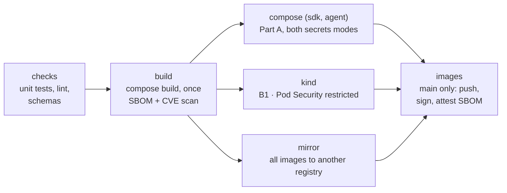
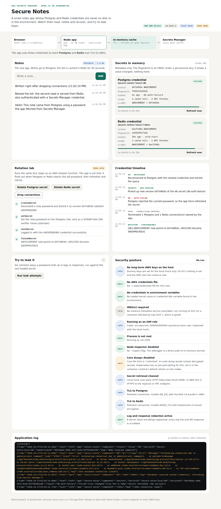

# Run and Deploy Secure Notes — Step-by-Step Guide

_Last updated October 17, 2026. The [README](../README.md) is the short version; this guide walks through every step._

Secure Notes runs three ways, all from the same two container images: on your laptop with Docker Compose, on Kubernetes or OpenShift, and on AWS on an EC2 server. Pick the part that matches where you want to run it; you don't need to do them in order.

## Pick your path

| Part | Where it runs | Secrets come from | You need | Time |
| --- | --- | --- | --- | --- |
| **A. Docker Compose** | Your laptop | A Secrets Manager stand-in, in a container | Docker | 5 min |
| **B. Kubernetes or OpenShift** | kind, OpenShift Local or a dev cluster; or EKS / ROSA | The stand-in inside the cluster, or real Secrets Manager on EKS / ROSA | kubectl or oc (plus Docker and kind for B1) | 10 to 20 min |
| **C. AWS on EC2** | In the [sibling repo](https://github.com/ephico2real2/aws-secrets-manager-node-poc/blob/main/docs/GUIDE.md#part-c--deploy-to-aws-on-ec2) | Real Secrets Manager | An AWS account | About 1 hour |

New to all of this? Do Part A first. It takes five minutes, needs no account, and shows you everything the app does before you deploy it anywhere.

**One build, everywhere.** `docker compose build` (which Part A runs for you) is the only place images are built. Part B loads those exact images into kind; on every push to `main`, CI publishes the images that passed its tests to GitHub's container registry for OpenShift and EKS to pull.

**How to read this guide:**

- Every grey command block is copy-paste.
- Text in `<angle brackets>` is something you replace with your own value.
- Run commands in a terminal, from the `openbao-node-poc` folder, unless the step says otherwise.
- Each step ends with a **Check**. Don't move on until it passes.

## Get the code

Every part starts from the project's GitHub repository, [ephico2real2/openbao-node-poc](https://github.com/ephico2real2/openbao-node-poc).

```bash
git clone https://github.com/ephico2real2/openbao-node-poc.git
cd openbao-node-poc
ls
```

**Check:** `ls` lists `backend`, `frontend`, `deploy`, `dev`, `infra`, `scripts`, `docker-compose.yml` and `README.md`.

No git? On the repository page, choose **Code → Download ZIP**, unzip it, and `cd` into the folder.

**On Windows,** run everything inside WSL (Ubuntu). The scripts are bash and won't run in PowerShell.

## Part A — Run locally with Docker Compose

The quickest way to see the app: no AWS account, no Kubernetes, only Docker. Everything AWS would normally provide runs in containers, including a stand-in for Secrets Manager.

**You need:** Docker Desktop, running. Check with `docker compose version`; it should print `v2.` followed by numbers. Node.js 22 is only needed for the optional tests in step 3.

1. Build the images and start everything:

   ```bash
   docker compose up --build
   ```

   The first run takes a few minutes while Docker downloads and builds. Wait until the log shows `secure-notes listening`.
2. Open <http://localhost:3000> and try it: add a note, click **Rotate Postgres secret**, then **Drop connections**, then **Run leak attempts**. Watch the Credential timeline record each step.
3. Optional: in a second terminal, run the unit tests and the end-to-end check:

   ```bash
   (cd backend && npm install && npm test)
   scripts/compose-check.sh
   ```

   **Check:** the tests end with `# fail 0`, and `compose-check.sh` ends with `credential-scan: no credential value found anywhere it must not be`.
4. Stop and reset. Press `Ctrl+C` in the first terminal, then:

   ```bash
   docker compose down -v
   ```

   `-v` deletes the data, so the next start creates new random passwords. It also frees port 3000.

**Optional: agent mode.** On EC2 the app can read its secrets through a local AWS agent instead of calling Secrets Manager itself (`SecretsMode=agent` in the sibling repo's stack). To try that here, start the stack with a second file:

```bash
docker compose -f docker-compose.yml -f docker-compose.agent.yml up --build
```

The dashboard looks the same, and **Secrets in memory** shows `mode: agent`. The agent only answers requests that carry its token, which only it and the app can read.

**What that one command started:**

| Container | Image | What it does |
| --- | --- | --- |
| `app` | `secure-notes-app:dev` (built here) | The Node.js app and dashboard |
| `aws-mock` | `secure-notes-aws-mock:dev` (built here) | Stands in for Secrets Manager and STS; local and CI only |
| `seed` | `secure-notes-app:dev` | Runs once: puts random passwords into Secrets Manager, applies them to Postgres and Redis, then disables the startup passwords |
| `postgres` | `postgres:16` | The database |
| `redis` | `redis:7-alpine` | The cache |

**Why is there a password in docker-compose.yml?** `bootstrap-only-change-me` only lets the seed job log in the first time. The seed job immediately replaces it with a random value stored only in Secrets Manager, and CI checks on every push that the old one no longer works.

## Part B — Run on Kubernetes or OpenShift

The same images run on any Kubernetes cluster. Pick B1 for a local kind cluster, B2 for OpenShift, or B3 for EKS or ROSA against real AWS. The manifests live in `deploy/k8s/` as Kustomize overlays:

| Overlay | Use it for | What it adds to the base |
| --- | --- | --- |
| `overlays/kind` | kind, or any local Kubernetes | Postgres, Redis, the AWS stand-in and the seed job, inside the cluster; Pod Security `restricted` enforced on the namespace; the app on a NodePort that kind maps to `localhost:3000` |
| `overlays/openshift` | OpenShift Local (CRC) or a dev cluster | The same, plus a TLS Route; images pulled from GHCR; no fixed user IDs, so OpenShift assigns them |
| `overlays/openshift-local` | OpenShift Local on an Apple-silicon Mac, or any cluster that can't pull from GHCR | The OpenShift overlay with images built on the cluster from your checkout (`scripts/openshift-build.sh`) |
| `overlays/aws` | EKS, or ROSA with STS | Only the app, against real RDS, ElastiCache and Secrets Manager, with AWS access through an IAM role on the service account (IRSA) |

The base is hardened in every overlay: non-root, read-only root filesystem, all Linux capabilities dropped, seccomp on, no service-account token, and default-deny NetworkPolicies. The app's credentials never become a Kubernetes Secret: the only Secret in the namespace is the one-time startup secret.

### B1 — kind (Kubernetes on your laptop)

**You need:** Docker, [kind](https://kind.sigs.k8s.io) (CI uses v0.33.0) and kubectl, and about 6 GiB of memory for Docker. On a Mac, `scripts/bootstrap/macos.sh` installs what's missing; on Linux, `scripts/bootstrap/linux.sh`. Then check the machine:

```bash
scripts/preflight.sh kind
```

**Check:** the last line is `preflight: ready for the kind lab.` Port 3000 must be free, so stop Docker Compose first (`docker compose down`), or give kind another port with `KIND_APP_PORT=3100`.

1. Create the cluster. It reads `deploy/kind/cluster.yaml`, which pins the Kubernetes version and maps the app to your machine (on `127.0.0.1` only), so no port-forward is needed:

   ```bash
   scripts/kind-up.sh
   ```
2. Build the images with Docker Compose and load them into kind. These are the same images Part A runs; nothing is built twice.

   ```bash
   scripts/images-build.sh
   ```
3. Deploy and wait:

   ```bash
   scripts/k8s-deploy.sh deploy/k8s/overlays/kind
   ```

   It waits for Postgres, Redis and the stand-in, then the seed job, then the app. The app pod may restart once or twice while the seed job finishes; that's expected.
4. Open <http://localhost:3000>. The header says **Node.js on Kubernetes**.
5. Collect the evidence:

   ```bash
   scripts/k8s-check.sh
   ```

   It shows which user each container runs as and the Secrets in the namespace, proves the startup passwords were disabled and that Postgres only ever received password hashes, then runs the end-to-end test.

   **Check:** the last line is `k8s-check: all checks passed`.

When you're done: `scripts/kind-down.sh`. The images stay in Docker for next time.

A cluster made before `deploy/kind/cluster.yaml` existed has no port mappings; `kind-up.sh` says so. Recreate it, or use `kubectl -n secure-notes port-forward svc/secure-notes 3000:80`.

### B2 — OpenShift

**You need:** `oc`, logged in to a cluster as a user who can create a project. OpenShift Local (CRC) on a laptop works: give it at least 9 GiB and 4 CPUs (`crc config set memory 10240`), then `crc start`, `eval $(crc oc-env)` and `oc login -u developer https://api.crc.testing:6443`. Check with `scripts/preflight.sh openshift`.

1. Create the project and deploy. Pick one:

   ```bash
   oc new-project secure-notes

   # the published images (amd64 clusters that can pull from ghcr.io)
   KUBECTL=oc scripts/k8s-deploy.sh deploy/k8s/overlays/openshift

   # or: build the images on the cluster from your checkout (Apple-silicon Macs,
   # where the published amd64 images can't run, or no access to ghcr.io)
   scripts/openshift-build.sh
   ```

   `openshift-build.sh` creates two BuildConfigs, uploads the committed source (`git archive` of HEAD), builds it on the cluster for the cluster's own CPU, and deploys `deploy/k8s/overlays/openshift-local`.
2. The deploy prints the app's address, HTTPS through the OpenShift router:

   ```
   app: https://secure-notes-secure-notes.apps-crc.testing
   ```

   Open it. The header says **Node.js on OpenShift**, and **Security posture** shows the high user ID OpenShift assigned. OpenShift Local's certificate is self-signed, so the browser asks you to accept it once.
3. Collect the evidence:

   ```bash
   oc -n secure-notes port-forward svc/secure-notes 3000:80 &
   KUBECTL=oc scripts/k8s-check.sh
   ```

   **Check:** the last line is `k8s-check: all checks passed`.

**Cluster can't reach ghcr.io or Docker Hub?** Copy the four images into a registry it can reach. Log in to that registry first (`skopeo login`, `podman login` or `oc registry login`), then:

```bash
scripts/mirror-images.sh <your-registry>/<path>
KUBECTL=oc scripts/k8s-deploy.sh deploy/k8s/overlays/mirror
```

The script copies the app, the stand-in, Postgres and Redis with `skopeo` (or `oc image mirror` if you set `MIRROR_TOOL=oc`), writes the `mirror` overlay, and checks that every image in it comes from your registry. If the registry needs a login to pull, also create a pull secret and link it to the `secure-notes` and `default` service accounts.

Why no fixed user IDs: OpenShift's restricted-v2 policy starts every container as a random high user ID with group 0, and rejects pods that ask for a specific one. CI tests the Kubernetes deployment on kind (B1), which runs the same base and backing services; this overlay only adds the Route and the image names, and leaves the user IDs to OpenShift. The check in step 3 confirms it on your cluster.

CI has no OpenShift cluster. It renders and validates both OpenShift overlays on every push, but the Route and `openshift-build.sh` are proven only when you run them; tell us if a step doesn't behave as written.

### B3 — EKS or ROSA, against real AWS

**You need:** an EKS cluster (or ROSA with STS) with an IAM OIDC provider; Postgres on RDS, Redis on ElastiCache with TLS and an RBAC user, and their two secrets in Secrets Manager (the sibling repo's Part C stack creates all of these); and network access from the pods to them.

1. Create the IAM role the pod will use. Replace `ACCOUNT_ID` and `OIDC_PROVIDER` in `infra/irsa-trust-policy.example.json`, and the ARNs in `infra/iam-policy.example.json`, then:

   ```bash
   aws iam create-role --role-name secure-notes-pod \
     --assume-role-policy-document file://infra/irsa-trust-policy.example.json
   aws iam put-role-policy --role-name secure-notes-pod --policy-name read-own-secrets \
     --policy-document file://infra/iam-policy.example.json
   ```

   The permissions policy only works through a Secrets Manager VPC endpoint (`aws:SourceVpce`). If your cluster's VPC has none, delete that `Condition` block.
2. Fill in every `<PLACEHOLDER>` in `deploy/k8s/overlays/aws/kustomization.yaml`: region, the two secret ARNs, the RDS and ElastiCache endpoints, and the role ARN from step 1.
3. Create the namespace and the RDS certificate bundle the app uses to verify the database:

   ```bash
   kubectl create namespace secure-notes
   curl -fsSLo global-bundle.pem https://truststore.pki.rds.amazonaws.com/global/global-bundle.pem
   kubectl -n secure-notes create configmap rds-ca --from-file=global-bundle.pem
   ```
4. Deploy:

   ```bash
   scripts/k8s-deploy.sh deploy/k8s/overlays/aws
   ```
5. Port-forward and open the app as in B1.

   **Check:** **Security posture** shows **Running as an IAM role: pass**, with an ARN that contains `assumed-role`.

On EKS you can use Pod Identity instead of IRSA: skip the annotation, and create a Pod Identity association for the `secure-notes` service account in the `secure-notes` namespace. On a cluster outside AWS, IAM Roles Anywhere is the keyless option, exchanging an X.509 certificate for temporary credentials.

## Part C — AWS on EC2

Deploying to AWS on EC2 (CloudFormation, RDS, ElastiCache, the instance role, the alert
topics) is the sibling repo's job and isn't copied here. Follow
[its Part C](https://github.com/ephico2real2/aws-secrets-manager-node-poc/blob/main/docs/GUIDE.md#part-c--deploy-to-aws-on-ec2): the app it deploys is the
same `SECRETS_PROVIDER=aws` path this repo keeps.

## CI — what every push proves

Every push to the repository runs Part A and Part B1 (kind) on a GitHub runner, photographs the dashboard, and only then publishes the images. The workflow is [`.github/workflows/ci.yaml`](https://github.com/ephico2real2/openbao-node-poc/blob/main/.github/workflows/ci.yaml), and it calls the same scripts you run by hand.



| Job | Same as | What it proves |
| --- | --- | --- |
| `checks` | Part A, step 3 | Unit tests with the real Postgres, Redis and AWS SDK libraries; every script and workflow lints clean; every Kustomize overlay renders and matches its schema |
| `build` | `docker compose build` | Builds the two images once, lists every package in them (an SBOM) and fails if any has a critical vulnerability that already has a fix, then hands them to every later job |
| `compose (sdk)`, `compose (agent)` | Part A | The stack starts, the startup passwords stop working, and the end-to-end test passes. It runs twice: once as normal, and once with the app reading its secrets through a local agent (agent mode), which must refuse any request without its token. |
| `kind` | B1 | The same under Pod Security `restricted`: who each container runs as, that no app credential is a Kubernetes Secret, that Postgres only received password hashes, and the end-to-end test |
| mirror | B2, no internet | The mirror script copies all four images into a throwaway registry, and the overlay it generates pulls only from there |
| `v0-leak` | [`versions/v0-env-file`](../versions/v0-env-file/README.md) | The original `.env` app still leaks its passwords (the "before" picture) |
| `docs` | — | Every relative link resolves and every Mermaid diagram renders |
| `images` | — | On `main` only: pushes the exact images that passed to `ghcr.io/ephico2real2/openbao-node-poc`, signs each one with cosign and attaches its SBOM as a signed attestation, then checks both without logging in |

**The screenshots.** In the compose and kind jobs, a Playwright browser walks the dashboard: first load, a Postgres rotation and recovery, a Redis rotation, the leak test, and a phone-width view. Each page lists the text it must show, so a screenshot of a broken page fails the job. The pictures go to the [`ci-captures`](https://github.com/ephico2real2/openbao-node-poc/tree/ci-captures) branch, one folder per run and job, and appear on the run's summary page. The same pattern as cilium-implementation-poc.



A real capture from the `kind` job: the four rotation steps have run, and the timeline shows Postgres rejecting the cached password, the app picking up the new version, and recovering, all within the same second.

**To see them:** open the repository's **Actions** tab, pick a run, and scroll the summary. Each job's logs and evidence (`k8s-check.txt`, pod logs) are in a `…-logs` folder on the same branch.

## What the tests prove

Every claim in this guide has a test that fails if the claim stops being true; the most important one searches the running stack for the **actual passwords**, not just their names, and finds none.

| Claim | Proven by | Where |
| --- | --- | --- |
| No password in any container or pod: configuration, pod specs, ConfigMaps, decoded Secrets, events, process environment, every file, the databases (only hashes), every log | `scripts/credential-scan.sh`, run after the end-to-end test | `compose`, `kind` |
| The scan really finds a leak | the same scan with `LOG_REVEAL_SECRETS=true`: FOUND in the app log, and only there | `compose (sdk)` |
| Rotation needs no restart | rotate from the dashboard, drop connections: `auth-failed → new-version → recovered` | `compose`, `kind` |
| Six common leaks are blocked | the leak test: `0 of 6 leaked` | `compose`, `kind` |
| Debug logs name every key and mask every value | unit tests and the dashboard capture | `checks`, `compose`, `kind` |
| Production refuses the reveal flag | the app exits 78 | `checks`, `compose (sdk)` |

**Debug logging.** With `LOG_LEVEL=debug` (the default in Compose and kind; the `LogLevel` parameter on AWS), the log shows which secret, version and keys the app used: passwords as `******** (32 chars, fp=…)`, usernames partly masked, hosts and ports in full. On the dashboard, tick **Credential lines only** under **Application log**.

To see each one work, follow the [tutorial](TUTORIAL.md); to demo them one at a time, with the CI screenshot and output for each, open the [demo folder](../demo/README.md). [TEST-CASES.md](TEST-CASES.md) lists every automated test.

## Troubleshooting

Find your symptom below. Rows marked A are for Docker Compose, B for Kubernetes and OpenShift. AWS problems are in the [sibling repo's troubleshooting](https://github.com/ephico2real2/aws-secrets-manager-node-poc/blob/main/docs/GUIDE.md#troubleshooting).

| Symptom | Likely cause | Fix |
| --- | --- | --- |
| App log: `unable to load secrets` with `AccessDenied` | Requests aren't going through the VPC endpoint | Check that the VPC has DNS hostnames and DNS resolution turned on, and that the endpoint values are right |
| App log: `Refusing to start` (exit code 78) | An unsafe setting, such as a password in the environment | The next lines name the setting; remove it |
| A: port is already allocated | Something else uses port 3000 | Stop it, or change 127.0.0.1:3000:3000 in docker-compose.yml to 127.0.0.1:3001:3000 |
| A: app keeps restarting after an earlier run | Old volumes hold passwords from a previous start | docker compose down -v, then start again |
| B: app pod restarts for the first minute | It waits for the seed job to create its secrets | Normal. If it keeps going: kubectl -n secure-notes logs deploy/secure-notes |
| B1: ErrImageNeverPull or ErrImagePull for secure-notes-app:dev | The images aren't loaded into kind | scripts/images-build.sh (with the kind cluster running) |
| B2: ImagePullBackOff from ghcr.io | The cluster can't reach ghcr.io, or the package is private | Mirror the two images to a registry it can reach (see B2), or make the GHCR package public |
| B2: pods rejected by a security context constraint | The kind overlay was applied; it asks for fixed user IDs | Use deploy/k8s/overlays/openshift |
