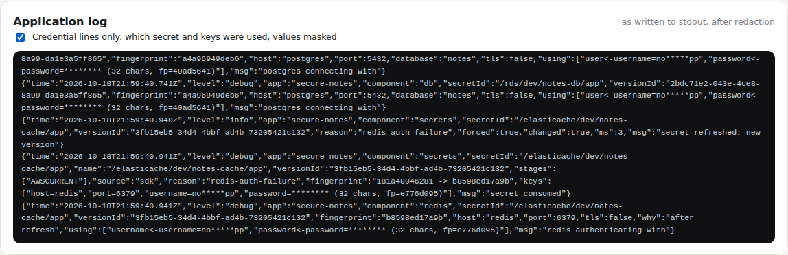
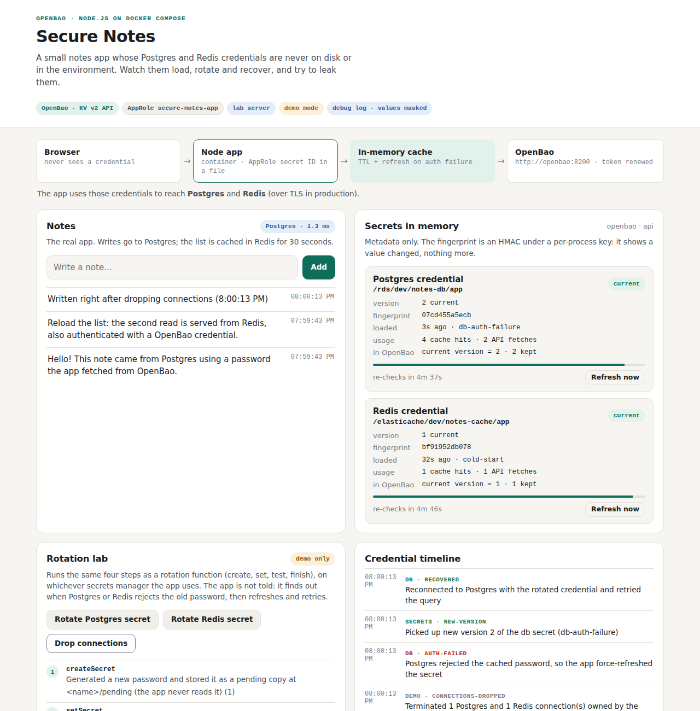
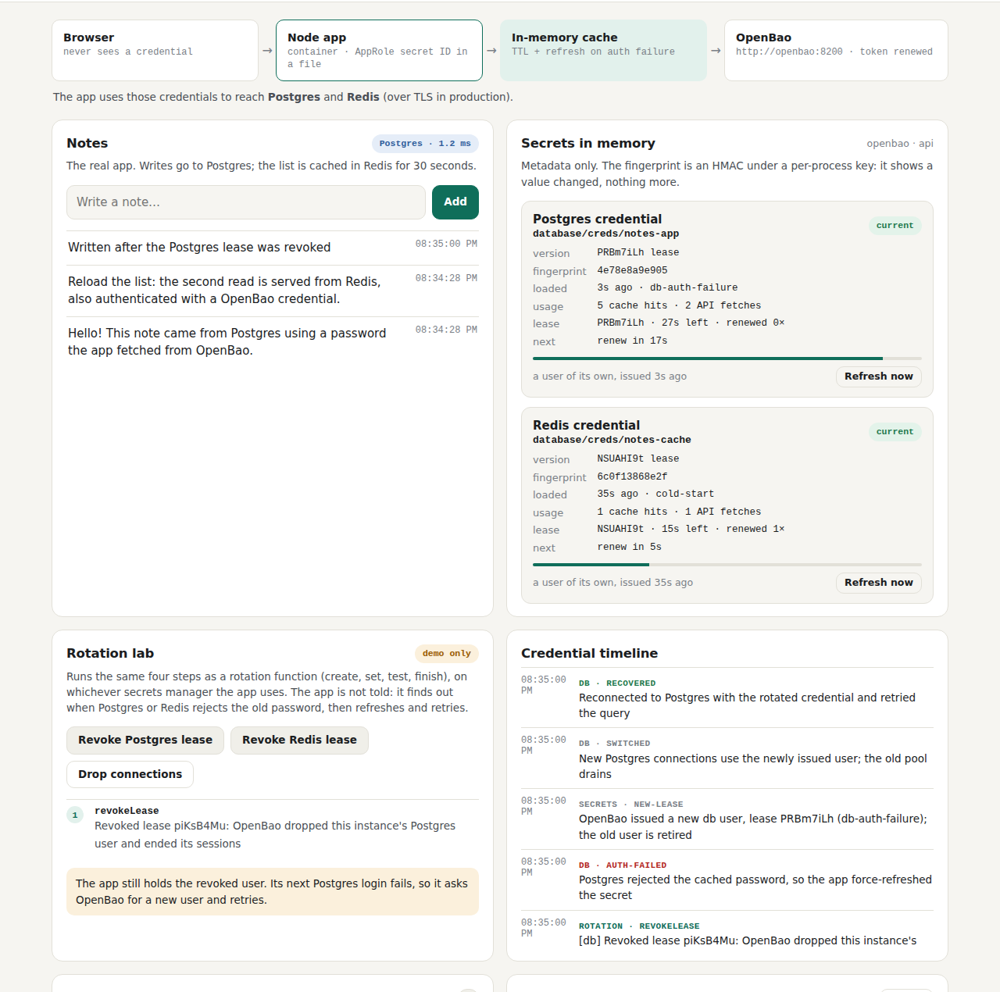

# Tutorial — see every feature work, and prove it yourself

About 20 minutes for steps 1 to 9, on your laptop, and about as long again for steps 10 to 14. You need Docker with Compose v2 (2.24 or later from step 10 on), `jq`, and for the check scripts Node.js 22 and `curl`; steps 9 and 12 also need kind and `kubectl`, and step 12 `helm` 3. You will watch the app load
its credentials, rotate them from the dashboard, try to leak them, read the
app's own log (with every password masked), then search the running containers
for the real passwords and find nothing. Every screenshot below is taken by CI
on every push, so they always match the current app.

Steps 1 to 9 use the AWS path: a Secrets Manager stand-in in a container. Steps
10 to 14 continue the story on OpenBao and HashiCorp Vault: stored secrets with
AppRole, database users that expire, Kubernetes auth and External Secrets,
the same app on Vault, and an alert when someone else reads the secret.

For the list of every automated test behind these steps, see
[TEST-CASES.md](TEST-CASES.md). To demo one feature at a time, with the CI
output for each, see the [demo folder](../demo/README.md). For deploying to Kubernetes, OpenShift or AWS,
see [GUIDE.md](GUIDE.md).

**On OpenBao from the start.** Steps 1 to 6 and 8 work the same on [step v1](../steps/v1-openbao-kv/README.md) (step 7, agent mode, is AWS only). Run
`export COMPOSE_FILE=docker-compose.yml:steps/v1-openbao-kv/compose.yaml` before step 1.
The dashboard then says **OpenBao**. The secrets are KV v2 versions, not AWS version stages.
The step README covers what is different, and step 10 below picks it up.

## 1. Start the stack

```bash
git clone https://github.com/ephico2real2/openbao-node-poc.git
cd openbao-node-poc
docker compose up --build -d
docker compose logs -f app        # in a second terminal: follow the app's log
```

Wait for `secure-notes listening` in the log, then open <http://localhost:3000>.
The Compose stack runs with `LOG_LEVEL=debug` by default, so the log also shows
which credential keys the app uses (with the values masked; step 5).


What you're looking at:

- **Secrets in memory**: the two credentials the app holds. You see the secret
  name, version and a *fingerprint* (an HMAC under a per-process key: it changes
  when the value changes, and reveals nothing about it). Never the value.
- **Credential timeline**: what happened to the credentials, in plain words.
- **Security posture**: thirteen checks the app runs on itself, such as no keys in
  the environment, not running as root, core dumps off.
- **Application log** (bottom of the page): the app's log, as written, after
  redaction.

## 2. Rotate the Postgres password from the dashboard

In **Rotation lab**, click **Rotate Postgres secret**. The four steps of an AWS
rotation function run: a new password is generated (`createSecret`), applied to
Postgres (`setSecret`), tested (`testSecret`) and made current
(`finishSecret`). The app is not told.

Now click **Drop connections**. The app's next database login uses the cached,
now-wrong password; Postgres rejects it, the app re-reads the secret, logs in
with the new one and retries the query. Watch the **Credential timeline**:

> `auth-failed` → `new-version` → `recovered`, all within the same second, with
> no error for the user.


## 3. Rotate the Redis password

Click **Rotate Redis secret**, then **Drop connections**. Same story for the
cache. Redis has an extra step, `revokeOld`: for a moment both passwords work,
then the old one is removed.


## 4. Try to leak a password

Click **Run leak attempts**. The app takes its real database password and tries
the six most common ways a password ends up somewhere it shouldn't: `JSON.stringify`,
`console.log`, a template string, an error message with a connection string,
a log field named `dbPassword`, and the password pasted into a log message.


Every one comes out as `[REDACTED]`.

## 5. Read the Application log

Scroll to the bottom of the dashboard and tick **Credential lines only**. With `LOG_LEVEL=debug`, every time the
app loads a secret or a client logs in, it writes **which secret, which version
and which keys** it used, with every value masked:



The same lines are in the container's log. From a second terminal:

```bash
docker compose logs app | grep '"secret consumed"' | tail -1 | sed 's/^[^{]*//' | jq '{secretId, versionId, source, fingerprint, keys}'
docker compose logs app | grep -E 'connecting with|authenticating with' | tail -2 | sed 's/^[^{]*//' | jq '{msg, secretId, fingerprint, host, port, using}'
```

How each value is shown:

| Key | Shown as | Why |
| --- | --- | --- |
| `password` (and `token`, `secret`, …) | `******** (32 chars, fp=1a2b3c4d)` | nothing of the value; the fingerprint shows when it changes |
| `username` | `no*****pp` | partly masked |
| `host`, `port`, `engine` | in full | not secret, and what you need to debug a connection |

After the rotation in step 2, the `fingerprint` field reads `old -> new`, so you
can see the app picked up a new password without seeing either one.

## 6. Search the running containers for the real passwords

This is the proof that matters: take the **actual** passwords and look for them
everywhere they could have leaked to.

```bash
scripts/credential-scan.sh compose
```

It reads every password from the Secrets Manager stand-in (the current and
previous version of each secret), then searches the configuration of every
container, the app's process environment, every file in the app container, the
Postgres and Redis data (they must hold only hashes), and the log of every
container. It never prints a value.

```
== credential scan (compose): searching for 6 secret values from Secrets Manager (every version); the values are never printed
-- containers
  ok    app: container config (env, command, labels: docker inspect)   clean
  ok    aws-mock: container config (env, command, labels: docker inspect) clean
  ok    postgres: container config (env, command, labels: docker inspect) clean
  ok    redis: container config (env, command, labels: docker inspect) clean
  ok    seed: container config (env, command, labels: docker inspect)  clean
  ok    app: process environment values (/proc/1/environ)              clean
  ok    app: every readable file (5828 files)                          clean
  ok    postgres: data directory and config (plaintext passwords?)     clean
  ok    redis: data and ACL files (plaintext passwords?)               clean
-- logs
  ok    app: log                                                       clean
  ok    aws-mock: log                                                  clean
  ok    postgres: log                                                  clean
  ok    redis: log                                                     clean
  ok    seed: log                                                      clean
-- debug logging (LOG_LEVEL=debug)
  ok    app log names the secrets and keys it consumed                 6 line(s)
  ok    every password is shown as ******** (length, fingerprint)      yes
credential-scan: no credential value found anywhere it must not be
```

The full check, which runs this scan after the end-to-end test, is
`scripts/compose-check.sh`.

## 7. Agent mode

On EC2 the app can read its secrets through a local AWS agent instead of
calling Secrets Manager itself. To try it here:

```bash
docker compose down -v
export COMPOSE_FILE=docker-compose.yml:docker-compose.agent.yml   # every compose command now uses both files
docker compose up --build -d
```

The dashboard shows `mode: agent` and **Workload Credentials Provider**, and
the log gains a line per request showing where the agent's token came from,
masked:

```bash
docker compose logs app | grep 'agent request' | tail -1 | sed 's/^[^{]*//' | jq '{secretId, tokenFile, ssrfTokenMasked}'
```

With `COMPOSE_FILE` still set, `scripts/compose-check.sh` runs the scan (agent container
included) and also proves the agent rejects a request without its token. Then go back to
the normal stack for step 8:

```bash
docker compose down -v && unset COMPOSE_FILE && docker compose up -d
```

## 8. In a lab only: reveal the real values

Sometimes you need to see the password the app actually used, for example when
a login fails and you suspect the secret itself. `LOG_REVEAL_SECRETS=true`
makes the debug credential lines print the real values next to the masked ones.

```bash
LOG_REVEAL_SECRETS=true docker compose up -d --no-deps app
docker compose logs app | grep 'values revealed' | tail -1 | sed 's/^[^{]*//' | jq '{msg, keys, warning}'
```

If you're following `docker compose logs -f app`, the real passwords scroll past there
too: that is what the flag does, and why it is for a lab only.

It is impossible to miss while it's on:


Revealed lines go only to the container's log: the dashboard's Application log
never shows them.


Run the scan now and it finds the passwords, in the app's log and nowhere else.
That is how CI proves the scan would catch a real leak:

```bash
EXPECT_REVEALED=1 scripts/credential-scan.sh compose
```

```
== credential scan (compose): searching for 6 secret values from Secrets Manager (every version); the values are never printed
-- containers
  ok    app: container config (env, command, labels: docker inspect)   clean
  ok    aws-mock: container config (env, command, labels: docker inspect) clean
  ok    postgres: container config (env, command, labels: docker inspect) clean
  ok    redis: container config (env, command, labels: docker inspect) clean
  ok    seed: container config (env, command, labels: docker inspect)  clean
  ok    app: process environment values (/proc/1/environ)              clean
  ok    app: every readable file (5828 files)                          clean
  ok    postgres: data directory and config (plaintext passwords?)     clean
  ok    redis: data and ACL files (plaintext passwords?)               clean
-- logs
  ok    app: log                                                       FOUND 4 (expected: LOG_REVEAL_SECRETS=true)
  ok    aws-mock: log                                                  clean
  ok    postgres: log                                                  clean
  ok    redis: log                                                     clean
  ok    seed: log                                                      clean
-- debug logging (LOG_LEVEL=debug)
  ok    app log names the secrets and keys it consumed                 2 line(s)
  ok    every password is shown as ******** (length, fingerprint)      yes
credential-scan: no credential value found anywhere it must not be
```

Turn it off:

```bash
docker compose up -d --no-deps app
```

**The app refuses this setting in production.** Try it:

```bash
docker run --rm -e NODE_ENV=production -e LOG_REVEAL_SECRETS=true \
  -e DB_SECRET_ID=x -e REDIS_SECRET_ID=y secure-notes-app:dev
```

```
{"time":"…","level":"error","app":"secure-notes","msg":"Refusing to start:\n  - LOG_REVEAL_SECRETS must not be enabled in production: it writes secret values to the log"}
```

It exits with code 78, so on EC2 systemd does not keep restarting it.

## 9. The same on Kubernetes

With the kind cluster from the [guide](GUIDE.md) (Part B1), the log level is
debug in the local overlay too:

```bash
kubectl -n secure-notes logs deploy/secure-notes | grep '"secret consumed"' | tail -1 | jq '{secretId, versionId, keys}'
scripts/credential-scan.sh k8s
```

On Kubernetes the scan also checks the pod specs, ConfigMaps, the decoded
Kubernetes Secrets (only the burned one-time bootstrap Secret may exist) and the
namespace's events. `scripts/k8s-check.sh` runs it after the end-to-end test.

Stop the cluster before you go on (`scripts/kind-down.sh`), so port 3000 is
free for Compose again.

## 10. The same lab on OpenBao (step v1)

Swap the Secrets Manager stand-in for a real OpenBao 2.7.1 server. The secrets
are KV v2 versions. The app logs in with AppRole: a role ID that isn't secret,
plus a secret ID it reads from a mode-0400 file that the seed job minted for it.
No one types a token.

```bash
docker compose down -v
export COMPOSE_FILE=docker-compose.yml:steps/v1-openbao-kv/compose.yaml   # every compose command now uses both files
docker compose up --build -d        # http://localhost:3000
scripts/compose-check.sh            # the checks below, the smoke test, the credential scan
docker compose exec app stat -c '%a %u %n' /home/node/bao-secret-id   # 400 1000 …
curl -s localhost:3000/api/config | jq .bao                            # loggedIn, TTL, policies; never the token
```

The header says **OpenBao** and **AppRole secret ID in a file**; `aws-mock`
isn't started. Repeat steps 2 to 6: a rotation writes the next KV version, and
the secret's version number goes up by one. `compose-check.sh` adds its
OpenBao lines: logged in as `secure-notes-app`, the seed's bootstrap secret ID
is spent, another path gets 403, and the audit log holds only HMACs of the
values.



[Step README](../steps/v1-openbao-kv/README.md) · [demo page](../demo/test-case-19-openbao-kv.md) · [chapter 7, secret zero and AppRole](learn/07-secret-zero-and-approle.md).

## 11. Database users that expire (step v2)

Now the app has no stored database password at all. On startup it asks OpenBao
for a Postgres user and a Valkey user of its own, each with a 30-second lease
that the app renews, and a 90-second max TTL after which it takes a new user.
Valkey replaces Redis.

```bash
export COMPOSE_FILE=docker-compose.yml:steps/v1-openbao-kv/compose.yaml:steps/v2-openbao-dynamic/compose.yaml
docker compose down -v               # start clean: the seed job sets up the database engine once
docker compose up --build -d         # http://localhost:3000
scripts/compose-check.sh
```

**Secrets in memory** shows a `lease` row per credential: the time left and
the renewal count. **Security posture** passes **Database logins are
short-lived**. The rotation buttons are now **Revoke Postgres lease** and
**Revoke Redis lease**. Click the first, then add a note: the note is saved,
and the timeline shows `revokeLease`, `auth-failed`, `new-lease`, `switched`
and `recovered`. Leave it a few minutes and watch `new-lease … (lease-max-ttl)`
arrive on its own.



[Step README](../steps/v2-openbao-dynamic/README.md) · [demo page](../demo/test-case-20-dynamic-users.md) · [chapter 8, leases and dynamic credentials](learn/08-leases-and-dynamic-credentials.md).

## 12. On Kubernetes: Kubernetes auth and External Secrets (step v3)

The lab of step 11 on kind. OpenBao comes from its own Helm chart, in the
`openbao` namespace. The app pod proves who it is with a service-account token
projected for audience `openbao`, so there is no secret zero to hand over. You
need `helm` 3; the bootstrap scripts don't install it. Stop Compose first so
port 3000 is free.

```bash
docker compose down -v
scripts/kind-up.sh
KIND_OPENBAO=1 scripts/images-build.sh                    # also preloads OpenBao and Valkey
scripts/openbao-k8s-up.sh                                 # OpenBao from its chart, initialised
scripts/k8s-deploy.sh deploy/k8s/overlays/kind-openbao    # http://localhost:3000
scripts/k8s-check.sh
```

`kubectl -n openbao exec openbao-0 -- bao status` shows `Initialized true` and
`Sealed false`, with nobody having run `operator init`. The header says
**Kubernetes auth secure-notes-app**. `k8s-check.sh` shows the app logged in
with Kubernetes auth, no Kubernetes API token in its pod, and Postgres sessions
under a user OpenBao created, then ends with `k8s-check: all checks passed`.

**File mode.** Some apps can't call OpenBao. For those, External Secrets
Operator reads OpenBao and writes a Kubernetes Secret, which the app mounts as
a volume and watches. The app has no OpenBao identity at all:

```bash
scripts/openbao-k8s-up.sh
scripts/eso-k8s-up.sh                                        # ESO from its chart, then its ClusterSecretStore
scripts/k8s-deploy.sh deploy/k8s/overlays/kind-openbao-eso
scripts/k8s-check.sh                                         # also rotates in OpenBao and watches it arrive
```

The dashboard says **via External Secrets** and **No OpenBao identity in the
app**. `k8s-check.sh` runs the `rotate-db` Job and reports when the new version
reached the app as a changed file, with no restart. In this mode the credentials
are in a Kubernetes Secret, and the check says so. CI runs each overlay on a
fresh cluster. Then `scripts/kind-down.sh`.

[Step README](../steps/v3-k8s/README.md) · demo pages [21, Kubernetes auth](../demo/test-case-21-kubernetes-auth.md) and [22, External Secrets](../demo/test-case-22-external-secrets.md) · [chapter 9, Kubernetes auth and External Secrets](learn/09-kubernetes-auth-and-external-secrets.md).

## 13. The same app on HashiCorp Vault (step v4)

One setting, `SECRETS_PROVIDER=vault`, and the same image runs against Vault
2.2.0, with the dynamic users of step 11. Vault has no self-init, so
`dev/vault/entrypoint.sh` runs `operator init` with one key share, unseals,
configures with the root token held only in memory, then revokes it.

```bash
export COMPOSE_FILE=docker-compose.yml:steps/v4-vault/compose.yaml
docker compose down -v
docker compose up --build -d          # http://localhost:3000
scripts/compose-check.sh
docker compose logs vault | grep vault-lab
```

The dashboard says **HashiCorp Vault**, and the timeline says "Vault issued
this instance its own db user". The `vault-lab` lines are the entrypoint's
three: initialised and unsealed, configured with the root token revoked, and
after a restart, unsealed with the key from the data volume. The checks are
step 11's, with Vault's container, audit log and storage in the scan.

[Step README](../steps/v4-vault/README.md) · [demo page](../demo/test-case-23-vault.md) · [chapter 10, OpenBao and Vault](learn/10-openbao-and-vault.md).

## 14. An alert when someone else reads the secret (step v5)

Nothing leaked in steps 1 to 13. This step asks: if someone with access reads
the credentials anyway, would you know? OpenBao's audit log (every value an
HMAC) is shipped to VictoriaLogs, vmalert runs a rule on it every 10 seconds,
and an alert console on port 3100 shows what fires.

```bash
docker compose down -v
export COMPOSE_FILE=docker-compose.yml:steps/v1-openbao-kv/compose.yaml:steps/v5-detection/compose.yaml
docker compose up --build -d          # the app on :3000, the alert console on :3100
docker compose run --rm intruder      # role ops-admin reads the app's Postgres secret
```

Open <http://localhost:3100> before the intruder: **No alerts**, though the app
has been reading its secrets all along. Within about a minute after it:
**SecretReadByUnexpectedIdentity**, "An app credential was read by 'ops-admin',
not by the app", with the path that was read. `scripts/compose-check.sh` does
the same after the smoke test and the credential scan, and checks none of those
raised an alert first.

[Step README](../steps/v5-detection/README.md) · [demo page](../demo/test-case-24-detection.md) · [chapter 11, detection on the audit log](learn/11-detection-on-the-audit-log.md).

## 15. Clean up

```bash
docker compose down -v
unset COMPOSE_FILE          # back to the AWS path next time
scripts/kind-down.sh        # if a cluster from step 9 or 12 is still running
```
