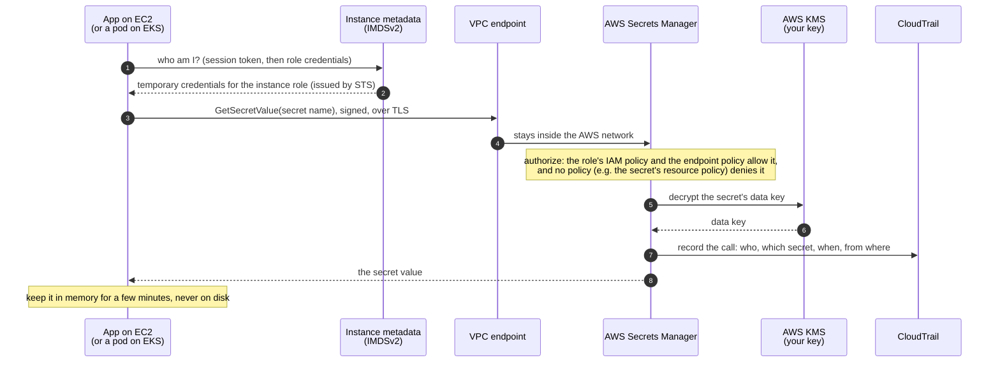

# 1. Secrets managers, and how a workload fetches a secret

[Learning path](README.md) · Next: [2. The `.env` file problem →](02-the-env-file-problem.md)

**What you'll learn:** what a secrets manager is, the seven steps every one of them uses
to hand a secret to an application, and how those steps look in AWS Secrets Manager,
HashiCorp Vault, Azure Key Vault and Google Secret Manager.

## 1.1 What it is

A **secret** is anything that grants access: a database password, an API key, a TLS
private key, a token. A **secrets manager** is a service that stores secrets encrypted,
gives each one to only the identities allowed to have it, records every read, and can
change (rotate) the secret without anyone touching it.

The key idea: the application is **not given** its credentials. It is given an
**identity** and the **name** of a secret, and asks for the value when it needs it.

## 1.2 The pattern: seven steps

| # | Step | The question it answers |
| --- | --- | --- |
| 1 | **Identity** | Who is this workload? The platform says so (a cloud role, a Kubernetes service account), not a password in a file |
| 2 | **Authenticate** | Can it prove it? It shows a short-lived credential or a signed token (often a JWT, see [chapter 3](03-why-a-secrets-manager.md#workload-identity-and-jwt)) |
| 3 | **Authorize** | May this identity read *this* secret, from *here*? Policies decide |
| 4 | **Decrypt** | The store decrypts the secret with a key held in a KMS or HSM |
| 5 | **Deliver** | The value goes to the app over TLS, into memory |
| 6 | **Cache** | The app keeps it for a few minutes so it doesn't call the store on every request |
| 7 | **Rotate** | The store (or a function it runs) changes the secret on a schedule; the app picks up the new version |

Step 1 replaces the "first secret" problem: you can't protect a secret with another
secret forever, so the chain must start with something the platform vouches for.

## 1.3 The pattern on AWS

1. The EC2 instance has an **IAM role**. The SDK asks the instance metadata service for
   **temporary credentials** for that role; they expire and are refreshed automatically.
2. The SDK signs a `GetSecretValue` request with them (SigV4) and sends it over TLS, to a
   **VPC endpoint**, so it never crosses the internet.
3. Secrets Manager checks the policies: the **IAM policy** on the role must allow the read,
   the **endpoint policy** must allow it, and nothing may deny it, including the
   **resource policy** on the secret (Secure Notes' resource policy only adds denies).
4. It decrypts the secret with a **KMS** key (envelope encryption: a data key protected by
   your KMS key).
5. The value returns to the app, which keeps it **in memory** and never writes it down.
6. **CloudTrail** records the call: who, which secret, when, from where.

On Kubernetes, step 1 is the pod's **service-account token** (a JWT) exchanged for role
credentials (IRSA or EKS Pod Identity). Everything after that is the same.

## 1.4 The same steps in four products

| Step | AWS Secrets Manager | HashiCorp Vault | Azure Key Vault | Google Secret Manager |
| --- | --- | --- | --- | --- |
| Identity | IAM role (EC2, Lambda, ECS); IRSA or Pod Identity on EKS | Auth method: AWS IAM, Kubernetes, JWT/OIDC, AppRole | Managed identity; Entra Workload ID on Kubernetes | Service account; Workload Identity Federation outside GCP |
| Authenticate | SigV4-signed request with temporary STS credentials | Log in → a **Vault token** with a TTL | Entra ID access token (a JWT) | OAuth 2.0 access token |
| Authorize | IAM + resource policy + VPC endpoint policy | Vault policies attached to the token | Azure RBAC (e.g. *Key Vault Secrets User*) | IAM role `secretmanager.secretAccessor` |
| Encrypt at rest | KMS envelope encryption, AES-256 | Barrier encryption, AES-256-GCM; unseal keys or cloud KMS auto-unseal | Software or HSM-backed keys (Managed HSM: FIPS 140-3 Level 3) | Google-managed or customer-managed (CMEK) keys |
| Deliver | HTTPS API, SDK, local agent, Kubernetes CSI / External Secrets | HTTPS API, Vault Agent, Secrets Operator | HTTPS API, SDK, CSI driver | HTTPS API, SDK, CSI driver |
| Rotate | Managed for RDS, Aurora, Redshift, DocumentDB; Lambda for anything else | **Dynamic secrets**: a new credential per lease, revoked when it expires | Event Grid `SecretNearExpiry` → your function | Pub/Sub notification → your function |
| Audit | CloudTrail | Audit devices | Azure Monitor diagnostic logs | Cloud Audit Logs |

Same seven steps, different names. An app written to the pattern needs a different
client library and identity setup for each product, not a different design.

## Sources

- [AWS Secrets Manager: how it works](https://docs.aws.amazon.com/secretsmanager/latest/userguide/intro.html) · [encryption](https://docs.aws.amazon.com/secretsmanager/latest/userguide/security-encryption.html) · [VPC endpoints](https://docs.aws.amazon.com/secretsmanager/latest/userguide/vpc-endpoint-overview.html)
- [IAM roles for EC2](https://docs.aws.amazon.com/AWSEC2/latest/UserGuide/iam-roles-for-amazon-ec2.html) · [IMDSv2](https://docs.aws.amazon.com/AWSEC2/latest/UserGuide/configuring-instance-metadata-service.html)
- [Vault auth methods](https://developer.hashicorp.com/vault/docs/auth) · [Vault seal/unseal](https://developer.hashicorp.com/vault/docs/concepts/seal)
- [Azure Key Vault overview](https://learn.microsoft.com/azure/key-vault/general/overview) · [Key Vault RBAC](https://learn.microsoft.com/azure/key-vault/general/rbac-guide)
- [Google Secret Manager overview](https://cloud.google.com/secret-manager/docs/overview)
