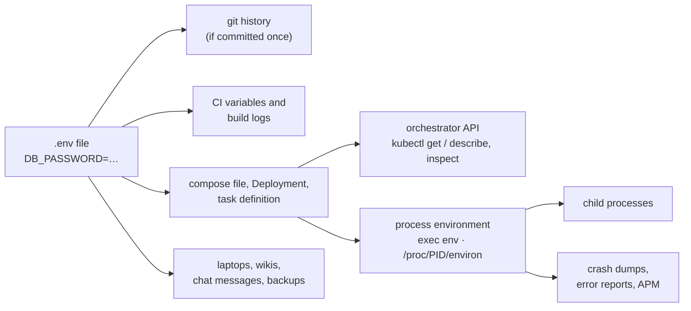

# 2. The `.env` file problem, shown live

[← 1. Secrets managers](01-secrets-managers.md) · [Learning path](README.md) · Next: [3. Why a secrets manager →](03-why-a-secrets-manager.md)

**What you'll learn:** what happens to a credential you pass to a container with
`--env-file`, and why "anyone with access to the environment" really means anyone.

## 2.1 The setup

A typical `.env` file (example values only):

```bash
# demo/env-file-demo/generic-app.env
DB_HOST=db.internal
DB_USER=notes_app
DB_PASSWORD=Example-Only-Pa55w0rd
REDIS_URL=redis://:Example-Only-R3dis@cache.internal:6379
API_KEY=sk_test_EXAMPLE_ONLY_4f9a2c7e
```

Start a container with it, headless (`-d`) and removed when it stops (`--rm`):

```console
$ podman run -q -d --rm --name envdemo --env-file demo/env-file-demo/generic-app.env docker.io/library/alpine:3.20 sleep 600
7281d243072d5283a84de7633ead5bf7ba2e1a188cc2cff6582631e5ad182feb
```

## 2.2 Four ways to read the password

The output below is from CI (Podman 4.9.3), unedited except for trimming `PATH`/`HOME`
lines. Run it yourself with `scripts/env-file-demo.sh` (`ENGINE=docker` works too).

**1. `exec` into the container**, the way anyone debugging it would:

```console
$ podman exec envdemo env
REDIS_URL=redis://:Example-Only-R3dis@cache.internal:6379
API_KEY=sk_test_EXAMPLE_ONLY_4f9a2c7e
DB_HOST=db.internal
DB_USER=notes_app
DB_PASSWORD=Example-Only-Pa55w0rd
```

**2. The process's environment block**, which the kernel keeps for the life of the process:

```console
$ podman exec envdemo sh -c 'tr "\0" "\n" < /proc/1/environ'
...
DB_PASSWORD=Example-Only-Pa55w0rd
```

**3. No shell at all:** the container runtime stores the values in the container's
configuration and hands them to anyone allowed to run `inspect`:

```console
$ podman inspect envdemo --format '{{range .Config.Env}}{{println .}}{{end}}'
...
DB_PASSWORD=Example-Only-Pa55w0rd
```

**4. From the host:** a container's process is an ordinary Linux process, so root on the
host (or anyone who can read `/proc/PID/environ`) sees it too:

```console
$ pid=$(podman inspect envdemo --format '{{.State.Pid}}')
$ sudo cat /proc/$pid/environ | tr '\0' '\n' | grep PASSWORD
DB_PASSWORD=Example-Only-Pa55w0rd
```

And every child process inherits the environment: a subprocess, a crash reporter, a
debug shell.

## 2.3 What this means in a real system

The demo used `podman`, but every platform has the same doors:



| Who | How they read it |
| --- | --- |
| Anyone with shell access to the host | `/proc/PID/environ`, `podman inspect` / `docker inspect` |
| Anyone allowed to `exec` or `inspect` (on Kubernetes: `pods/exec`, or `get` on the pod spec or Secret) | Shown above |
| Anyone who reads logs, crash reports or APM traces | A library that prints its config or the environment on error |
| Anyone with access to git, CI or backups | The file itself, or a copy of it |

No step above is an attack: each is a normal operation granted to developers, operators
and tools every day. That is the problem, and none of it is logged as "read a password".
OWASP's guidance says it directly: environment variables are "generally accessible to
all processes", so using them for secrets "is therefore not recommended"
([OWASP Secrets Management Cheat Sheet](https://cheatsheetseries.owasp.org/cheatsheets/Secrets_Management_Cheat_Sheet.html)).

## 2.4 The same lookups on Secure Notes

Secure Notes gets an env file too, but it says only **where** the secrets are: the
database secret by ARN, the Redis secret by the parts of its name
([naming convention](../reference/secret-naming.md): `/elasticache/prod/secure-notes/app`):

```console
$ podman run -q -d --rm --name sndemo --env-file demo/env-file-demo/secure-notes.env secure-notes-app:dev sleep 600
$ podman exec sndemo env | grep -Ei 'pass|secret|token|key|url'
SECRETS_MODE=sdk
REDIS_SECRET_RESOURCE=secure-notes
DB_SECRET_ID=arn:aws:secretsmanager:us-east-1:111122223333:secret:rds!db-0a1b2c3d-AbCdEf
SECRETS_ENV=prod
```

Nothing to steal. The app fetches the passwords at runtime, keeps them in memory, and
**refuses to start** if `DB_PASSWORD`, `DATABASE_URL`, `REDIS_URL` or similar are set.
A secret ID is useless without the app's identity, and with it, the read is authorized
and recorded. Chapter 3 explains how.

CI runs this demo on every push (job `env-file-demo`) and fails if the generic
container's password is *not* readable, so this page can't silently go out of date.
