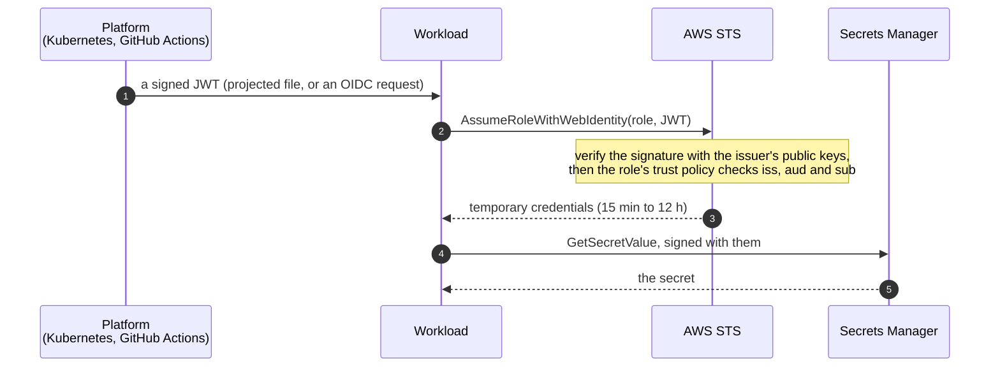

# 3. Why a secrets manager

[← 2. The `.env` file problem](02-the-env-file-problem.md) · [Learning path](README.md) · Next: [4. Secure Notes, before and after →](04-secure-notes-app.md)

**What you'll learn:** the enterprise problems a secrets manager solves, how it protects
a secret at rest and in transit, how automation removes people from the loop, how a JWT
lets a workload prove who it is, and what it costs you.

## The problems it solves

| Problem with `.env` and copies | What a secrets manager does instead |
| --- | --- |
| Copies everywhere: laptops, CI, wikis, compose files ("secret sprawl") | **One central place.** Every consumer reads the same secret by name |
| Anyone with access to the environment reads it | **Per-identity access.** Only the identities a policy names can read a secret, optionally only from one network path |
| Nobody knows who read it | **Audit.** Every read is a logged API call: who, what, when, from where |
| Passwords live for years, because changing every copy is painful | **Rotation.** Scheduled, automatic, with no restart if the app re-reads on failure |
| People create, paste and share passwords | **No manual handling.** The database, the stack or a rotation function generates the value; no human sees it |
| Offboarding: leavers still know the password | Rotate once; nothing to chase |

This is what the [OWASP Secrets Management Cheat Sheet](https://cheatsheetseries.owasp.org/cheatsheets/Secrets_Management_Cheat_Sheet.html)
asks for: centralize, least privilege, automate rotation, prefer short-lived (dynamic)
secrets, and keep a tamper-resistant audit trail.

## Encryption at rest and in transit

| | AWS Secrets Manager | What it means for you |
| --- | --- | --- |
| **At rest** | Envelope encryption: each secret version is encrypted with a unique AES-256 data key, which is itself encrypted by a **KMS key** | Reading the secret also needs permission to use the key. Secure Notes' app role may call `kms:Decrypt` only *via Secrets Manager* (`kms:ViaService`). With a customer-managed key you can also make the key policy a second lock; today its policy delegates to IAM, and narrowing it is [S4.6](https://github.com/ephico2real2/aws-secrets-manager-node-poc/blob/main/docs/modernization/backlog.md#e4--security-hardening) |
| **In transit** | TLS 1.2 or 1.3 on every endpoint; hybrid post-quantum key exchange available | Combined with a **VPC endpoint**, the request never leaves the AWS network |
| **In use** | The app holds the value in memory | The remaining exposure: a memory dump of the process. Keep the cache short and never log the value ([chapter 6](06-request-flows.md#63-logging-why-no-line-can-carry-a-password)) |

The databases protect the hop to them too: Secure Notes uses TLS with certificate
verification for RDS, and TLS (required) for ElastiCache.

## Rotation without people

A rotation **Lambda** is a four-step state machine (`createSecret → setSecret → testSecret →
finishSecret`); RDS managed rotation runs inside AWS but uses the same version labels. Versions carry labels: `AWSPENDING` while the new one is tested,
`AWSCURRENT` once it is live, `AWSPREVIOUS` for the one before.

- **RDS, Aurora, Redshift, DocumentDB:** managed. With `ManageMasterUserPassword`, RDS
  creates the secret and rotates it (every 7 days by default) with no function to write.
- **Anything else** (ElastiCache users, API keys): a Lambda function. AWS publishes
  templates, including one for ElastiCache users; Secure Notes ships its own
  (`infra/rotation/elasticache-user-rotation.js`).

The app's part is small: read the secret by name, cache it briefly, and **re-read on an
authentication failure**. Then rotation needs no restart.

## Automation: Terraform, Ansible and Kubernetes

Infrastructure-as-code creates secrets and wires them up, so a person never types one.

**Terraform**

```hcl
resource "aws_db_instance" "notes" {
  # ...
  manage_master_user_password = true   # RDS creates and rotates the secret
}

resource "aws_secretsmanager_secret" "redis" {
  name       = "/elasticache/${var.env}/secure-notes/app"   # the naming convention
  kms_key_id = aws_kms_key.secrets.arn
}

resource "aws_secretsmanager_secret_rotation" "redis" {
  secret_id           = aws_secretsmanager_secret.redis.id
  rotation_lambda_arn = aws_lambda_function.redis_rotation.arn
  rotation_rules { automatically_after_days = 30 }
}
```

Keep values out of Terraform state: let the service generate them, or use the
write-only argument `secret_string_wo` (Terraform 1.11+) and ephemeral resources
(Terraform 1.10+). Secure Notes uses CloudFormation
(`infra/cloudformation.yaml`) the same way: `GenerateSecretString` and RDS-managed
passwords, so the values never appear in a template, a parameter or an output.

**Ansible** reads a secret at run time instead of storing it in inventory or a vault file:

```yaml
- name: Configure the app's database user
  community.postgresql.postgresql_user:
    name: notes_app
    password: "{{ (lookup('amazon.aws.secretsmanager_secret', '/rds/prod/notes-db/app') | from_json).password }}"
  no_log: true
```

**Kubernetes:** an app that can't call the API itself can have secrets delivered by the
**External Secrets Operator** (syncs into a Kubernetes Secret) or the **Secrets Store
CSI Driver** with the AWS provider (mounts as files). Both still use the pod's identity.
Secure Notes calls the API directly, so no Kubernetes Secret exists at all.

## Workload identity and JWT

A **JWT** (JSON Web Token) is a signed, base64url-encoded JSON document in three parts:
`header.payload.signature`. Anyone can read it; only the issuer can create one that
verifies against the issuer's published public keys. The claims that matter:

| Claim | Meaning | Example: a Kubernetes service-account token for Secure Notes |
| --- | --- | --- |
| `iss` | Who issued it | `https://oidc.eks.us-east-1.amazonaws.com/id/EXAMPLE` |
| `sub` | Who it is about | `system:serviceaccount:secure-notes:secure-notes` |
| `aud` | Who it is for | `sts.amazonaws.com` |
| `exp` | When it expires | a Unix time: 24 h ahead for IRSA's token (the kubelet refreshes it), about 1 h for a default projected token |

A workload uses its JWT to get cloud credentials **without any stored key**:



| Where | How the JWT arrives | In this repo |
| --- | --- | --- |
| EKS or ROSA (IRSA) | The kubelet projects a service-account token into the pod (`AWS_WEB_IDENTITY_TOKEN_FILE`) and refreshes it; the SDK exchanges it | `infra/irsa-trust-policy.example.json`, `deploy/k8s` |
| EKS Pod Identity | An agent on the node exchanges the token for the pod | — |
| GitHub Actions | The job requests an OIDC token (`permissions: id-token: write`, audience `sts.amazonaws.com`) | `.github/workflows/aws.yaml`, `infra/github-actions-bootstrap.yaml` (trust: this repo's environment only) |
| Vault, Azure, GCP | Vault's JWT/Kubernetes auth; Entra Workload ID; GCP Workload Identity Federation | — |

On EC2 there is no JWT: the instance metadata service hands the SDK role credentials
directly ([chapter 1](01-secrets-managers.md#13-the-pattern-on-aws)).

## The trade-offs

| Cost | How to manage it |
| --- | --- |
| A runtime dependency: if the store is unreachable, a cold start can't get its secret | Cache with a TTL and serve the last good value on errors; retry at startup; multi-region replicas for DR |
| Money: $0.40 per secret per month and $0.05 per 10,000 API calls (AWS) | The cache keeps reads to about 24 an hour per instance (2 secrets, 5-minute TTL), plus up to 120 `DescribeSecret` calls an hour while a dashboard is open |
| The value is still in process memory | Short cache TTL, no core dumps, never log it |
| The identity is now the key | Least-privilege roles, IMDSv2, narrow trust policies on `sub` and `aud`, and an alarm on unexpected reads |

## Sources

- [Secrets Manager encryption](https://docs.aws.amazon.com/secretsmanager/latest/userguide/security-encryption.html) · [rotation](https://docs.aws.amazon.com/secretsmanager/latest/userguide/rotating-secrets.html) · [RDS-managed passwords](https://docs.aws.amazon.com/AmazonRDS/latest/UserGuide/rds-secrets-manager.html) · [pricing](https://aws.amazon.com/secrets-manager/pricing/)
- [Terraform `aws_secretsmanager_secret_version`](https://registry.terraform.io/providers/hashicorp/aws/latest/docs/resources/secretsmanager_secret_version) · [Ansible `secretsmanager_secret` lookup](https://docs.ansible.com/ansible/latest/collections/amazon/aws/secretsmanager_secret_lookup.html)
- [External Secrets Operator](https://external-secrets.io/) · [Secrets Store CSI Driver, AWS provider](https://github.com/aws/secrets-store-csi-driver-provider-aws)
- [RFC 7519: JSON Web Token](https://www.rfc-editor.org/rfc/rfc7519) · [`AssumeRoleWithWebIdentity`](https://docs.aws.amazon.com/STS/latest/APIReference/API_AssumeRoleWithWebIdentity.html) · [IRSA](https://docs.aws.amazon.com/eks/latest/userguide/iam-roles-for-service-accounts.html) · [GitHub Actions OIDC with AWS](https://docs.github.com/en/actions/security-for-github-actions/security-hardening-your-deployments/configuring-openid-connect-in-amazon-web-services)
- [OWASP Secrets Management Cheat Sheet](https://cheatsheetseries.owasp.org/cheatsheets/Secrets_Management_Cheat_Sheet.html)
