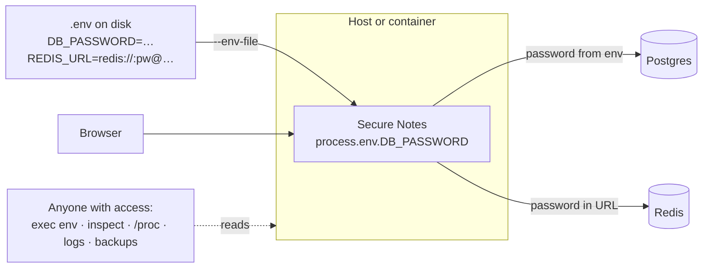
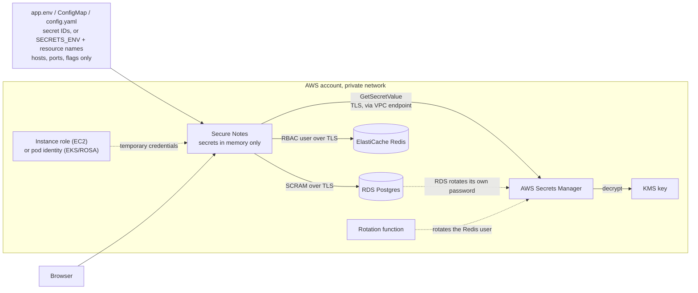

# 4. Our example: Secure Notes, before and after

[← 3. Why a secrets manager](03-why-a-secrets-manager.md) · [Learning path](README.md) · Next: [5. System design →](05-system-design.md)

**What you'll learn:** what the app does, how it was wired with a `.env` file, how it is
wired with AWS Secrets Manager, and the code any app needs to add to make that switch.

## 4.1 The app

Secure Notes is a small notes service: a Node.js backend and a web dashboard. Notes are
stored in **Postgres**; the list is cached in **Redis** for 30 seconds. So it needs two
credentials, a database password and a cache password, which is exactly the shape of
most real services.

## 4.2 Before: credentials in a `.env` file

Integration point: **raw key/value pairs** in the environment. Simple, and readable by
everyone who can reach the host, the container runtime or the orchestrator
([chapter 2](02-the-env-file-problem.md) shows it live).

## 4.3 After: credentials fetched at runtime from AWS Secrets Manager

On EC2, `app.env` is `/etc/secure-notes/app.env`, written by the CloudFormation user data
and loaded by systemd (`EnvironmentFile=`); on Kubernetes the same keys are a ConfigMap.

Integration point: **secret IDs** (names or ARNs), or the parts of a name built by the
[naming convention](../reference/secret-naming.md) (`/elasticache/prod/secure-notes/app`).
The environment says *where* the credentials are, never *what* they are. The full request path is in
[chapter 6](06-request-flows.md).

## 4.4 What the application code must add

Switching from `.env` to a secrets manager is not only an infrastructure change. These
are the prerequisites in the application, in any language; the right column is where
Secure Notes does each one.

| # | The app must… | Why | Secure Notes |
| --- | --- | --- | --- |
| 1 | Read only **secret IDs** from config (or build them from a [naming convention](../reference/secret-naming.md)), and **refuse to start** if a credential variable is set | Stops someone "fixing" an outage by pasting a password into the environment; one setting (`env`) moves an app between environments | `backend/src/config.js` (`FORBIDDEN_ENV`, `assertSafeEnvironment`), `secrets/naming.js` |
| 2 | **Fetch** the secret at runtime, with the platform identity (no access keys) | The credential never touches disk or env | `backend/src/secrets/fetchers.js` (AWS SDK, or the local agent) |
| 3 | **Cache** it in memory with a TTL, share concurrent fetches, serve the last good value during a short outage | One API call per secret per TTL, not per request; survives a brief Secrets Manager hiccup | `backend/src/secrets/provider.js` |
| 4 | **Re-read on authentication failure** and retry once | Rotation must not need a restart | `backend/src/clients/db.js` (Postgres `28P01`), `clients/cache.js` (Redis `WRONGPASS`) |
| 5 | Ask for the password **per new connection**, not once at startup | The pool picks up a rotated password by itself | `db.js`: `password: async () => …` |
| 6 | **Wrap** the value so printing it shows `[REDACTED]`, and **redact** every log line by key and by value | A secret must not leak through logs, errors or API responses | `secrets/SecretValue.js`, `secrets/redactor.js`, `log.js` |
| 7 | Log **which** secret and keys were used, values masked | Operators can debug without seeing a password | `secrets/mask.js` |
| 8 | Fail fast at startup if the secret can't be read | A clear error, not half a service | `server.js` `warmUp` |

The same building blocks exist in every stack:

| Language | Fetch | Cache |
| --- | --- | --- |
| Python | `boto3` `secretsmanager.get_secret_value` | `aws-secretsmanager-caching` |
| Java | AWS SDK for Java v2 `SecretsManagerClient` | `aws-secretsmanager-caching-java`; Spring Cloud AWS for config |
| Go | AWS SDK for Go v2 `secretsmanager` | `aws-secretsmanager-caching-go` |
| .NET | `AWSSDK.SecretsManager` | `AWSSDK.SecretsManager.Caching` |
| Any | the AWS Workload Credentials Provider (local agent on `localhost:2773`) | built in |

With HashiCorp Vault or Azure Key Vault the steps are the same; only the client
library and the identity change ([chapter 1](01-secrets-managers.md)).
