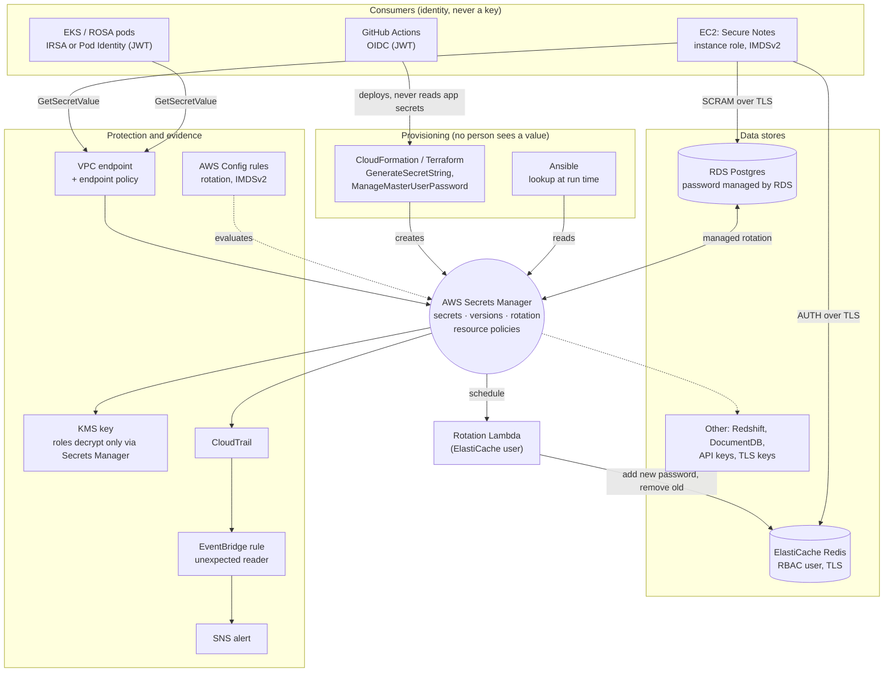

# 5. System design review and the target architecture

[← 4. Secure Notes, before and after](04-secure-notes-app.md) · [Learning path](README.md) · Next: [6. Request flows →](06-request-flows.md)

**What you'll learn:** how to review a secrets design control by control, what Secure
Notes' AWS design gets right, what to improve, and the target architecture with
Secrets Manager at the center.

## 5.1 Evaluation

Each row asks one question of the deployed design (`infra/cloudformation.yaml`).
✅ = in place, 🔎 = built but still to verify on a real AWS account, ⚠️ = gap. S4.x is a
story in the [backlog](https://github.com/ephico2real2/aws-secrets-manager-node-poc/blob/main/docs/modernization/backlog.md#e4--security-hardening) (and a GitHub issue).

| Area | Question | Today | |
| --- | --- | --- | --- |
| Identity | Does the workload hold any long-lived key? | No: EC2 instance role; IRSA on EKS/ROSA; GitHub OIDC for CI | ✅ |
| Identity | Can a server-side request forgery (SSRF: tricking the app into fetching a URL for you) steal the role? | IMDSv2 required, hop limit 1 | ✅ |
| Authorization | Can the role read anything besides its two secrets? | Read-only on two ARNs, only via the VPC endpoint; `kms:Decrypt` only via Secrets Manager | ✅ |
| Authorization | Could a broadly privileged admin read the secrets? | The Redis secret has a resource policy: only the app, the rotation function and a named break-glass role (an emergency admin role). Reads through CloudFormation are allowed, for cache-user updates, and alarmed | 🔎 built; verify on AWS · [S4.1](https://github.com/ephico2real2/aws-secrets-manager-node-poc/blob/main/docs/modernization/backlog.md#e4--security-hardening) |
| Authorization | …and the RDS-managed secret? | Protected by IAM and the alarm; a resource policy on it must first be proven not to break RDS rotation | ⚠️ [S4.1b](https://github.com/ephico2real2/aws-secrets-manager-node-poc/blob/main/docs/modernization/backlog.md#e4--security-hardening) |
| Network | Does a secret request cross the internet? | VPC endpoint with an account-only endpoint policy | ✅ |
| Network | What can the app reach? | No inbound; egress 443, Postgres and Redis only; 443 is still open to any address | ⚠️ [S4.6](https://github.com/ephico2real2/aws-secrets-manager-node-poc/blob/main/docs/modernization/backlog.md#e4--security-hardening) |
| Encryption | At rest and in transit? | Customer-managed KMS key; RDS and ElastiCache encrypted; TLS everywhere with RDS certificate verification | ✅ |
| Rotation | Are both credentials rotated without people or restarts? | RDS managed (7 days); Redis via the stack's function; the app re-reads on auth failure | ✅ |
| Detection | Would anyone notice an unexpected read? | CloudTrail → EventBridge → SNS alarm on any role, user or root other than the app and rotation roles; the RDS secret is matched by ARN | 🔎 fixed (rule state, customer-managed topic key) and simulated end to end locally; verify on AWS · [chapter 7](https://github.com/ephico2real2/aws-secrets-manager-node-poc/blob/main/docs/learn/07-alerts-and-audit.md) · [S4.2](https://github.com/ephico2real2/aws-secrets-manager-node-poc/blob/main/docs/modernization/backlog.md#e4--security-hardening) |
| Compliance | Is drift caught? | AWS Config rules: rotation enabled, rotation succeeded, IMDSv2 | ✅ opt-in (`EnableConfigRules=true`) · [S4.3](https://github.com/ephico2real2/aws-secrets-manager-node-poc/blob/main/docs/modernization/backlog.md#e4--security-hardening) |
| Least privilege in the data store | Does the app log in as an admin? | Yes: the app uses the RDS **master** user | ⚠️ [S4.4](https://github.com/ephico2real2/aws-secrets-manager-node-poc/blob/main/docs/modernization/backlog.md#e4--security-hardening) |
| Credential lifetime | Could there be no password at all? | Passwords, rotated; IAM auth tokens (15 minutes) are possible for both RDS and ElastiCache | ⚠️ [S4.5](https://github.com/ephico2real2/aws-secrets-manager-node-poc/blob/main/docs/modernization/backlog.md#e4--security-hardening) |
| Resilience | What if a region is lost? | Single region; the app's cache rides out short outages only | ⚠️ [S4.6](https://github.com/ephico2real2/aws-secrets-manager-node-poc/blob/main/docs/modernization/backlog.md#e4--security-hardening) |
| Application | Can a credential leak through config, logs or the API? | Refuses credential env vars; two-layer redaction; scanned for in CI | ✅ |

## 5.2 Enhancements

| Story | Change | Why it matters | Trade-off |
| --- | --- | --- | --- |
| [S4.4](https://github.com/ephico2real2/aws-secrets-manager-node-poc/blob/main/docs/modernization/backlog.md#e4--security-hardening) | A dedicated `notes_app` Postgres role with rights on its own tables; the master user only for admin and rotation | A stolen app credential can't drop the database or read other schemas | One more secret to rotate (use the "alternating users" rotation template) |
| [S4.5](https://github.com/ephico2real2/aws-secrets-manager-node-poc/blob/main/docs/modernization/backlog.md#e4--security-hardening) | IAM authentication: RDS `rds-db:connect`, ElastiCache Valkey 7.2+/Redis 7+ IAM users | No password exists to steal; a token lives 15 minutes | Token generation on every new connection; ElastiCache closes IAM connections after 12 hours; RDS IAM auth isn't suited to very high connection rates |
| [S4.6](https://github.com/ephico2real2/aws-secrets-manager-node-poc/blob/main/docs/modernization/backlog.md#e4--security-hardening) | Replica secrets in a second region; egress 443 limited to the interface endpoints' security group (plus the S3 gateway endpoint's prefix list); a tighter KMS key policy (named admins only) | Recovery from a regional outage; less room for exfiltration | More moving parts; a package mirror or proxy is needed once 443 is closed |

## 5.3 Target architecture

Secrets Manager sits in the middle: everything that **creates**, **changes**, **reads**
or **watches** a secret goes through it, and no person handles a value.

How each AWS service integrates, so nobody handles a credential:

| Service | Integration |
| --- | --- |
| **RDS / Aurora** | `ManageMasterUserPassword: true`: RDS creates the secret, encrypts it with your key and rotates it. The app reads the `rds!…` secret by ARN |
| **ElastiCache** | An RBAC user whose password CloudFormation reads from a generated secret; a rotation function keeps both in step, using the user's two password slots so there is no gap |
| **Redshift, DocumentDB** | Managed rotation, like RDS |
| **Lambda, ECS, EKS** | The Lambda extension or the local agent; ECS injects from Secrets Manager at task start (env, so prefer runtime fetch); EKS through IRSA plus the SDK, the CSI driver or External Secrets |
| **KMS** | Customer-managed key; the app and rotation roles may decrypt only via Secrets Manager (`kms:ViaService`) |
| **CloudTrail, EventBridge, SNS** | Every read is an event; a rule alerts on unexpected readers |
| **AWS Config** | Managed rules flag secrets without rotation, failed rotations and instances without IMDSv2 |

## Sources

- [Secrets Manager resource policies](https://docs.aws.amazon.com/secretsmanager/latest/userguide/auth-and-access_resource-policies.html) · [monitor with EventBridge](https://docs.aws.amazon.com/secretsmanager/latest/userguide/monitoring-eventbridge.html) · [Config rules for Secrets Manager](https://docs.aws.amazon.com/secretsmanager/latest/userguide/config-rules.html) · [replicate secrets](https://docs.aws.amazon.com/secretsmanager/latest/userguide/create-manage-multi-region-secrets.html)
- [RDS IAM database authentication](https://docs.aws.amazon.com/AmazonRDS/latest/UserGuide/UsingWithRDS.IAMDBAuth.html) · [ElastiCache IAM authentication](https://docs.aws.amazon.com/AmazonElastiCache/latest/dg/auth-iam.html)
- [AWS Security Reference Architecture](https://docs.aws.amazon.com/prescriptive-guidance/latest/security-reference-architecture/welcome.html)
