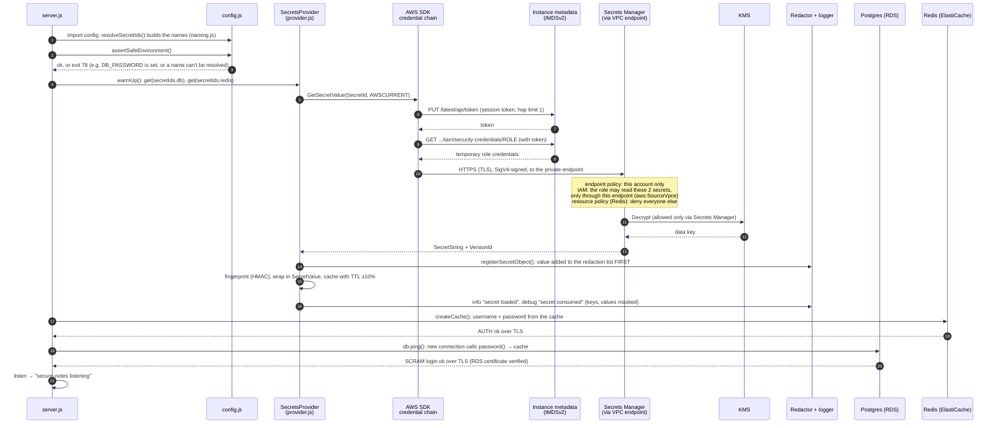
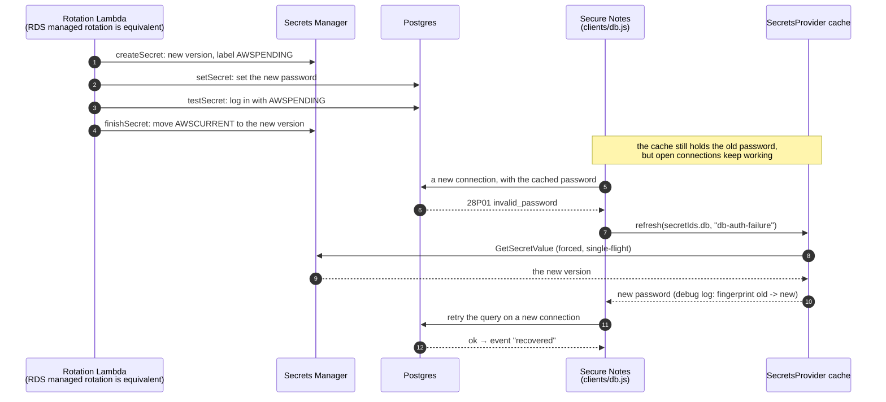
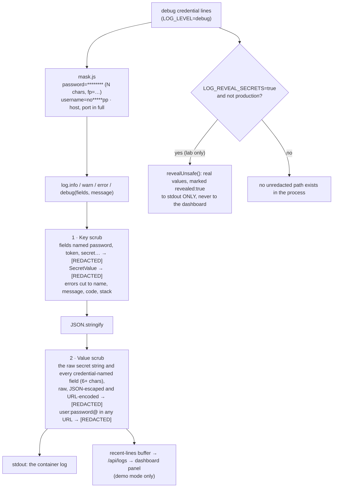

# 6. Inside the app: how a secret travels, and how logs stay clean

[← 5. System design](05-system-design.md) · [Learning path](README.md) · Next: [7. Secret zero and AppRole →](07-secret-zero-and-approle.md)

**What you'll learn:** the exact path a credential takes from Secrets Manager into a
database login, what happens when it is rotated, and how every log line is cleaned.
Each step names the file that does it, so you can read the code next to the diagram.

## 6.1 Startup: from nothing to the first database login

The app starts with **no credential at all**, only secret IDs. It proves who it is with
the EC2 instance role (on Kubernetes: the pod's service-account token, see
[chapter 3](03-why-a-secrets-manager.md#workload-identity-and-jwt)).

| Step | What happens | Where |
| --- | --- | --- |
| 1 | Build the secret names: explicit IDs, or the [naming convention](../reference/secret-naming.md) (`/rds/dev/notes-db/app`) | `config.js`, `secrets/naming.js` |
| 2–3 | Refuse to start if a credential is in the environment, a name can't be resolved, or the reveal flag is on in production (exit 78: systemd does not restart-loop) | `config.js` `assertSafeEnvironment` |
| 4 | Load both secrets: 8 attempts with 1–8 s backoff while the network comes up, then exit 1. Concurrent cold reads of one secret share a single API call (single-flight) | `server.js` `warmUp`, `secrets/provider.js` |
| 5–9 | The SDK finds credentials on its own: on EC2 from IMDSv2 (a PUT for a session token, then a GET); they are short-lived and refreshed automatically | AWS SDK default chain |
| 10–13 | The request never leaves the VPC; the role's IAM policy and the endpoint policy must allow it, and no policy may deny it (the Redis secret's resource policy denies everyone else); Secrets Manager decrypts with KMS | `infra/cloudformation.yaml` |
| 14 | The value is registered for redaction **before** anything can log it | `secrets/provider.js`, `secrets/redactor.js` |
| 15–16 | The value is wrapped so printing it shows `[REDACTED]`, cached with a TTL, and logged as "secret loaded" / "secret consumed" (keys only, values masked) | `secrets/provider.js`, `secrets/SecretValue.js`, `secrets/mask.js` |
| 17–20 | Clients take the credential from the cache; Postgres asks for the password on **every new connection** | `clients/cache.js`, `clients/db.js` |
| 21 | Listen | `server.js` |

**In agent mode** steps 5–13 are done by the AWS Workload Credentials Provider on the
host, and the app asks it on `http://localhost:2773` with a token file (`fetchers.js`
`createAgentFetcher`). Everything from step 13 on is identical.

## 6.2 Rotation: the password changes, the app recovers by itself

Redis works the same way (`clients/cache.js`): on `WRONGPASS` the app refreshes, updates
the client's username and password, and ioredis reconnects. ElastiCache users accept two
passwords, so the stack's rotation function adds the new one before it removes the old
(`infra/rotation/elasticache-user-rotation.js`). Without any failure, the cache also
expires after about 5 minutes (`SECRET_CACHE_TTL_SECONDS`; in agent mode 30 s in the app
and 300 s in the agent), so the app moves to the new version on its own.

## 6.3 Logging: why no line can carry a password

| Layer | Catches | Where |
| --- | --- | --- |
| Key scrub | a field named like a credential, whatever its value | `secrets/redactor.js` `scrub` |
| Value scrub | a loaded secret string or credential field anywhere: in a message, an error, a stack trace, a URL (usernames and hosts are deliberately not scrubbed) | `secrets/redactor.js` `scrubString` |
| Masking | debug lines that *describe* a credential: which key, its length, a fingerprint | `secrets/mask.js` |
| Reveal flag | nothing: it deliberately prints values, for a lab; refused in production | `log.js` `revealUnsafe`, `config.js` |

The proof that this holds in a running system is the credential scan: it takes the real
passwords and searches every container, file and log for them
([demo test case 6](../../demo/test-case-06-credential-scan.md)).
