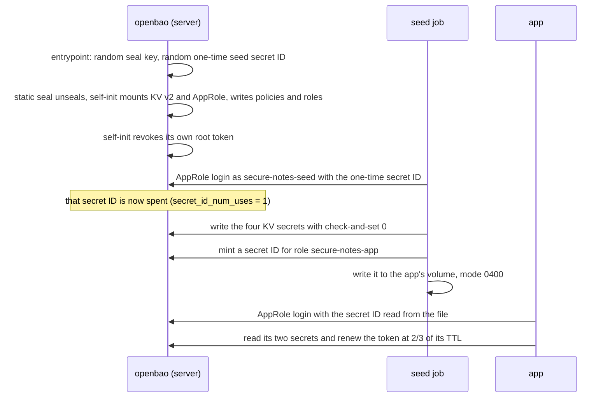

# 7. Secret zero and AppRole: how the app gets its first credential

[← 6. Request flows](06-request-flows.md) · [Learning path](README.md) · Next: [8. Leases and dynamic credentials →](08-leases-and-dynamic-credentials.md)

**What you'll learn:** the "secret zero" problem, and how step v1 of this repo solves it
on Docker Compose with OpenBao. You'll see how the server starts with no manual step,
how the seed job gets a one-time credential, how the app gets its own, and how the app
keeps its login alive. At the end you'll know which parts are lab-only.

## 7.1 The problem: you need a secret to get the secrets

Chapters 1 to 6 moved the credentials out of `.env` files and into a secrets manager.
But the app still has to **prove who it is** before the secrets manager hands anything
over. On AWS that proof came for free from the platform: the EC2 instance role or the
pod identity ([chapter 3](03-why-a-secrets-manager.md#workload-identity-and-jwt)).

Off AWS, on a plain Docker Compose network, there is no platform identity. The app
needs a first credential to log in with. That first credential is called **secret
zero**. If you put it in an environment variable, you are back in
[chapter 2](02-the-env-file-problem.md). [ADR-002](../modernization/03-adr-002-openbao-first.md)
puts it plainly: *secret zero moves, it doesn't vanish*. The job is to make it small,
short-lived, and hard to reach.

## 7.2 AppRole: a role ID and a secret ID

OpenBao's **AppRole** auth method gives a workload two things:

| | What it is | Is it secret? |
| --- | --- | --- |
| **Role ID** | A fixed name for the role, like a username. Here it is `secure-notes-app` | No. It is set in the config and shown in the app's environment |
| **Secret ID** | A value minted for that role, like a password | Yes. The app reads it from a **file**, mode 0400, never from the environment |

A **policy** says what a login with that role may do. The `secure-notes-app` policy in
[`dev/openbao/config.hcl`](../../dev/openbao/config.hcl) allows the app's two KV paths
and little else. Any other path gets a 403.

The client that does the login is
[`backend/src/secrets/bao/client.js`](../../backend/src/secrets/bao/client.js). It
refuses to start without `BAO_SECRET_ID_FILE`, and the error text says why: the secret
ID is read from a file, never from env. The file is read again at **every** login, so a
rotated secret ID is picked up without a restart.

## 7.3 How the first start works, with nobody typing anything



**Step 1: the server starts unsealed.** OpenBao encrypts its storage, and it needs a
key to "unseal" it. In this lab the seal is `seal "static"`: a 32-byte key in a file
that [`dev/openbao/entrypoint.sh`](../../dev/openbao/entrypoint.sh) creates on first
start. Then **self-init** runs the requests in `config.hcl` once: it mounts KV v2,
the database engine and AppRole, writes the policies and the roles, and revokes the
root token it used. After that, no root token exists anywhere.

**Check:** `docker compose ps` shows `openbao`, `postgres`, `redis` and `app` running,
and `seed` exited with code 0. `aws-mock` isn't started.

**Step 2: the seed job logs in once.** The seed job has its own role,
`secure-notes-seed`. Its secret ID is not minted by anyone: the server's entrypoint
generates it on first start and keeps it at `/openbao/config/seed-secret-id`, on the
server's own volume. The seed job mounts that volume read-only. The role is set up with
`secret_id_num_uses = 1`, so the value works **once** and is then spent, the same way
the bootstrap passwords for Postgres and Redis are burned. Its token lives 10 minutes
and cannot be renewed past that (`token_max_ttl = "10m"`).

**Check:** `scripts/compose-check.sh` prints
`ok    the seed's bootstrap secret ID is spent (single use)`.

**Step 3: the seed job provisions the app.** It creates the Postgres and Redis users,
writes the four secrets to KV v2 (the app's two and the demo's two admin ones), and
**mints** a secret ID for `secure-notes-app`. Minting is one API call,
`POST auth/approle/role/secure-notes-app/secret-id`, and the seed policy allows exactly
that path. The seed writes the new secret ID into a volume that only the app mounts,
read-only, mode 0400.

**Check:**

```bash
docker compose exec app stat -c '%a %u %n' /home/node/bao-secret-id   # 400 1000 …
docker compose exec app printenv | grep -E '^BAO_'                      # an address, a role ID, a file path; no token, no secret ID
```

**Step 4: the app logs in with its own identity.** The login returns a **token**. The
token stays in the app's memory only. The client registers both the secret ID and the
token with the redactor before they can appear in any log line.

**Check:** `curl -s localhost:3000/api/config | jq .bao` shows `loggedIn`, the TTL and
the policies, and never the token.

## 7.4 Keeping the login alive

A token has a **TTL** (time to live) and a **max TTL**. The app's role sets
`token_ttl = "15m"` and `token_max_ttl = "4h"`. The client handles the whole lifecycle,
and the rule is the same one chapter 8 uses for leases:

| When | What `client.js` does |
| --- | --- |
| Login | `POST auth/approle/login` with the role ID and the secret ID from the file |
| 2/3 of the TTL | `POST auth/token/renew-self`. A timer is set to two thirds of the time left |
| A renewal doesn't extend the token | The max TTL has been reached, so the app logs in again (`max-ttl`) |
| A renewal fails | The app logs in again (`renew-failed`) |
| A request gets a 403 | One fresh login, then the request is retried once |

Why two thirds? It leaves a third of the TTL as a margin. If OpenBao is slow or briefly
unreachable, the token is still valid while the app retries.

**Check:** `/api/config` shows `logins` and `renewals` going up over time. The CI output
in [step v1](../../steps/v1-openbao-kv/README.md) shows the app logged in as role
`secure-notes-app` with policies `default,secure-notes-app`.

## 7.5 What the checks prove

`scripts/compose-check.sh` adds these lines on this step:

- the app is logged in as `secure-notes-app`;
- `/api/config` shows no token;
- the secret ID file is mode 0400, owned by the app user;
- no token or secret ID is in the app's environment;
- the seed's bootstrap secret ID no longer logs in;
- the app's policy refuses another path (403);
- the audit log recorded the KV reads.

Then `scripts/credential-scan.sh` reads every version of every secret **as the app's own
identity** and searches for those values everywhere, including OpenBao's audit log
(which must hold only HMACs) and its raft storage. It also searches every container's
config, every log and the app's environment for the **two AppRole secret IDs**: the
app's and the seed's spent one.

**Check:** the scan ends with `credential-scan: no credential value found anywhere it
must not be`. With `LOG_REVEAL_SECRETS=true` the values show up in the app's log and
nowhere else.

## 7.6 What stays lab-only

- **The seal key sits next to the data,** on the `bao-data` volume. In production, use
  a KMS or HSM seal, kept away from the data.
- **Plain HTTP** on the Compose network (`tls_disable`). In production the app refuses a
  non-`https` `BAO_ADDR`.
- **The app may write its own secrets** so the dashboard can demo rotation. In
  production, rotation belongs to something else, and chapter 8's dynamic credentials
  replace it.
- **Port 8200 is published on loopback** so you can use the `bao` CLI. There is no root
  token, though, so use a role's secret ID or add your own auth method.
- **Secret zero is still a file on a volume.** It is small (one value, one role, one
  policy) and never in env, but it exists. Chapter 9 removes it on Kubernetes.

## What's next

[Chapter 8](08-leases-and-dynamic-credentials.md) replaces the stored, shared database
password with a user OpenBao creates for each app instance, with a lease that expires.

**Try it:** [step v1](../../steps/v1-openbao-kv/README.md) runs it in three commands.
The demo page [test case 19: OpenBao KV](../../demo/test-case-19-openbao-kv.md) walks
through the dashboard.
