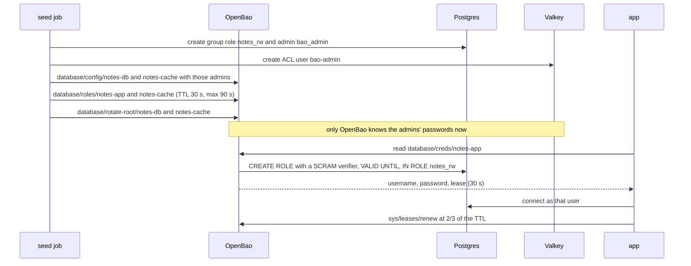
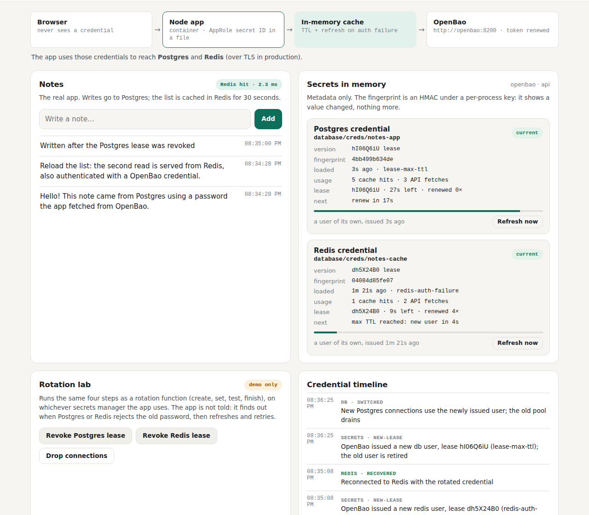

# 8. Leases and dynamic credentials: a database user per instance

[← 7. Secret zero and AppRole](07-secret-zero-and-approle.md) · [Learning path](README.md) · Next: [9. Kubernetes auth and External Secrets →](09-kubernetes-auth-and-external-secrets.md)

**What you'll learn:** how step v2 removes the stored database password altogether.
OpenBao's **database secrets engine** creates a Postgres user and a Valkey user for each
app instance, with a **lease** that expires. You'll follow a lease from issue to
renewal, to re-issue, to revocation, and see what the app does at each point. Then
you'll run the "Revoke lease" demo and weigh the trade-offs.

## 8.1 From a stored password to a leased user

In step v1 the app read a **stored** password from KV. It was protected and could be
rotated, but it was **shared** (every instance used `notes_app`) and **long-lived**
(it worked until someone rotated it). Step v2 changes the shape of the secret:

| | Step v1 (KV) | Step v2 (dynamic) |
| --- | --- | --- |
| The app's secret ID | `/rds/dev/notes-db/app`, a KV path | `database/creds/notes-app`, an OpenBao role |
| Who the app logs in as | `notes_app`, the same user for every instance, forever | `v-approle-notes-ap-…`, a new user per instance and per lease |
| How long a leaked password works | until someone rotates it | until the lease ends: 30 s here, renewed while the app runs, never past the max TTL (90 s here) |
| Rotation | write a new version, update the database, switch | none: near the max TTL the app takes a **new** user, and OpenBao drops the old one |
| The cache | Redis 7 | **Valkey 8.1**. OpenBao documents a Valkey plugin; the app's `ioredis` client works unchanged |

A **lease** is OpenBao's record that it handed out a credential, with a TTL. While the
lease is alive, the credential works. When it ends or is revoked, OpenBao runs the
role's revocation statements and the user is gone. The lab's TTLs are short
(`BAO_DB_DEFAULT_TTL=30s`, `BAO_DB_MAX_TTL=90s`) so you can watch renewals and
re-issues within a few minutes. In production you'd use hours.

**Check:** on the dashboard, the **Secrets in memory** card shows a `lease` row for
each credential: the time left and the renewal count. The **Security posture** card
passes **Database logins are short-lived**.

## 8.2 Setup: only OpenBao can create a user

**Step 1: the seed job creates admins only for OpenBao.** In Postgres it creates the
group role `notes_rw` (SELECT and INSERT on `notes`) and `bao_admin`, which may create
users in that group, drop them and end their sessions. In Valkey it creates the ACL
user `bao-admin`, which may run ACL commands and touch no keys. It hands both admins to
OpenBao's database engine at `database/config/…`
([`seed-local.js`](../../backend/scripts/seed-local.js)).

**Step 2: OpenBao takes the admins over.** `database/rotate-root/…` changes each
admin's password to one only OpenBao knows. This is the same idea as the seed job
burning the bootstrap passwords in chapter 7. After it, no person and no other job can
create a database user.

**Step 3: Postgres never sees a password.** With
`password_authentication = scram-sha-256`, OpenBao sends Postgres a **SCRAM
verifier**: a hash Postgres can check a login against, but not turn back into the
password. The Postgres container logs every DDL statement (`log_statement=ddl`), and
the credential scan checks that log too.

**Step 4: the app's policy is narrow.** It may read `database/creds/notes-app` and
`database/creds/notes-cache`, renew leases, and revoke a lease only for those two
roles ([`config.hcl`](../../dev/openbao/config.hcl), `allowed_parameters`).

**Check:** `scripts/compose-check.sh` prints
`ok    the app's Postgres sessions use a user OpenBao created for it (v-approle-notes-ap-…), not a stored one`.

## 8.3 The lease's life, in the app

[`backend/src/secrets/bao/leases.js`](../../backend/src/secrets/bao/leases.js) is the
**lease keeper**. It holds one lease per secret ID and runs a timer for each.

| When | What the app does | What you see on the dashboard |
| --- | --- | --- |
| Start | `GET database/creds/notes-app`: a username, a password and a lease ID | `secrets · leased`: "OpenBao issued this instance its own db user" |
| 2/3 of the time left | `PUT sys/leases/renew`. OpenBao also extends the Postgres role's `VALID UNTIL` | `lease` row: `renewed 1×`, `2×`… |
| A renewal comes back shorter than asked | The max TTL caps it, so this was the last extension. The keeper plans a **re-issue** shortly before the lease ends | `secrets · new-lease … (lease-max-ttl)` |
| A new user arrives | Postgres: new queries go to a pool for the new user, and the old pool finishes its queries and closes. Valkey: reconnects as the new user | `db · switched`, `redis · switched` |
| 15 s later | Revokes the old lease (`replaced`). OpenBao drops the old user and ends any session it still has | — |
| A renewal fails (the lease was revoked) | Asks for a new user at once (`lease-renew-failed`) | — |
| Shutdown | Revokes every lease it holds, so its users disappear now instead of at the max TTL | — |

Two details are worth knowing. The re-issue margin is a third of the time left, between
5 and 30 seconds, so a new user is in hand before the old one stops working. And the
15-second **grace period** before revocation lets open connections drain: `pg.Pool`'s
`end()` waits for queries in flight ([`clients/db.js`](../../backend/src/clients/db.js)),
and `ioredis` queues commands while it reconnects
([`clients/cache.js`](../../backend/src/clients/cache.js)).

The cache ([`provider.js`](../../backend/src/secrets/provider.js)) treats a leased value
differently from a stored one. A stored value is good until its cache TTL runs out. A
leased value is good until the lease ends (less a 2-second margin), or until the lease
keeper asks for a new one. Everything above the cache stays as it was: the masks, the
redactor, the reveal flag, recovery after an authentication failure.

**Check:** `scripts/compose-check.sh` prints
`ok    the app renewed both leases (sys/leases/renew)`.

## 8.4 The demo: revoke a lease

With dynamic users, the dashboard's rotation buttons become **Revoke Postgres lease**
and **Revoke Redis lease**. This is what an operator does after a leak:

1. OpenBao runs the role's revocation statements: it ends the user's sessions and drops
   the user. On Valkey it deletes the ACL user, which disconnects it.
2. The app still holds the revoked user. Its next Postgres login fails
   (`auth-failed`), so it asks for a new user (`new-lease`), switches its pool, and
   retries the query (`recovered`).
3. Valkey reconnects by itself and gets the same treatment.

**Check:** click **Revoke Postgres lease**, then add a note. The note is saved. The
timeline shows `revokeLease`, `auth-failed`, `new-lease`, `switched` and `recovered`.

Left alone, the leases renew. Near the max TTL the app takes a new user before the old
one ends:

## 8.5 What the checks prove

On this step `scripts/compose-check.sh` adds:

- the app's Postgres sessions use a user OpenBao created, never `notes_app`;
- the app renewed both leases;
- after the smoke test (which revokes both leases), at most two leased users are left in
  Postgres: the current one and at most one draining.

The leased passwords exist only in the app's memory and in OpenBao (encrypted), so
nothing can read them back to search for. The CI job therefore also runs the app with
`LOG_REVEAL_SECRETS=true`, takes the leased passwords from the app's own log, and checks
they appear **nowhere else**: containers, files, the Postgres log (SCRAM only), Valkey,
OpenBao's audit log (HMAC only) and its storage.

**Check:** the revealed scan ends with `credential-scan: no credential value found
anywhere it must not be`.

## 8.6 The trade-offs

- **A leaked password is worth less.** It works until the lease ends, and an operator
  can end it now with one revoke. In return, the app must handle leases: renew, re-issue,
  switch pools, revoke. That is the code in `leases.js`, `db.js` and `cache.js`.
- **Only OpenBao knows the admin.** After `rotate-root`, nobody else can create a
  database user. That is the point, and it also means OpenBao is now on the path of
  every new app instance. The operating burden ADR-002 notes (HA, upgrades, backups,
  unseal keys) matters more here than in step v1.
- **The cache changed from Redis 7 to Valkey 8.1,** because OpenBao documents a Valkey
  plugin. The app's client did not change.
- **Lab only:** the TTLs are seconds, not hours, so the demo fits in a CI job.
  `bao_admin` holds `pg_signal_backend` so revocation can end a dropped user's sessions;
  in production, give it only what your revocation statements need. And the app may
  revoke its own leases, which lets it clean up on shutdown and also drives the demo.

## What's next

[Chapter 9](09-kubernetes-auth-and-external-secrets.md) moves the same lab to
Kubernetes, where the pod's own service-account token replaces AppRole and secret zero
disappears.

**Try it:** [step v2](../../steps/v2-openbao-dynamic/README.md) runs it on top of step
v1. The demo page [test case 20: dynamic users](../../demo/test-case-20-dynamic-users.md)
walks through the revoke and the max-TTL re-issue.
