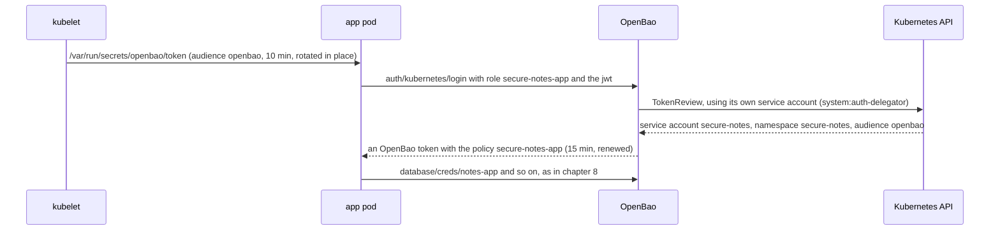
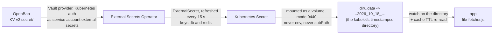

# 9. Kubernetes auth and External Secrets: no secret zero at all

[← 8. Leases and dynamic credentials](08-leases-and-dynamic-credentials.md) · [Learning path](README.md) · Next: [10. OpenBao and Vault →](10-openbao-and-vault.md)

**What you'll learn:** how step v3 runs the lab of chapter 8 on Kubernetes. OpenBao
comes from its Helm chart, and the pods log in with their own **service-account tokens**
instead of an AppRole secret ID. You'll see what a projected token is and how OpenBao
checks it. Then you'll meet **file mode**: External Secrets Operator writes a
Kubernetes Secret, the app reads it as files, and that mode is a trade-off.

## 9.1 What changes on Kubernetes

Step v3 runs OpenBao in the `openbao` namespace, and the app, Postgres and Valkey in
`secure-notes`, under Pod Security `restricted`. Everything from chapter 8 stays: the
users OpenBao creates per pod, their leases, renewals, re-issue at the max TTL, and the
"Revoke lease" demo. What changes is **how the pods prove who they are**:

| | Docker Compose (chapters 7, 8) | Kubernetes (this chapter) |
| --- | --- | --- |
| The app's login | AppRole: a secret ID in a mode-0400 file that the seed job hands over | **Kubernetes auth**: the pod's own service-account token, projected for audience `openbao`, valid 10 minutes, rotated by the kubelet |
| The secret zero | the seed job's one-time bootstrap secret ID | **none**. OpenBao asks the Kubernetes API whether the token is real |
| A token for the Kubernetes API in the app pod | — | none (`automountServiceAccountToken: false`): the projected token is good only for OpenBao |
| OpenBao | one container, config in `dev/openbao` | the chart `openbao-0.30.4` (OpenBao 2.7.1): one Raft server, the same static seal and self-init, written in [`openbao-values.yaml`](../../steps/v3-k8s/openbao-values.yaml) |
| The audit log | a file in a volume | the pod's log (`file_path = "stdout"`) |

**Check:** after `scripts/openbao-k8s-up.sh`,
`kubectl -n openbao exec openbao-0 -- bao status` shows `Initialized true` and
`Sealed false`, with nobody having run `operator init`.

## 9.2 How a pod logs in

A **service account** is a Kubernetes identity for a pod. A **projected token** is a
signed token (a JWT, see [chapter 3](03-why-a-secrets-manager.md#workload-identity-and-jwt))
that the kubelet writes into the pod for one named **audience** and a short time, and
rotates in place. Here the audience is `openbao` and the lifetime is 10 minutes.

**Step 1: the kubelet projects the token.** The component
[`deploy/k8s/components/openbao`](../../deploy/k8s/components/openbao) projects a token
for audience `openbao` into the app pod and the seed pod. The app pod has no token for
the Kubernetes API at all.

**Step 2: the app presents it.** The same
[`client.js`](../../backend/src/secrets/bao/client.js) from chapter 7, with
`BAO_AUTH=kubernetes`, posts `{role, jwt}` to `auth/kubernetes/login`. It reads the
token file again at every login, so it always presents the token the kubelet rotated
last.

**Step 3: OpenBao checks it with the cluster.** OpenBao calls the Kubernetes
**TokenReview** API, which says whether the token is real and which service account it
belongs to. OpenBao makes that call with its own service account, which holds the
`system:auth-delegator` role. Its login role accepts only service account
`secure-notes` in namespace `secure-notes`.

**Step 4: the app gets an OpenBao token** with the policy `secure-notes-app`, 15
minutes, renewed as in chapter 7. From here on, it is chapter 8.

The seed job logs in the same way, as service account `secure-notes-seed`, with its own
role and policy. It configures the database engine and has **nothing to hand to the
app**. That is why there is no secret zero. NetworkPolicies close the rest: the app and
the seed job may reach OpenBao on 8200, and OpenBao may reach Postgres and Valkey. The
ConfigMap holds addresses, roles and OpenBao paths, never a password.

**Check:** the dashboard's header says **Kubernetes auth secure-notes-app**, and its
flow says **pod · projected token for OpenBao · restricted PSA**.

## 9.3 What the checks prove

`scripts/k8s-check.sh` adds these lines on this step:

- OpenBao is initialised and unsealed by itself;
- the app logged in with Kubernetes auth;
- the app pod has no Kubernetes API token;
- the token it has is projected for audience `openbao` and is short-lived;
- its Postgres sessions use a user OpenBao created.

Then it runs the smoke test and the credential scan. On Kubernetes the scan reads the
stored values inside the app pod, as the app's own identity, and adds the OpenBao pod's
log (the audit log, HMACs only), its storage, and the `openbao` namespace's Secrets.

**Check:** the CI job `kind (openbao)` runs all of this on every push, with its own
dashboard captures.

## 9.4 File mode: External Secrets Operator and a watched volume

Some apps can't be changed to call OpenBao. For those, **External Secrets Operator**
(ESO) reads OpenBao and writes a Kubernetes **Secret**, and the app reads that Secret's
files. This app can do both: `SECRETS_MODE=file` makes it read a directory instead of
calling OpenBao, and it then holds **no OpenBao token at all**.

| Piece | What it is |
| --- | --- |
| [`eso-values.yaml`](../../steps/v3-k8s/eso-values.yaml), [`scripts/eso-k8s-up.sh`](../../scripts/eso-k8s-up.sh) | ESO's chart `external-secrets-2.13.0`, pinned and checked against the `.prov` checksum. Its defaults already meet Pod Security `restricted` |
| [`eso-clustersecretstore.yaml`](../../steps/v3-k8s/eso-clustersecretstore.yaml) | A **ClusterSecretStore** tells ESO where secrets come from. It uses ESO's **Vault provider** (stable; ESO's own OpenBao provider is alpha, see [ADR-002](../modernization/03-adr-002-openbao-first.md)). It points at KV v2 `secret` and logs in with Kubernetes auth as service account `external-secrets`, audience `openbao`. OpenBao's role `external-secrets` may read only the app's two KV secrets |
| [`deploy/k8s/components/openbao-eso`](../../deploy/k8s/components/openbao-eso) | The **ExternalSecret** says what to copy and how often: every 15 s, keys `db` and `redis`, each the whole KV secret as JSON. The app mounts the resulting Secret **as a volume** (mode 0440, never `env`, never `subPath`) |
| [`backend/src/secrets/file-fetcher.js`](../../backend/src/secrets/file-fetcher.js) | Reads `<dir>/db` and `<dir>/redis`. A watch on the directory sees the kubelet's `..data` swap, and the cache TTL re-reads anyway |

Why **never `subPath`**? When the kubelet updates a Secret volume, it writes the new
files into a fresh timestamped directory and atomically swaps the `..data` symlink to
point at it. The app mounts the whole directory, so it sees the swap. The rule in
`file-fetcher.js` is blunt: never use `subPath` for this mount, because **a subPath
file is never updated**. The fetcher reads the time from the name of the directory
`..data` points at, and uses it as the value's version (`22:03:24.405889`, say). The
kubelet swaps the whole volume when any one secret changes, so a file whose content is
unchanged keeps its old version: only the secret that really changed shows a new one.

**How a rotation reaches the app:**

1. A rotation outside the app changes the password in Postgres and writes the next KV
   version. In CI that is the Job [`rotate-db`](../../deploy/k8s/jobs/rotate-db.yaml).
2. Within 15 s, ESO copies the new version into the Secret.
3. Within the kubelet's sync period (about a minute), the kubelet writes the new files
   and swaps `..data`.
4. The app's watch fires and the cache re-reads (`file-changed`). New connections use
   the new password. There is no restart.

**Check:** `scripts/k8s-check.sh` on the `kind-openbao-eso` overlay rotates in OpenBao
and watches the new version arrive in the pod. The app's log shows
`the mounted secret changed; re-reading` (event `secrets.file.changed`).

## 9.5 The trade-offs of file mode, plainly

- **The credentials are in a Kubernetes Secret.** A Secret is base64 in etcd, and anyone
  allowed to read Secrets in the namespace can read it. In api mode they never enter
  Kubernetes at all. `k8s-check` reports this Secret as expected in file mode, and the
  credential scan says so instead of hiding it.
- **There is a window.** It runs from the moment the database has the new password to
  the moment the file arrives: up to 15 s for ESO plus up to about a minute for the
  kubelet. During it, new connections with the old password fail, and open ones keep
  working. Production setups avoid this with two alternating users, or with the dynamic
  users of api mode.

## 9.6 OpenShift (unproven)

`KUBECTL=oc scripts/openbao-k8s-up.sh` notices OpenShift and adds
[`openbao-values-openshift.yaml`](../../steps/v3-k8s/openbao-values-openshift.yaml),
which turns on the chart's OpenShift mode and leaves the UID and fsGroup to the
`restricted-v2` SCC. **This repo's CI does not run OpenShift**, so treat it as a
starting point, not a proven path. Where images must come from an internal registry,
mirror `docker.io/openbao/openbao:2.7.1` and `valkey/valkey:8.1-alpine` and set
`server.image` in the values.

## 9.7 Lab only

- **The seal key is a Secret in the same cluster.** Anyone who can read Secrets in
  `openbao` and copy the volume can read the data. In production, use a KMS or an HSM.
- **Plain HTTP** inside the cluster. The app refuses this when `NODE_ENV=production`.
- **One OpenBao server, no HA.**

## What's next

[Chapter 10](10-openbao-and-vault.md) runs the same app, unchanged, against HashiCorp
Vault, and lists what really differs between the two servers.

**Try it:** [step v3](../../steps/v3-k8s/README.md) has the kind commands for both
modes. The demo pages
[test case 21: Kubernetes auth](../../demo/test-case-21-kubernetes-auth.md) and
[test case 22: External Secrets](../../demo/test-case-22-external-secrets.md) walk
through each one.
