# 10. OpenBao and HashiCorp Vault: one app, two servers

[← 9. Kubernetes auth and External Secrets](09-kubernetes-auth-and-external-secrets.md) · [Learning path](README.md) · Next: [11. Detection on the audit log →](11-detection-on-the-audit-log.md)

**What you'll learn:** why this repo built on OpenBao first and ran HashiCorp Vault
second ([ADR-002](../modernization/03-adr-002-openbao-first.md)), how step v4 runs the
same app image against Vault with one setting changed, and what really differs between
the two servers: the licence, how a server starts, how the audit device is created, and
which cache plugin is used.

## 10.1 Two servers, one API

OpenBao is a fork of Vault and keeps its HTTP API. That is why the app has **one
client** for both: [`backend/src/secrets/bao/client.js`](../../backend/src/secrets/bao/client.js)
uses plain `fetch` and adds no dependency. The AppRole login with the secret ID in a
file (chapter 7), the KV v2 reads, and the dynamic database users with their leases
(chapter 8) are the same code against either server. `SECRETS_PROVIDER=vault` changes
only the **wording** of the app's messages: the client has a `product` string that
reads `OpenBao` or `Vault`, and nothing else in it branches on the provider.

An **ADR** (architecture decision record) is a short document that records a decision
and the facts behind it, so the next person can see why. ADR-002 checked each fact
below against the project's own page on 2026-10-18.

## 10.2 What differs: the facts from ADR-002

| | OpenBao (steps v1 to v3) | HashiCorp Vault (step v4) |
| --- | --- | --- |
| Licence | **MPL-2.0**, open source | **BSL 1.1** for 1.15.0 and later. The Licensor is now IBM. Each version changes to MPL 2.0 four years after it is published |
| Owner | An OpenSSF sandbox project since June 2025 (OpenSSF is part of the Linux Foundation) | HashiCorp, part of IBM since 27 February 2025 |
| Version used here | **2.7.1** | **2.2.0** |
| Image | `docker.io/openbao/openbao:2.7.1` | `docker.io/hashicorp/vault:2.2.0` |
| CLI | `bao` | `vault` |
| Starting with no manual step | `seal "static"` and self-init, both in the config file (both since 2.4.0; self-init needs an auto-unseal seal) | No such features. The entrypoint scripts `operator init` and `unseal` |
| Audit device | Declared in the config file (since 2.4.0). Since 2.3.2 the API can't create one unless `unsafe_allow_api_audit_creation` is set | Enabled through the API by the entrypoint |
| Namespaces | Since 2.3.1 | Enterprise only |
| Cache plugin | `valkey-database-plugin`, against Valkey 8.1 | `redis-database-plugin`, against Redis 7. Vault documents both root rotation and dynamic roles for it |
| Not available | Performance/DR replication, Sentinel, the Transform engine | Each of these needs an Enterprise licence |

The licence row is the one ADR-002 leans on. **MPL-2.0** is an open-source licence.
**BSL 1.1** is the licence Vault moved to with 1.15.0; each Vault version changes to
MPL 2.0 four years after it is published, so today's Vault is not under an open-source
licence yet. ADR-002 chose OpenBao for the main path because the licence is open source
and a foundation owns the project, so anyone can copy this lab. It then ran Vault
because many teams already run it, and showing the app unchanged on both is the
**portability** point.

ADR-002 also lists what it could **not** verify and so does not claim: that IBM removed
Vault Enterprise features, and the end-of-life date of HCP Vault Secrets. A good ADR
says what it doesn't know.

## 10.3 Starting a server: config file versus script

This is the biggest operational difference, and it is worth seeing side by side.

```mermaid
flowchart TB
  subgraph O["OpenBao: dev/openbao/config.hcl"]
    o1["entrypoint writes a 32-byte seal key"] --> o2["seal static: the server unseals itself"]
    o2 --> o3["self-init: KV v2, database, AppRole,<br/>audit device, policies, roles"]
    o3 --> o4["self-init revokes its root token"]
  end
  subgraph V["Vault: dev/vault/entrypoint.sh"]
    v1["vault server starts sealed"] --> v2["operator init with one key share"]
    v2 --> v3["unseal key saved to the data volume"]
    v3 --> v4["root token held in the script's memory"]
    v4 --> v5["audit enable, secrets enable, auth enable,<br/>policy write, role writes, seed secret ID"]
    v5 --> v6["token revoke -self, unset root"]
  end
```



**On OpenBao**, chapter 7 covered it: the config file declares the static seal and the
self-init requests. The server is ready from its config alone.

**On Vault**, [`dev/vault/entrypoint.sh`](../../dev/vault/entrypoint.sh) does by hand
what OpenBao's config does. On the first start it runs `vault operator init` with
**one key share and a threshold of one**, writes the unseal key to the data volume,
and unseals. It keeps the **root token** only in a shell variable, uses it to enable the
audit device, KV v2 at `secret`, the database engine and AppRole, to write the two
policies from [`dev/vault/policies/`](../../dev/vault/policies) (the same text as
OpenBao's), to create the two roles with the same TTLs, and to set the seed job's
one-time secret ID. Then it runs `vault token revoke -self` and `unset root`. The root
token is never written anywhere. On every later start, it unseals with the key from the
volume.

**Check:** `docker compose logs vault | grep vault-lab` shows the entrypoint's three
lines: initialised with one key share and unsealed; configured, with the root token
revoked; and, after a restart, unsealed with the key from the data volume.

## 10.4 The audit device: config versus API

On OpenBao, the audit device is **declared in the config** (chapter 11 depends on
that: an audit log that the API can't turn off). On Vault, the entrypoint enables it
with `vault audit enable file file_path=/vault/logs/audit.log`, using the root token.
Both produce a file audit log with every secret value replaced by an HMAC, and the
credential scan searches Vault's container, audit log and storage the way it searches
OpenBao's.

**Check:** `scripts/compose-check.sh` on step v4 prints the same OpenBao-style lines
for Vault: the app logged in with its own role, the seed job's bootstrap secret ID
spent, the app's policy refusing other paths, leased Postgres sessions, renewals,
revocation, recovery and cleanup.

## 10.5 The cache plugin: Valkey versus Redis

OpenBao's docs list a Valkey plugin among its database plugins. The 2.7.1 binary also
lists `redis-database-plugin` as built in, but the docs don't cover it, so step v2 uses
**Valkey 8.1** with `valkey-database-plugin`. Vault documents `redis-database-plugin`,
with both root rotation and dynamic roles, so step v4 uses **Redis 7** with it. The
app's `ioredis` client works unchanged against both.

**Check:** on step v4 the dashboard says **HashiCorp Vault**, and the timeline says
"Vault issued this instance its own db user".

## 10.6 Run it

```bash
export COMPOSE_FILE=docker-compose.yml:steps/v4-vault/compose.yaml
docker compose down -v
docker compose up --build -d          # http://localhost:3000
scripts/compose-check.sh
```

The CI job `compose (vault)` runs it on every push, with the same dashboard walk as
step v2.

**Check:** `docker compose ps` shows `vault` in place of `openbao`, and the app's
header names Vault.

## 10.7 What this shows, and what stays lab-only

- **The app is portable between the two.** One setting, `SECRETS_PROVIDER`, changes only
  the wording.
- **The difference is in operating the server.** OpenBao's static seal and self-init
  make a server that is ready from its config file alone. Vault's entrypoint has to
  script `init` and `unseal` and briefly hold a root token. In production, Vault would
  use a KMS, an HSM or transit auto-unseal, and its setup would come from Terraform or
  similar.
- **The operating burden is yours on both.** ADR-001 scored Vault 1 out of 3 for this,
  and ADR-002 says that holds for OpenBao: HA, upgrades, backups and unseal keys.
- **Lab only, on Vault:** the unseal key sits next to the data; one key share instead
  of the default five with a threshold of three; plain HTTP on the Compose network.

## What's next

[Chapter 11](11-detection-on-the-audit-log.md) uses the audit log that OpenBao's
config guarantees to answer a harder question: if someone with access reads the app's
secret anyway, would you know?

**Try it:** [step v4](../../steps/v4-vault/README.md) runs the Vault lab. The demo page
[test case 23: Vault](../../demo/test-case-23-vault.md) walks through the dashboard on
Vault.
