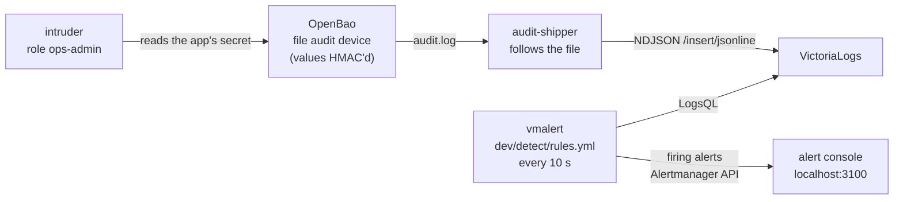

# 11. Detection on the audit log: would you know?

[← 10. OpenBao and Vault](10-openbao-and-vault.md) · [Learning path](README.md)

**What you'll learn:** why you need detection even when nothing leaks, what OpenBao's
audit log holds and what it hides, and how step v5 turns that log into an alert within
about a minute: a shipper, a log store, a rule, and a console. You'll run the lab's
"intruder", read the rule it trips, and see what the tests prove.

## 11.1 Why detection, when the earlier chapters already prevent leaks

Chapters 7 to 10 keep the credentials out of env, files, images and logs, and make
them short-lived. The credential scan proves the values are nowhere they shouldn't be.
But prevention has a limit: some identities are *allowed* to read the app's secret. An
operator role with a broad policy, a backup job, a colleague debugging. None of that is
a leak, and the scan will never flag it. So the next question is: **if someone with
access reads the app's credentials anyway, would you know?**

The sibling repo answered this on AWS with CloudTrail, EventBridge and SNS
([its chapter 7](https://github.com/ephico2real2/aws-secrets-manager-node-poc/blob/main/docs/learn/07-alerts-and-audit.md)).
Here it is built on the secrets manager's own audit trail, with open-source parts.

## 11.2 The audit log: what it shows and what it hides

OpenBao writes an **audit log** line for every request and every response. Two things
about it matter here:

- **Every secret value is replaced by an HMAC.** An HMAC is a keyed hash: you can tell
  two entries carry the same value, but you cannot get the value back. So the log can
  be shipped elsewhere without carrying a credential.
- **Paths, operations and identities are in plain text.** The request path
  (`secret/data/rds/dev/notes-db/app`), the operation (`read`), the AppRole role name
  and the token's policies are all readable. That is exactly what a rule needs.

In this repo the audit device is **declared in the config**
([`dev/openbao/config.hcl`](../../dev/openbao/config.hcl)), so the API can't turn it
off. Its file mode is `0644` so the shipper, which runs as another user, can read it.

**Check:** `scripts/compose-check.sh` on step v1 already prints
`ok    the audit log recorded N KV request/response entries`, and the credential scan
prints `ok    openbao: audit log (values must be HMAC'd)  clean`.

## 11.3 The chain: from a log line to an alert



| Piece | What it does |
| --- | --- |
| [`audit-ship.js`](../../backend/scripts/audit-ship.js) ([`shipper.js`](../../backend/src/detect/shipper.js)) | Follows the audit file like `tail -F` and POSTs complete new lines to VictoriaLogs (`/insert/jsonline`). It never parses or changes a line. A batch the store refuses is sent again |
| **VictoriaLogs** `v1.53.0` | A log store. It keeps the lines and flattens nested JSON into fields like `auth.metadata.role_name` and `request.path`, so a rule can filter on them |
| **vmalert** `v1.154.0` and [`rules.yml`](../../dev/detect/rules.yml) | A rule runner. Every 10 s it runs each rule's **LogsQL** query (VictoriaLogs' query language) and sends firing alerts on |
| [`alert-console.js`](../../backend/scripts/alert-console.js) ([`console.js`](../../backend/src/detect/console.js)) | Receives what vmalert sends to Alertmanager (`POST /api/v2/alerts`) and shows it at `:3100`. In production, point vmalert at Alertmanager and route to on-call |
| The `ops-admin` role and [`intruder.js`](../../backend/scripts/intruder.js) | A legitimate but too-broad operator role. The intruder logs in with it and reads the app's secret |

**Step 1: start the chain.**

```bash
export COMPOSE_FILE=docker-compose.yml:steps/v1-openbao-kv/compose.yaml:steps/v5-detection/compose.yaml
docker compose up --build -d          # the app on :3000, the alert console on :3100
```

**Check:** open `http://localhost:3100`. The console says **No alerts**, though the
app has been reading its secrets all along. The app's own reads are not an alert.

**Step 2: run the intruder.**

```bash
docker compose run --rm intruder      # role ops-admin reads the app's Postgres secret
```

**Check:** within about a minute the console shows **SecretReadByUnexpectedIdentity**:
"An app credential was read by 'ops-admin', not by the app", with the path that was
read.

## 11.4 The intruder: a legitimate role that is too broad

`ops-admin` is not an attacker's backdoor. It is the kind of role an operations team
often has. Its policy in `config.hcl` is two lines: read every `secret/data/*`, and read
and list every `secret/metadata/*`. That is enough to read the app's credentials, and
nothing in OpenBao's policy model will stop it, because the policy allows it.

Self-init sets its secret ID from a file on the server's volume
(`/openbao/config/ops-secret-id`), the same way it sets the seed job's in chapter 7, and
its token lives 10 minutes. [`intruder.js`](../../backend/scripts/intruder.js) logs in with that
role, reads the app's Postgres secret, and prints **only the version it read**, never
the value.

The lesson is in the alert's own text: check who holds that role, rotate the secret if
the read was not expected, and narrow the role's policy.

## 11.5 What the rule looks at

The first rule in [`dev/detect/rules.yml`](../../dev/detect/rules.yml) says, in
LogsQL:

- entries of `type` `response` (the request completed);
- whose `request.operation` is `read`;
- whose `request.path` matches
  `^secret/data/(rds|elasticache)/[^/]+/notes-(db|cache)/`, the app's two KV secrets
  in any environment;
- where `auth.metadata.role_name` is **not** `secure-notes-app`;
- counted by role name, display name and path, and kept when the count is above zero.

Every one of those fields is one OpenBao writes in plain text. The rule never needs a
secret value, so the log store never holds one. Its severity is `critical`.

Why doesn't the seed job trip it? The seed job only creates and updates the secrets;
it does not read them, and the rule is on `read`.

A second rule, **OpenBaoPermissionDenied**, warns when one role gets more than three
`permission denied` responses in an interval. That is someone probing paths they may
not read, the 403s chapter 7 showed.

**Check:** the alert's description names the count and the path, for example
`1 read(s) of secret/data/rds/dev/notes-db/app in the last interval`.

## 11.6 What the tests prove

- **[`dev/detect/test-detection.sh`](../../dev/detect/test-detection.sh)**, in the CI
  `checks` job, runs the whole chain without Docker: the real OpenBao, VictoriaLogs and
  vmalert release binaries, checksum-verified, plus the shipper, the console and the
  intruder. It checks that the app's own reads raise **no** alert; that the ops-admin
  read raises **SecretReadByUnexpectedIdentity**, naming the role and the path; and that
  VictoriaLogs holds the audit lines and the password appears in none of them.
- **`scripts/compose-check.sh`** does the same in the full Compose lab, after the smoke
  test, the rotations and the credential scan. None of those may have raised an alert.
  Then it runs the intruder and waits for the alert. The CI job
  `compose (openbao-detection)` runs it and photographs the console.
- **Unit tests** ([`detect.test.js`](../../backend/test/detect.test.js)) cover the
  shipper (partial lines, a recreated file, resending after a refusal) and the console
  (de-duplication, and HTML escaping of alert text).

**Check:** the CI job `compose (openbao-detection)` runs on every push and photographs
the console with the alert.

## 11.7 Lab only

- The audit log is world-readable inside its volume (`0644`), so another container can
  ship it. Its values are HMACs, but paths and role names are in plain text.
- The console has no authentication and keeps alerts in memory.
- One rule interval (10 s) and a 7-day retention, sized for a demo.
- This step runs on top of step v1 (KV) on Docker Compose. On Kubernetes (chapter 9)
  the audit log goes to the OpenBao pod's stdout instead of a file; shipping it from
  there is not part of this repo's CI, so treat it as unproven.

## What's next

This is the last chapter of the OpenBao path. Run the whole thing yourself with the
[tutorial](../TUTORIAL.md), demo one feature at a time with the
[demo pages](../../demo/README.md), or go back to the [learning path](README.md).

**Try it:** [step v5](../../steps/v5-detection/README.md) runs the chain in three
commands. The demo page [test case 24: detection](../../demo/test-case-24-detection.md)
walks through the console before and after the intruder.
