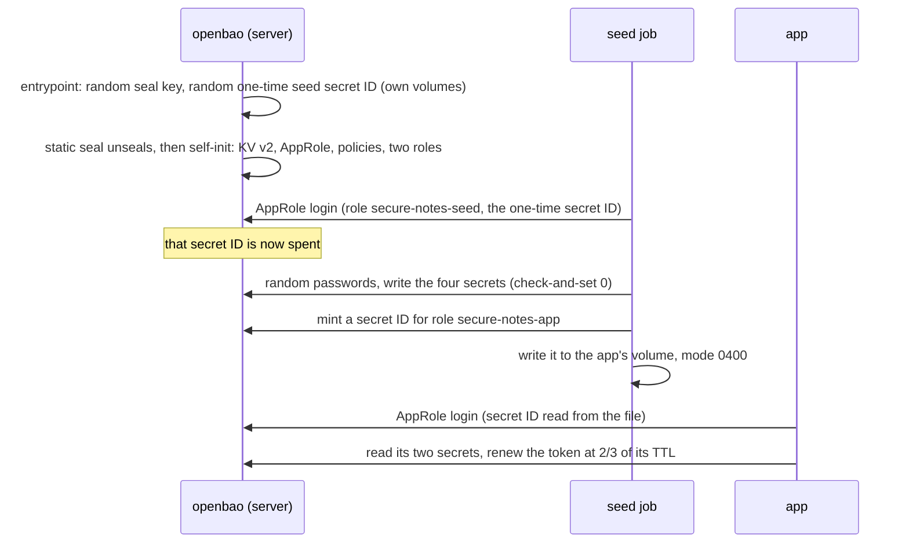

# Step v1: the lab on OpenBao (KV v2, AppRole)

[← Project README](../../README.md) · [ADR-002](../../docs/modernization/03-adr-002-openbao-first.md) · Epic B3

The same app and the same dashboard, with **OpenBao 2.7.1** in place of the AWS stand-in.
Postgres and Redis don't change, and neither do the app's image or the checks. Only
settings change:

| | AWS path (`docker-compose.yml`) | This step (`+ steps/v1-openbao-kv/compose.yaml`) |
| --- | --- | --- |
| `SECRETS_PROVIDER` / `SECRETS_MODE` | `aws` / `sdk` | `openbao` / `api` |
| The secrets live in | the Secrets Manager stand-in | OpenBao's KV v2 engine at `secret/`, e.g. `secret/data/rds/dev/notes-db/app` |
| How the app proves who it is | a dummy access key the stand-in maps to a role | **AppRole**: role ID `secure-notes-app` (not secret), plus a secret ID **read from a file** (mode 0400) |
| What the app may read | the stand-in's identity rules | the `secure-notes-app` policy in [`dev/openbao/config.hcl`](../../dev/openbao/config.hcl); any other path gets 403 |
| Rotation (dashboard demo) | AWSPENDING, then AWSCURRENT moves | the pending value goes to `<name>/pending`; the next KV version is written with check-and-set |

## Run it

```bash
export COMPOSE_FILE=docker-compose.yml:steps/v1-openbao-kv/compose.yaml
docker compose up --build -d        # http://localhost:3000
scripts/compose-check.sh            # the checks below, the smoke test, the credential scan
docker compose down -v              # stop and wipe (a new seal key and new secret IDs next time)
```

**Check:** the dashboard's header says **OpenBao** and **AppRole secret ID in a file**.
`docker compose ps` shows `openbao`, `postgres`, `redis` and `app` running, and `seed`
exited with code 0. `aws-mock` isn't started.

Needs Docker Compose 2.24 or later, because the overlay replaces the app's environment with `!override`.

## What happens at the first start, with no manual step



1. **The server starts unsealed.** [`dev/openbao/entrypoint.sh`](../../dev/openbao/entrypoint.sh) creates a 32-byte key for `seal "static"`. OpenBao's self-init then:
   - mounts KV v2 and AppRole;
   - writes the two policies and the two roles from `config.hcl`;
   - revokes the root token it used. No root token exists afterwards.
2. **The seed job logs in once.** Its secret ID is generated by the server's entrypoint and kept on the server's volume. The seed job mounts that volume read-only. The role allows one use (`secret_id_num_uses = 1`).
3. **The seed job provisions the app.**
   - It creates the Postgres and Redis users and burns their bootstrap passwords, as on the AWS path.
   - It writes the four secrets: the app's two, plus the demo's two admin ones.
   - It mints the app's secret ID into a volume only the app mounts (read-only).
4. **The app logs in with its own identity.** The token lives only in the app's memory.
   - It is renewed at 2/3 of its 15-minute TTL.
   - When renewal can't extend it (the 4-hour max TTL), the app logs in again.
   - On a 403 it logs in again once.

**Check:**

```bash
docker compose exec app stat -c '%a %u %n' /home/node/bao-secret-id   # 400 1000 …
docker compose exec app printenv | grep -E '^BAO_'                      # an address, a role ID, a file path; no token, no secret ID
curl -s localhost:3000/api/config | jq .bao                            # loggedIn, TTL, policies; never the token
```

## Rotation without version stages

KV v2 keeps versions, but has no AWSPENDING or AWSCURRENT labels: a write is
immediately the current version. So the demo rotator
([`backend/src/demo/rotator.js`](../../backend/src/demo/rotator.js) through
[`kv.js`](../../backend/src/secrets/bao/kv.js)) keeps the same four steps:

| Step | On OpenBao |
| --- | --- |
| createSecret | write the new value to `<name>/pending`. The app never reads that path |
| setSecret | change the password on Postgres or Redis (unchanged) |
| testSecret | log in with the pending value (unchanged) |
| finishSecret | write it as the next version of `<name>` with `cas` = the version the rotation started from, then delete `<name>/pending`. A rotation that raced another one fails instead of overwriting it |

**Check:** on the dashboard, click **Rotate Postgres secret**, then **Drop connections**.
The rotation's four steps appear in the event log. Then come `auth-failed`, `new-version`
and `recovered`, and the secret's version number goes up by one.

## What the checks prove

`scripts/compose-check.sh` adds these lines for OpenBao:
- the app is logged in as `secure-notes-app`;
- `/api/config` shows no token;
- the secret ID file is mode 0400, owned by the app user;
- no token or secret ID is in the app's environment;
- the seed's bootstrap secret ID no longer logs in;
- the app's policy refuses another path (403);
- the audit log recorded the KV reads.

`scripts/credential-scan.sh` reads every version of every secret **as the app's own
identity**, then searches for those values everywhere the AWS path is searched. It also
searches:
- the OpenBao container's config and log;
- the **audit log**, which must hold only HMACs of the values;
- the raft storage, which is encrypted.

It then searches every container's config and log, and the app's environment, for the
**two AppRole secret IDs**.

The CI job `compose (openbao)` runs all of this, plus the reveal flag: with
`LOG_REVEAL_SECRETS=true`, the values must show up in the app's log and nowhere else. Its
output goes to the job summary and the `ci-captures` branch.

## Lab only

- **The seal key sits next to the data,** on the `bao-data` volume. In production, use a KMS or HSM seal, kept away from the data.
- **Plain HTTP** on the Compose network (`tls_disable`). In production the app refuses a non-`https` `BAO_ADDR`. TLS comes with epic B5.
- **The app may write its own secrets** so the dashboard can demo rotation. In production, rotation belongs to something else, and B4's dynamic credentials replace it.
- **Port 8200 is published on loopback** so you can use the `bao` CLI. There is no root token, though, so use a role's secret ID or add your own auth method.
