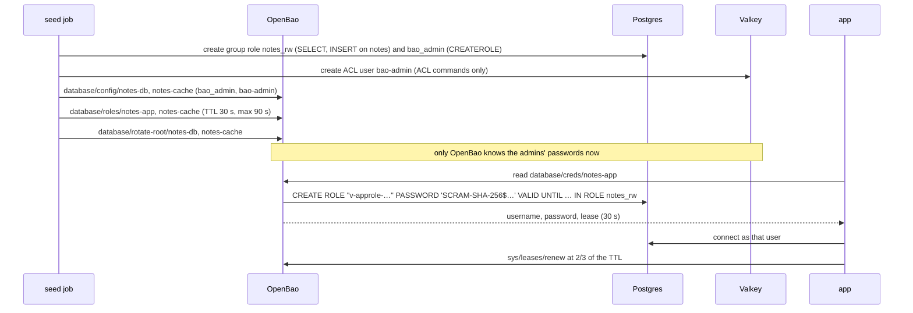

# Step v2: database users that expire (OpenBao dynamic credentials)

[← Project README](../../README.md) · [Step v1](../v1-openbao-kv/README.md) · Epic B4

In step v1 the app read a **stored** password from OpenBao. The password was protected and
rotated, but it was shared and long-lived. In this step **the app has no stored database
password at all.** On startup it asks OpenBao for a Postgres user and a Valkey user of its
own. OpenBao creates them on the spot, with a **lease**:

| | Step v1 (KV) | Step v2 (dynamic) |
| --- | --- | --- |
| The app's secret ID | `/rds/dev/notes-db/app` (a KV path) | `database/creds/notes-app` (an OpenBao role) |
| Who the app logs in as | `notes_app`, the same user for every instance, forever | `v-approle-notes-ap-…`, a new user per instance and per lease |
| How long a leaked password works | until someone rotates it | until the lease ends: 30 s here, renewed while the app runs, never past the max TTL (90 s here) |
| Rotation | write a new version, update the database, switch | none: near the max TTL the app takes a **new** user, and OpenBao drops the old one |
| The cache | Redis 7 | **Valkey 8.1**. OpenBao documents a Valkey plugin; the app's `ioredis` client works unchanged |

The lab's TTLs are short (`BAO_DB_DEFAULT_TTL=30s`, `BAO_DB_MAX_TTL=90s`) so you can watch
renewals and re-issues within a few minutes. In production you'd use hours.

## Run it

```bash
export COMPOSE_FILE=docker-compose.yml:steps/v1-openbao-kv/compose.yaml:steps/v2-openbao-dynamic/compose.yaml
docker compose down -v               # start clean: the seed job sets up the database engine once
docker compose up --build -d         # http://localhost:3000
scripts/compose-check.sh
```

**Check:** the **Secrets in memory** card shows a `lease` row for each credential: the time
left and the renewal count. The **Security posture** card passes **Database logins are
short-lived**.

## How it is set up: no one but OpenBao can create a user



1. **The seed job creates admins only for OpenBao.** Postgres gets `bao_admin`, which may create users in the group role `notes_rw`, drop them, and end their sessions. Valkey gets `bao-admin`, which may run ACL commands and touch no keys. The seed job hands both to OpenBao's database engine ([`seed-local.js`](../../backend/scripts/seed-local.js)).
2. **OpenBao takes the admins over.** `rotate-root` changes each admin's password to one only OpenBao knows. This is the same idea as the seed job burning the bootstrap passwords.
3. **Postgres never sees a password.** With `password_authentication = scram-sha-256`, OpenBao sends Postgres a SCRAM verifier. The Postgres container logs every DDL statement (`log_statement=ddl`), and the credential scan checks that log too.
4. **The app's policy is narrow.** It may read `database/creds/notes-app` and `database/creds/notes-cache`, and renew leases. It may revoke a lease only for those two roles; [`config.hcl`](../../dev/openbao/config.hcl) limits that with `allowed_parameters`.

## The lease's life, in the app

[`backend/src/secrets/bao/leases.js`](../../backend/src/secrets/bao/leases.js) keeps each lease alive:

| When | What the app does | What you see on the dashboard |
| --- | --- | --- |
| Start | Asks OpenBao for a user | `secrets · leased`: "OpenBao issued this instance its own db user" |
| 2/3 of the TTL | `PUT sys/leases/renew`. OpenBao also extends the Postgres role's `VALID UNTIL` | `lease` row: `renewed 1×`, `2×`… |
| A renewal comes back short (the max TTL caps it) | Asks for a **new** user before the lease ends | `secrets · new-lease … (lease-max-ttl)` |
| A new user arrives | Postgres: new queries use a pool for the new user, and the old pool finishes its queries and closes. Valkey: reconnects as the new user | `db · switched`, `redis · switched` |
| 15 s later | Revokes the old lease. OpenBao drops the old user and ends any session it still has | — |
| A renewal fails (the lease was revoked) | Asks for a new user at once | — |
| Shutdown | Revokes its leases, so its users disappear now instead of at the max TTL | — |

The cache ([`provider.js`](../../backend/src/secrets/provider.js)) keeps a leased user until
the lease keeper asks for a new one, not until the cache TTL runs out. Everything above it
stays the same: the masks, the redactor, the reveal flag, recovery after an
authentication failure.

## The demo: revoke a lease

With dynamic users, the dashboard's rotation buttons become **Revoke Postgres lease** and
**Revoke Redis lease**. This is what an operator does after a leak:

1. OpenBao runs the role's revocation statements: it ends the user's sessions and drops the user. On Valkey it deletes the ACL user, which disconnects it.
2. The app still holds the revoked user. Its next Postgres login fails (`auth-failed`), so it asks for a new user (`new-lease`), switches its pool, and retries the query (`recovered`).
3. Valkey reconnects by itself and gets the same treatment.

**Check:** click **Revoke Postgres lease**, then add a note. The note is saved. The
timeline shows `revokeLease`, `auth-failed`, `new-lease`, `switched` and `recovered`.

## What the checks prove

On this step, `scripts/compose-check.sh` adds:
- the app's Postgres sessions use a user OpenBao created, never `notes_app`;
- the app renewed both leases;
- after the smoke test (which revokes both leases), at most two leased users are left in Postgres: the current one and at most one draining.

`scripts/credential-scan.sh` searches for every KV value, as in step v1. The leased
passwords exist only in the app's memory and in OpenBao (encrypted), so nothing can read
them back to search for. The CI job therefore also runs the app with
`LOG_REVEAL_SECRETS=true`, takes the leased passwords from the app's own log, and checks
they appear **nowhere else**. That covers containers, files, the Postgres log (SCRAM only),
Valkey, OpenBao's audit log (HMAC only) and its storage.

## Lab only

- The TTLs are minutes, not hours, so the demo fits in a CI job.
- `bao_admin` holds `pg_signal_backend`, so revocation can end a dropped user's sessions. In production, give it only what your revocation statements need.
- The app may revoke its own leases. That is what lets it clean up on shutdown, and here it also drives the demo.
