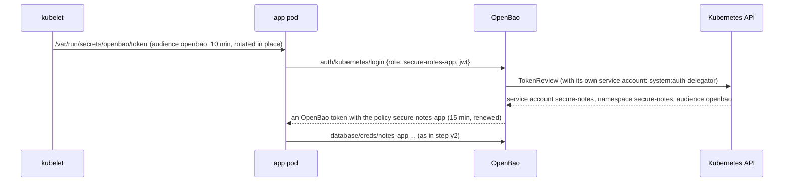

# Step v3: OpenBao on Kubernetes (kind in CI; OpenShift, unproven)

[← Project README](../../README.md) · [Step v2](../v2-openbao-dynamic/README.md) · Epic B5

This step runs the lab of step v2 on Kubernetes:
- OpenBao, from its own Helm chart, in the `openbao` namespace;
- the app, Postgres and Valkey in `secure-notes`, under Pod Security `restricted`.

What changes is **how the pods prove who they are**:

| | Docker Compose (steps v1, v2) | Kubernetes (this step) |
| --- | --- | --- |
| The app's login | AppRole: a secret ID in a mode-0400 file that the seed job hands over | **Kubernetes auth**: the pod's own service-account token, projected for audience `openbao`, valid 10 minutes, rotated by the kubelet |
| The secret zero | the seed job's one-time bootstrap secret ID | **none**. OpenBao asks the Kubernetes API (TokenReview) whether the token is real, and its role accepts only service account `secure-notes` in namespace `secure-notes` |
| A token for the Kubernetes API in the app pod | — | none (`automountServiceAccountToken: false`): the projected token is good only for OpenBao |
| OpenBao | one container, config in [`dev/openbao`](../../dev/openbao) | the [chart](https://github.com/openbao/openbao-helm) `openbao-0.30.4` (OpenBao 2.7.1): one Raft server, the same static seal and self-init, written in [`openbao-values.yaml`](openbao-values.yaml) |
| The audit log | a file in a volume | the pod's log (`file_path = "stdout"`) |

Everything else is step v2: the database users OpenBao creates per pod, their leases,
renewals, re-issue at the max TTL, and the "Revoke lease" demo.

## Run it on kind

```bash
scripts/kind-up.sh
KIND_OPENBAO=1 scripts/images-build.sh                    # also preloads OpenBao and Valkey
scripts/openbao-k8s-up.sh                                 # OpenBao from its chart, initialised
scripts/k8s-deploy.sh deploy/k8s/overlays/kind-openbao    # http://localhost:3000
scripts/k8s-check.sh
```

You need `helm` 3 as well as `kind` and `kubectl`. The script downloads the chart from the
openbao-helm GitHub release and checks it against the checksum pinned in
[`scripts/versions.env`](../../scripts/versions.env).

**Check:** `kubectl -n openbao exec openbao-0 -- bao status` shows `Initialized true` and
`Sealed false`, with nobody having run `operator init`. The dashboard's header says
**Kubernetes auth secure-notes-app**, and its flow says **pod · projected token for
OpenBao · restricted PSA**.

## What the pieces are

| File | What it does |
| --- | --- |
| [`scripts/openbao-k8s-up.sh`](../../scripts/openbao-k8s-up.sh) | Creates the `openbao` namespace (Pod Security `restricted`) and the static seal key (a Secret of 32 random bytes, made once; lab only). Then installs the pinned chart |
| [`openbao-values.yaml`](openbao-values.yaml) | The chart values. One Raft server, a `restricted` security context, and the seal key mounted from the Secret. The audit device writes to stdout. **Self-init** enables KV v2, the database engine and Kubernetes auth, and writes the policies and the three roles (app, seed job, External Secrets) |
| [`deploy/k8s/components/openbao`](../../deploy/k8s/components/openbao) | Moves the app and the seed job onto OpenBao. It removes the AWS stand-in and swaps Redis for Valkey. It projects a token for audience `openbao` into both pods, sets the ConfigMap (addresses, roles and OpenBao paths, never a password), and adds NetworkPolicies: the app and seed job may reach OpenBao on 8200, and OpenBao may reach Postgres and Valkey |
| [`deploy/k8s/overlays/kind-openbao`](../../deploy/k8s/overlays/kind-openbao) | That component on kind, with the app's NodePort on localhost:3000 |

## How a pod logs in



The app reads the token file again at every login, so it always presents the token the
kubelet rotated last. The seed job logs in the same way, as service account
`secure-notes-seed` with its own role and policy. It configures the database engine and
has nothing to hand to the app.

## What the checks prove

`scripts/k8s-check.sh` adds these lines on this step:
- OpenBao is initialised and unsealed by itself;
- the app logged in with Kubernetes auth;
- the app pod has no Kubernetes API token;
- the token it has is projected for audience `openbao` and is short-lived;
- its Postgres sessions use a user OpenBao created.

Then it runs the smoke test (lease revocations, recovery, the leak test, posture) and the
credential scan. On Kubernetes the scan reads the stored values inside the app pod, as
the app's own identity, and adds the OpenBao pod's log (the audit log, HMACs only), its
storage, and the `openbao` namespace's Secrets.

The CI job `kind (openbao)` runs all of this on every push, with its own dashboard captures.

## OpenShift (unproven)

`KUBECTL=oc scripts/openbao-k8s-up.sh` notices OpenShift and adds
[`openbao-values-openshift.yaml`](openbao-values-openshift.yaml). That turns on the chart's
OpenShift mode and leaves the UID and fsGroup to the `restricted-v2` SCC. **This repo's CI
does not run OpenShift**, so treat it as a starting point. Where images must come from an
internal registry, mirror `docker.io/openbao/openbao:2.7.1` and `valkey/valkey:8.1-alpine`
and set `server.image` in the values.

## Lab only

- **The seal key is a Secret in the same cluster.** Anyone who can read Secrets in `openbao` and copy the volume can read the data. In production, use a KMS, an HSM, or another OpenBao (transit).
- **Plain HTTP** inside the cluster (`tls_disable`). The app refuses this when `NODE_ENV=production`.
- **One OpenBao server, no HA.** The chart's HA Raft mode runs with one replica here.
