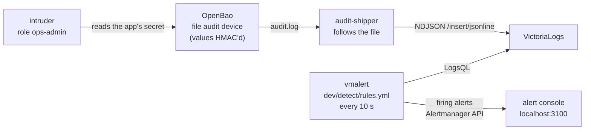

# Step v5: an alert when someone else reads the app's secret (epic B7)

[← Project README](../../README.md) · [Step v1](../v1-openbao-kv/README.md) · Epic B7

The earlier steps keep the credentials from leaking. This step answers the next question:
**if someone with access reads them anyway, would you know?** OpenBao writes an audit
log line for every request and response, with every secret value replaced by an HMAC.
The step ships that log to a log store and runs a rule on it. A read of the app's
credentials by anyone but the app raises an alert within a minute.



The sibling repo did this on AWS with CloudTrail, EventBridge and SNS. Here it is built
on the secrets manager's own audit trail, with open-source parts.

## Run it

```bash
export COMPOSE_FILE=docker-compose.yml:steps/v1-openbao-kv/compose.yaml:steps/v5-detection/compose.yaml
docker compose up --build -d          # the app on :3000, the alert console on :3100
docker compose run --rm intruder      # role ops-admin reads the app's Postgres secret
open http://localhost:3100            # the alert arrives within about a minute
```

**Check:** before the intruder, the console says **No alerts**, though the app has been
reading its secrets all along. After it, the console shows
**SecretReadByUnexpectedIdentity**: "An app credential was read by 'ops-admin', not by
the app", with the path that was read.

## The pieces

| Piece | What it does |
| --- | --- |
| The audit device ([`dev/openbao/config.hcl`](../../dev/openbao/config.hcl)) | Declared in the config, so the API can't turn it off. Mode `0644` so the shipper, which runs as another user, can read it. Every value in it is already an HMAC |
| [`audit-ship.js`](../../backend/scripts/audit-ship.js) ([`shipper.js`](../../backend/src/detect/shipper.js)) | Follows the file like `tail -F` and POSTs complete new lines to VictoriaLogs (`/insert/jsonline`). It never parses or changes a line. A batch the store refuses is sent again |
| VictoriaLogs `v1.53.0` | Stores the lines, flattening nested JSON into fields like `auth.metadata.role_name` and `request.path` |
| vmalert `v1.154.0` and [`rules.yml`](../../dev/detect/rules.yml) | Every 10 s it runs a LogsQL query: responses to a **read** of `secret/data/{rds,elasticache}/…/notes-{db,cache}/…` where the AppRole role is **not** `secure-notes-app`, counted by role and path. A second rule warns on repeated `permission denied` |
| [`alert-console.js`](../../backend/scripts/alert-console.js) ([`console.js`](../../backend/src/detect/console.js)) | Receives what vmalert sends to Alertmanager (`POST /api/v2/alerts`) and shows it at `:3100`. In production, point vmalert at Alertmanager and route to on-call |
| The `ops-admin` role and [`intruder.js`](../../backend/scripts/intruder.js) | A legitimate but too-broad operator role (it may read every KV secret). The intruder logs in with it and reads the app's secret. It prints only the version it read |

**Why it works without seeing any secret:** the rule uses only fields OpenBao writes in
plain text: the path, the operation and who asked (the role name and the token's
policies). The values in the log are HMACs, so the log store never holds a credential.
The test checks that too.

## What the tests prove

- **[`dev/detect/test-detection.sh`](../../dev/detect/test-detection.sh)**, in the CI `checks` job, runs the whole chain without Docker: the real OpenBao, VictoriaLogs and vmalert release binaries (checksum-verified) plus the shipper, the console and the intruder. It checks:
  - the app's own reads raise **no** alert;
  - the ops-admin read raises **SecretReadByUnexpectedIdentity**, naming the role and the path;
  - VictoriaLogs holds the audit lines, and the password appears in none of them.
- **`scripts/compose-check.sh`** does the same in the full Compose lab, after the smoke test, the rotations and the credential scan. None of those may have raised an alert. Then it runs the intruder and waits for the alert. The CI job `compose (openbao-detection)` runs it and photographs the console.
- **Unit tests** ([`detect.test.js`](../../backend/test/detect.test.js)) cover:
  - the shipper: partial lines, a recreated file, and resending after a refusal;
  - the console: de-duplication, and HTML escaping of alert text.

## Lab only

- The audit log is world-readable inside its volume (`0644`), so another container can ship it. Its values are HMACs, but paths and role names are in plain text.
- The console has no authentication and keeps alerts in memory.
- One rule interval (10 s) and a 7-day retention, sized for a demo.
